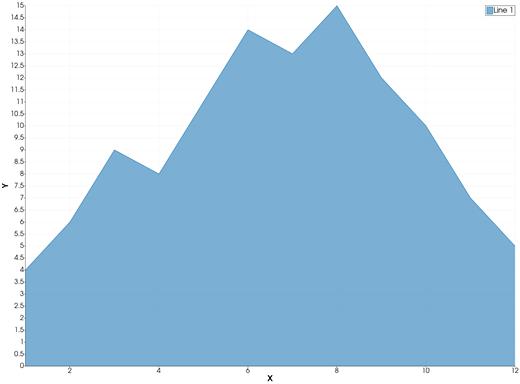
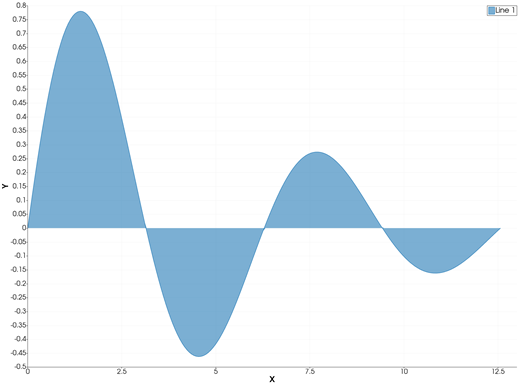
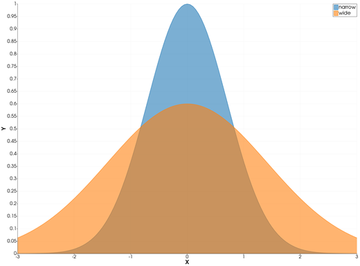
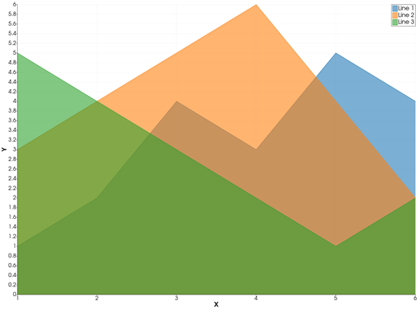
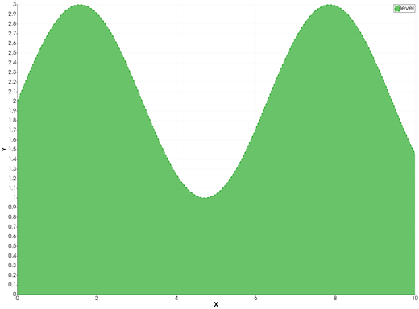

```@meta
CurrentModule = InteractiveGMT
```

# area — Filled Area Plot

The **area** icon on the X,Y Plot tool's gallery row re-plots each series of the current page as a
**filled area**: the curve, with the region between it and `y = 0` filled in the series' colour.
There is no `area` function in iGMT: draw the curves with [`plot`](@ref) and [`plot!`](@ref), then
click **area**.

## Syntax

Draw the curves, then click **area**:

```julia
p = plot(x, y)
p = plot(x, Y; multicol=true)    # Y a matrix: one area per column
plot!(p, x, y2)                  # more curves: one area each
```

## Description

- Each series of the page becomes one area: its points `(x, y)` joined by a line, and the region
  between that line and `y = 0` filled. A curve that goes below zero is filled down to zero from
  above and up to zero from below.
- The fill is the series' own colour, **see-through**, so areas drawn over other areas still show
  them. The outline is the series' line, with its width and style; markers, if the series has
  them, are drawn at the points.
- Every area stands on `y = 0`. The areas of several series are **not stacked** on top of each
  other, as MATLAB's `area` does with a matrix: each one is filled down to zero on its own. (To fill
  between curves, use the gallery's **fill_between** icon.)
- The axes are linear and re-fitted to the data, and always include `y = 0`, so the whole fill is
  on screen.
- The legend shows each area as a filled box.

A `NaN` in the data breaks the area, as it breaks a line.

### The area icon

Clicking **area** acts on the whole current page and needs no series selected. Each series keeps
its data, name, colour and style. Any log axis goes back to linear. Click **plot** to go back to
lines.

If you turn on **Misc > Log Y axis** afterwards, the fill reaches down to the lowest point of the
curve, since a log axis has no zero.

## Running the Examples

Paste each example into the iGMT window's **Julia console**, or into the Julia REPL after
`using InteractiveGMT`, then click **area** on the gallery row. Each one is complete on its own and
draws a new page of the X,Y Plot window.

## Examples

### Create Area Plot

Monthly values filled down to zero.

```julia
x = 1:12
y = [4, 6, 9, 8, 11, 14, 13, 15, 12, 10, 7, 5]
p = plot(x, y)
```



### Fill Above and Below Zero

A damped sine wave: the lobes above zero are filled down to it, those below filled up to it.

```julia
x = range(0, 4π; length=200)
y = sin.(x) .* exp.(-x ./ 6)
p = plot(x, y)
```



### Plot Several Areas

Two curves on one page, each filled down to zero. The fills are see-through, so the narrow peak shows
through the wide one.

```julia
x = range(-3, 3; length=121)
p = plot(x, exp.(-x .^ 2); legend="narrow")
plot!(p, x, 0.6 .* exp.(-x .^ 2 ./ 4); legend="wide")
```



### Plot the Columns of a Matrix

With `multicol=true` each column of the matrix is one curve, so one area.

```julia
x = 1:6
Y = [1 3 5
     2 4 4
     4 5 3
     3 6 2
     5 4 1
     4 2 2]
p = plot(x, Y; multicol=true)
```



### Change the Colour and the Outline

The fill takes the series' colour; the outline its width and style.

```julia
x = range(0, 10; length=100)
p = plot(x, 2 .+ sin.(x); lc=:green, lw=2, ls=:dash, legend="level")
```



## Input Arguments

**`x`, `y` — the curve**, as in [`plot`](@ref): `y` against `x`, or the columns of a matrix with
`multicol=true`.

## Keywords

There are no keywords of its own: the series' look comes from [`plot`](@ref)'s keywords.

| Keyword | Values | Default |
|---------|--------|---------|
| `lc`, `linecolor` | the outline and the fill (see-through) | next palette colour |
| `lw`, `ls`, `pen` | the outline's width and style | tool default, `:solid` |
| `marker`, `ms` | markers at the points | no marker |
| `legend` | the series' name | `"Line n"` |

## See Also

[plot — 2-D Line Plot](@ref) · [stem — Stem Plot of Discrete Data](@ref) ·
[stairs — Stairstep Plot](@ref) · [X,Y Plot Tool](40-xyplot.md)
