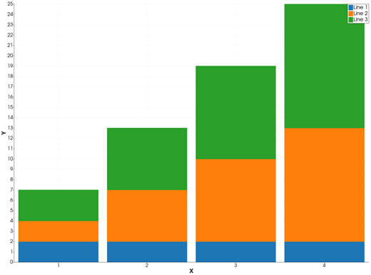
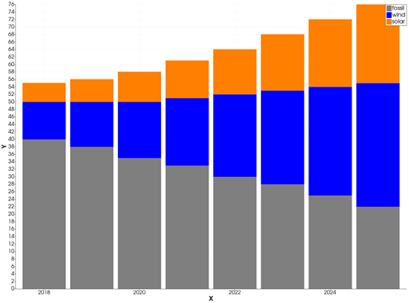
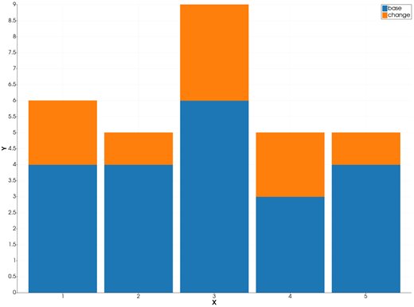

```@meta
CurrentModule = InteractiveGMT
```

# bar stack — Stacked Bar Graph

The **bar stack** icon on the X,Y Plot tool's gallery row re-plots the series of the current page as
**stacked vertical bars**: at each X, the first series' bar stands on `y = 0` and each next series'
bar stands on top of the ones before it, so the top of the stack is the sum of all of them.

## Syntax

Draw the values as curves, then click **bar stack**:

```julia
p = plot(x, Y; multicol=true)    # Y a matrix: one layer of the stack per column
p = plot(x, y1)
plot!(p, x, y2)                  # each new series goes on top
```

## Description

- The series are stacked in their order on the page: the first one is the bottom layer.
- The bar of a series at row `i` starts at the sum of the Y values of the series before it **at the
  same row `i`**, and is as tall as its own Y. The series are matched row by row, not by X value, so
  give every series the same X.
- The values are added as they are: a negative value is a bar that goes down from the top of the
  stack below it. A value that is not finite adds nothing.
- Each series keeps its colour and name; its bars are filled in its colour.
- The bar width is 90 % of the median spacing of the series' X values. A series that was already
  drawn as bars keeps its bar width.

### The bar stack icon

Clicking **bar stack** re-plots every series of the current page as stacked bars, whatever type it
was drawn in before. The axes go back to linear and are re-fitted to show every bar whole. The icon
acts on the page and needs no series selected. Deleting a series re-stacks the ones left. The **bar**
icon puts the bars side by side again; the **plot** icon turns them back into lines.

## Running the Examples

Paste each example into the iGMT window's **Julia console**, or into the Julia REPL after
`using InteractiveGMT`, then click **bar stack** on the gallery row.

## Examples

### Create Stacked Bar Graph

Each column of the matrix is one layer of the stacks.

```julia
Y = [2 2 3; 2 5 6; 2 8 9; 2 11 12]
p = plot(1:4, Y; multicol=true)
```



### Stack Series Drawn One by One

Energy sources by year, one series each: the stack is the total.

```julia
x = 2018:2025
p = plot(x, [40, 38, 35, 33, 30, 28, 25, 22]; legend="fossil", lc=:gray)
plot!(p, x, [10, 12, 15, 18, 22, 25, 29, 33]; legend="wind", lc=:blue)
plot!(p, x, [5, 6, 8, 10, 12, 15, 18, 21]; legend="solar", lc=:orange)
```



### Stack with a Negative Value

A negative value goes down from the top of the layer below it.

```julia
x = 1:5
p = plot(x, [4, 5, 6, 5, 4]; legend="base")
plot!(p, x, [2, -1, 3, -2, 1]; legend="change")
```



## Input Arguments

**`x` — bar positions**, a vector, the same for every series.

**`Y` — layers**, a matrix with `length(x)` rows and `multicol=true` (one layer per column), or one
series per `plot` / `plot!` call.

## Keywords

The keywords of [`plot`](@ref): `lc` is a layer's colour, `lw` its outline width, `legend` its name.
A series drawn with [`bar!`](@ref) and a `width` keeps that width in the stack.

## See Also

[bar — Bar Graph](@ref) · [barh stack — Stacked Horizontal Bar Graph](@ref) ·
[waterfall — Waterfall Chart](@ref) · [plot — 2-D Line Plot](@ref) · [X,Y Plot Tool](40-xyplot.md)
