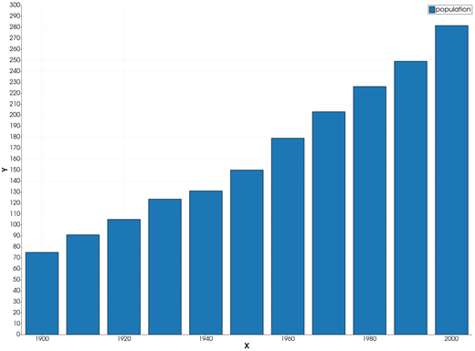
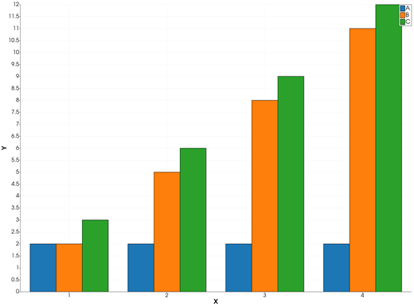
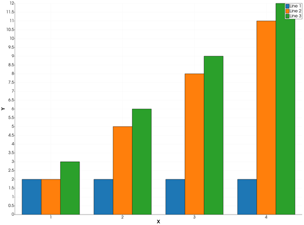
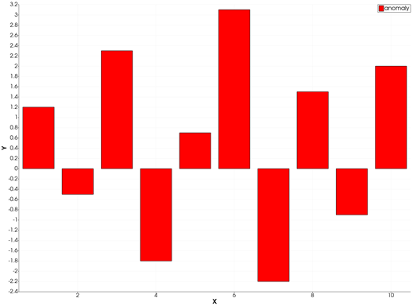
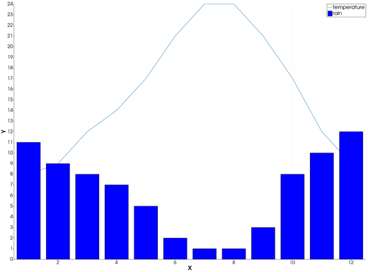
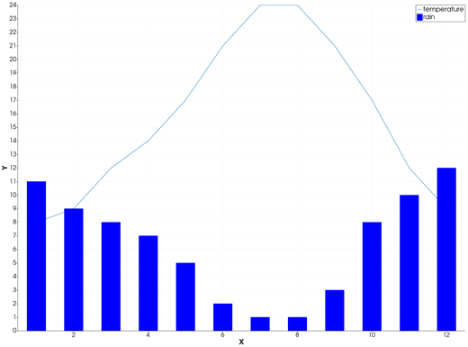

```@meta
CurrentModule = InteractiveGMT
```

# bar — Bar Graph

The **bar** icon on the X,Y Plot tool's gallery row re-plots every series of the current page as
**vertical bars**: one bar per point, standing on `y = 0` at the point's X and reaching up (or down)
to its Y. From Julia, a series is drawn as bars directly with [`bar!`](@ref).

## Syntax

Draw the values as curves, then click **bar**:

```julia
p = plot(x, y)
p = plot(x, Y; multicol=true)    # Y a matrix: one bar series per column
plot!(p, x, y2)                  # more series: bars side by side
```

Or add a bar series to an open page from Julia:

```julia
bar!(p, x, y)
bar!(p, x, y; lc=:red, legend="name")
```

## Description

- Each point `(x, y)` of a series is one bar centred on `x`, from `0` to `y`. A negative `y` hangs
  down from `0`.
- Each series keeps its colour and name; its bars are filled in its colour.
- With several series on the page, the bars of each X stand **side by side**, one slot per series:
  together they take 80 % of the spacing between the first two X values.
- `bar!(p, x, y)` adds one series to the page of `p`, already drawn as bars. It takes `lc` (the
  colour), `lw` (the bars' outline width) and `legend`, as in [`plot`](@ref), and `width`: the bar
  width in X units. A series given a `width` keeps it; without one, its bars are sized by the chart
  like the bars of the **bar** icon.

### The bar icon

Clicking **bar** re-plots every series of the current page as bars, whatever type it was drawn in
before. The series keep their data, name and colour. The axes go back to linear and are re-fitted to
all the data. The icon acts on the page and needs no series selected. The **plot** icon turns the
bars back into lines.

## Running the Examples

Paste each example into the iGMT window's **Julia console**, or into the Julia REPL after
`using InteractiveGMT`, then click **bar** on the gallery row. The last example draws its bars with
`bar!` and needs no click.

## Examples

### Create Bar Graph

The population of a country, one value per decade.

```julia
x = 1900:10:2000
y = [75, 91, 105, 123.5, 131, 150, 179, 203, 226, 249, 281.5]
p = plot(x, y; legend="population")
```



### Display Groups of Bars

Three series on one page: at each X their bars stand side by side.

```julia
x = 1:4
p = plot(x, [2, 2, 2, 2]; legend="A")
plot!(p, x, [2, 5, 8, 11]; legend="B")
plot!(p, x, [3, 6, 9, 12]; legend="C")
```



The same with the series as the columns of a matrix:

```julia
Y = [2 2 3; 2 5 6; 2 8 9; 2 11 12]
p = plot(1:4, Y; multicol=true)
```



### Bars with Negative Values

A negative value is a bar that goes down from `0`.

```julia
x = 1:10
y = [1.2, -0.5, 2.3, -1.8, 0.7, 3.1, -2.2, 1.5, -0.9, 2.0]
p = plot(x, y; lc=:red, legend="anomaly")
```



### Draw Bars from Julia

`bar!` adds a series drawn as bars to a page: here monthly rainfall as bars and the temperature as a
line, on the same page.

```julia
x = 1:12
p = plot(x, [8, 9, 12, 14, 17, 21, 24, 24, 21, 17, 12, 9]; legend="temperature")
bar!(p, x, [11, 9, 8, 7, 5, 2, 1, 1, 3, 8, 10, 12]; lc=:blue, legend="rain")
```



### Set the Bar Width

`width` is the bar width in X units: here bars half a month wide.

```julia
x = 1:12
p = plot(x, [8, 9, 12, 14, 17, 21, 24, 24, 21, 17, 12, 9]; legend="temperature")
bar!(p, x, [11, 9, 8, 7, 5, 2, 1, 1, 3, 8, 10, 12]; width=0.5, lc=:blue, legend="rain")
```



## Input Arguments

**`x` — bar positions**, a vector. Ranges are accepted.

**`y` — bar heights**, a vector of the same length as `x`, or a matrix with `length(x)` rows and
`multicol=true` (one series per column).

**`p` — plot handle**, the `QtXYPlot` returned by `plot`.

## Keywords

| Keyword | Values | Default |
|---------|--------|---------|
| `lc`, `linecolor` | the bars' colour, as in [`plot`](@ref) | next palette colour |
| `lw`, `linewidth` | the bars' outline width, points | tool default |
| `legend`, `l` | the series' name | `"Line n"` |
| `width` | `bar!` only: the bar width in X units; `0` = sized by the chart | `0` |

With `plot`, every keyword of [`plot`](@ref) is accepted; a bar has no markers. `bar!`
takes only the keywords above.

## See Also

[barh — Horizontal Bar Graph](@ref) · [bar stack — Stacked Bar Graph](@ref) ·
[waterfall — Waterfall Chart](@ref) · [histogram — Histogram Plot](@ref) ·
[plot — 2-D Line Plot](@ref) · [X,Y Plot Tool](40-xyplot.md)
