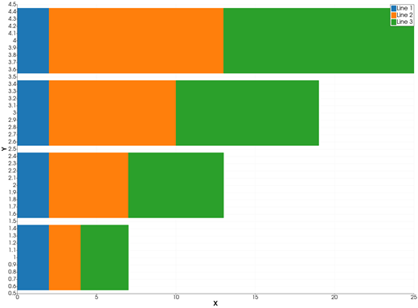
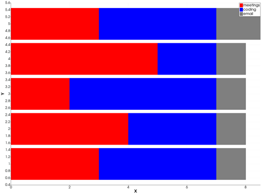

```@meta
CurrentModule = InteractiveGMT
```

# barh stack — Stacked Horizontal Bar Graph

The **barh stack** icon on the X,Y Plot tool's gallery row re-plots the series of the current page as
**stacked horizontal bars**: at each position, the first series' bar starts at `0` and each next
series' bar continues to the right of the ones before it, so the end of the stack is the sum of all
of them. The positions (the series' X) are read on the **vertical** axis, the lengths (their Y) on
the **horizontal** axis.

## Syntax

Draw the values as curves, then click **barh stack**:

```julia
p = plot(x, Y; multicol=true)    # Y a matrix: one layer of the stack per column
p = plot(x, y1)
plot!(p, x, y2)                  # each new series goes at the end of the stack
```

## Description

- The series are stacked in their order on the page: the first one starts at `0`.
- The bar of a series at row `i` starts at the sum of the Y values of the series before it **at the
  same row `i`**, and is as long as its own Y. The series are matched row by row, not by X value, so
  give every series the same X.
- The values are added as they are: a negative value is a bar that goes back to the left from the end
  of the stack before it. A value that is not finite adds nothing.
- Each series keeps its colour and name; its bars are filled in its colour.
- The bar thickness is 90 % of the median spacing of the series' X values. A series that was already
  drawn as bars keeps its bar width.

### The barh stack icon

Clicking **barh stack** re-plots every series of the current page as stacked horizontal bars,
whatever type it was drawn in before. The axes go back to linear and are re-fitted to show every bar
whole. The icon acts on the page and needs no series selected. Deleting a series re-stacks the ones
left. The **bar stack** icon stands the stacks up; the **plot** icon turns them back into lines.

## Running the Examples

Paste each example into the iGMT window's **Julia console**, or into the Julia REPL after
`using InteractiveGMT`, then click **barh stack** on the gallery row.

## Examples

### Create Stacked Horizontal Bar Graph

```julia
Y = [2 2 3; 2 5 6; 2 8 9; 2 11 12]
p = plot(1:4, Y; multicol=true)
```



### Stack Series Drawn One by One

Hours of a working day, by activity, for five days.

```julia
x = 1:5
p = plot(x, [3, 4, 2, 5, 3]; legend="meetings", lc=:red)
plot!(p, x, [4, 3, 5, 2, 4]; legend="coding", lc=:blue)
plot!(p, x, [1, 1, 1, 1, 1.5]; legend="email", lc=:gray)
```



## Input Arguments

**`x` — bar positions**, a vector, the same for every series, read on the vertical axis.

**`Y` — layers**, a matrix with `length(x)` rows and `multicol=true` (one layer per column), or one
series per `plot` / `plot!` call.

## Keywords

The keywords of [`plot`](@ref): `lc` is a layer's colour, `lw` its outline width, `legend` its name.
A series drawn with [`bar!`](@ref) and a `width` keeps that width in the stack.

## See Also

[barh — Horizontal Bar Graph](@ref) · [bar stack — Stacked Bar Graph](@ref) ·
[plot — 2-D Line Plot](@ref) · [X,Y Plot Tool](40-xyplot.md)
