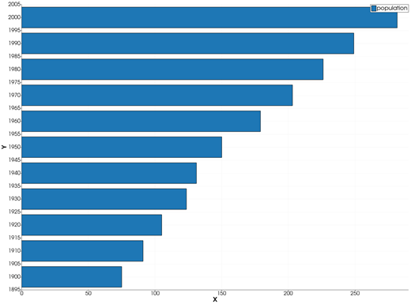
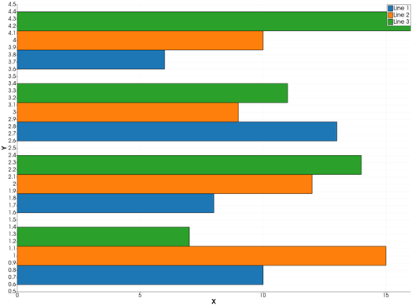
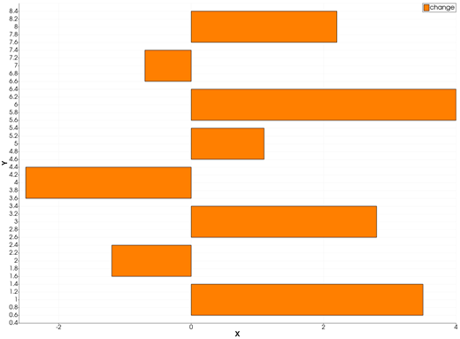

```@meta
CurrentModule = InteractiveGMT
```

# barh — Horizontal Bar Graph

The **barh** icon on the X,Y Plot tool's gallery row re-plots every series of the current page as
**horizontal bars**: one bar per point, its position the point's X, read on the **vertical** axis,
and its length the point's Y, read on the **horizontal** axis, from `0`.

## Syntax

Draw the values as curves, then click **barh**:

```julia
p = plot(x, y)
p = plot(x, Y; multicol=true)    # Y a matrix: one bar series per column
plot!(p, x, y2)                  # more series: bars side by side
```

## Description

- Each point `(x, y)` of a series is one horizontal bar centred on `x` on the vertical axis, from `0`
  to `y` along the horizontal axis. A negative `y` goes to the left of `0`.
- Each series keeps its colour and name; its bars are filled in its colour.
- With several series on the page, the bars of each position stand side by side, one slot per
  series: together they take 80 % of the spacing between the first two X values.

### The barh icon

Clicking **barh** re-plots every series of the current page as horizontal bars, whatever type it was
drawn in before. The series keep their data, name and colour. The axes go back to linear and are
re-fitted to all the data. The icon acts on the page and needs no series selected. The **bar** icon
stands the bars up again; the **plot** icon turns them back into lines.

## Running the Examples

Paste each example into the iGMT window's **Julia console**, or into the Julia REPL after
`using InteractiveGMT`, then click **barh** on the gallery row.

## Examples

### Create Horizontal Bar Graph

```julia
x = 1900:10:2000
y = [75, 91, 105, 123.5, 131, 150, 179, 203, 226, 249, 281.5]
p = plot(x, y; legend="population")
```



### Display Groups of Horizontal Bars

```julia
Y = [10 15 7; 8 12 14; 13 9 11; 6 10 16]
p = plot(1:4, Y; multicol=true)
```



### Bars with Negative Values

```julia
x = 1:8
y = [3.5, -1.2, 2.8, -2.5, 1.1, 4.0, -0.7, 2.2]
p = plot(x, y; lc=:orange, legend="change")
```



## Input Arguments

**`x` — bar positions**, a vector, read on the vertical axis. Ranges are accepted.

**`y` — bar lengths**, a vector of the same length as `x`, or a matrix with `length(x)` rows and
`multicol=true` (one series per column).

## Keywords

The keywords of [`plot`](@ref): `lc` is the bars' colour, `lw` their outline width, `legend` the
series' name.

## See Also

[bar — Bar Graph](@ref) · [barh stack — Stacked Horizontal Bar Graph](@ref) ·
[plot — 2-D Line Plot](@ref) · [X,Y Plot Tool](40-xyplot.md)
