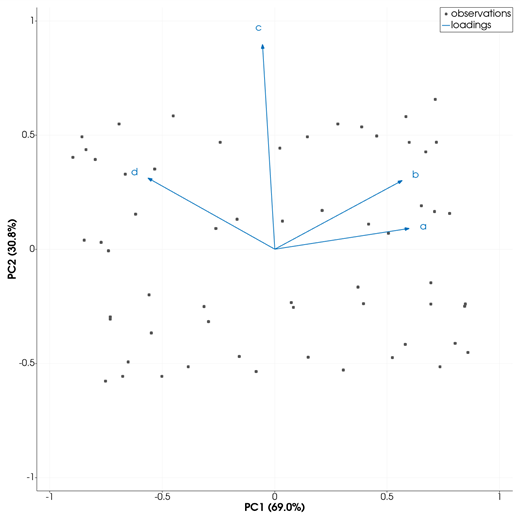
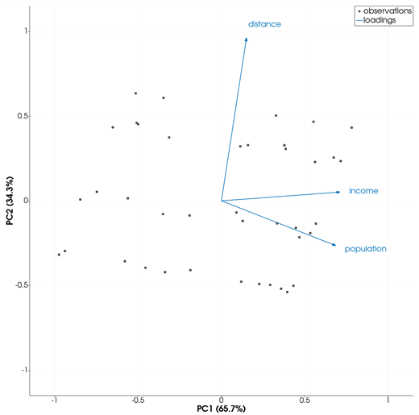
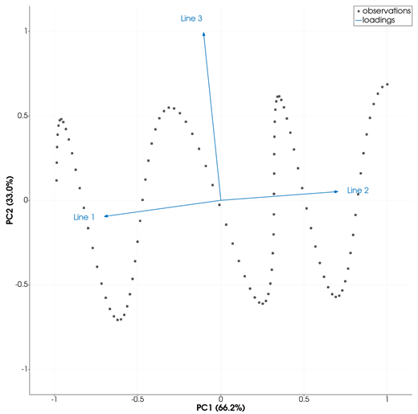
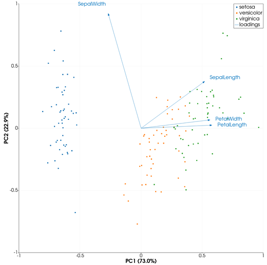
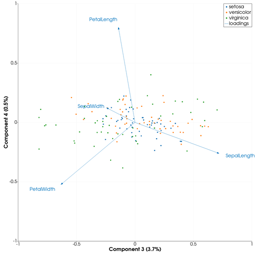
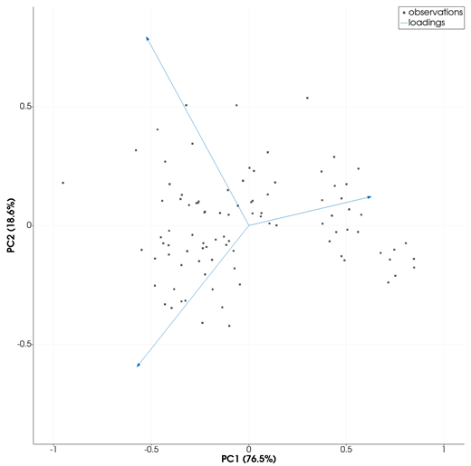
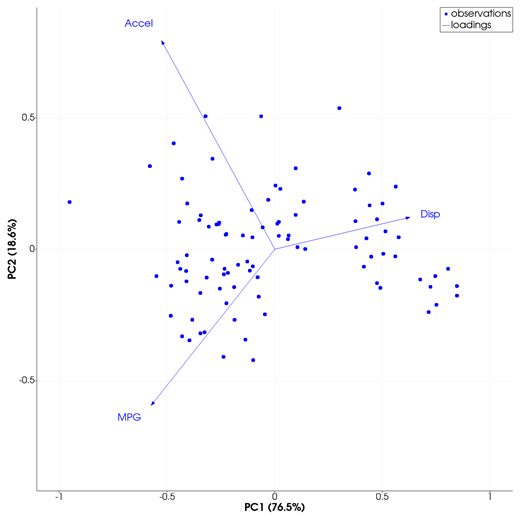
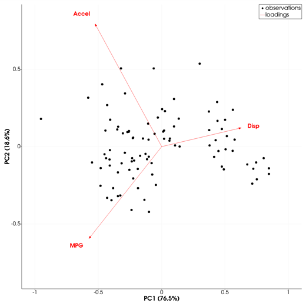

```@meta
CurrentModule = InteractiveGMT
```

# biplot — Principal Component Biplot

The **biplot** icon on the X,Y Plot tool's gallery row runs a **principal component analysis** of the
series of the current page and draws its **biplot**: every observation as a point at its scores on
the first two principal components, and every variable as an arrow, its coefficients (loadings) on
them. The biplot goes on a **new page**; the series it was made from stay as they were. It follows
GMT.jl's `biplot`, with its `zscores` and `pca`.

## Syntax

Draw one series per variable, then click **biplot**:

```julia
p = plot(x, v1; legend="name1")
plot!(p, x, v2; legend="name2")    # more variables: one per series
p = plot(D; multicol=true)         # a table: one variable per column after the first
```

Or call **`biplot`** from the console, with GMT.jl's syntax. Every column of the data is a variable;
they go on a page of their own, one series each, and the biplot on a new page, drawn by the same code
the icon runs:

```julia
p = biplot(D)                      # a GMTdataset
p = biplot("file.dat")             # a table file gmtread can read
p = biplot(M)                      # a numeric matrix
p = biplot(D; PC=(3, 4), varlabels=["a", "b", "c"], xlabel="Component 3", ylabel="Component 4")
```

## Description

- Each series of the page is one variable; only its **Y values** are used. A series with fewer than
  two values is left out. There must be two or more variables.
- The observations are the rows of the variables put side by side: the series are cut to the length
  of the shortest one, and a row with any value that is not finite is left out.
- Each variable is first standardized to a mean of 0 and a standard deviation of 1 (GMT.jl's
  `zscores`), so variables in different units weigh the same; then the principal components are
  computed (GMT.jl's `pca`).
- **Arrows**: one per variable, from the origin to its coefficients on the first (X) and second (Y)
  principal component, labelled with the variable's name (the series' name).
- **Points**: one per observation, at its scores on the same two components. The scores are scaled
  so the largest of them, in absolute value on either component, equals the length of the longest
  arrow.
- The sign of each component is chosen so that its largest coefficient is positive, as GMT.jl's
  `biplot` does.
- Unlike the other plot types that draw their own frame, the page keeps its X,Y axes: X is titled
  `PC1 (<p>%)` and Y `PC2 (<p>%)`, with the percentage of the total variance each component explains.
  The limits are symmetric about 0, rounded to round numbers and widened by 15 % so the arrow names
  stay inside; the page is square.
- In the Object Manager the points are one row, `observations`, and the arrows another, `loadings`.
  When the data carry a trailing text (the species of the iris data, say), the observations are
  grouped by it, as GMT.jl's `biplot` groups them: one series per group, each in its own colour.
- The variable names are labels on the page: **drag** any of them with the left mouse button to move
  it. A saved session keeps them where they were dropped.

## Running the Examples

Paste each example into the iGMT window's **Julia console**, or into the Julia REPL after
`using InteractiveGMT`. Where the example plots the variables, click **biplot** on the gallery row
then; the icon uses every series of the page, so no series needs to be selected. Where it calls
`biplot`, the biplot is drawn by that call.

## Examples

### Create Biplot

Four variables of 60 observations, built from two underlying signals, `f` and `g`: `a` and `b` follow
`f`, `c` follows `g`, and `d` mixes both.

```julia
k = 1:60
f = sin.(0.3 .* k)
g = cos.(0.7 .* k)
a = f .+ 0.1 .* cos.(2.1 .* k)
b = 0.8 .* f .+ 0.2 .* g
c = g .+ 0.1 .* sin.(1.9 .* k)
d = 0.5 .* g .- f
D = mat2ds([k a b c d], colnames=["obs", "a", "b", "c", "d"])
p = plot(D; multicol=true)
```



### Variables in Different Units

The variables are standardized first, so a variable measured in thousands does not outweigh one
measured in units.

```julia
x = 1:40
p = plot(x, 1000 .+ 300 .* sin.(0.2 .* x);            legend="population")
plot!(p, x, 20 .+ 3 .* sin.(0.2 .* x) .+ cos.(0.9 .* x); legend="income")
plot!(p, x, 5 .+ 2 .* cos.(0.9 .* x);                 legend="distance")
```



### Biplot from a Matrix

A matrix whose first column is X: with `multicol=true` each further column is a variable, here
`Line 1` to `Line 3`.

```julia
t = 0:0.1:10
M = [t  t .+ sin.(t)  10 .- t  cos.(2 .* t)]
p = plot(M; multicol=true)
```



### Two Biplots of the Iris Data (MATLAB's "Specify Axes for Biplot")

MATLAB's example on Fisher's iris data: the four measurements standardized, then the biplot of the
first two principal components and the biplot of the third and fourth, both with the axes limited to
[-1, 1]. GMT.jl ships the same data as `iris.dat` (the 150 measurements of MATLAB's `fisheriris`,
value for value, with the species as trailing text, which groups the points by colour).

```julia
D = gmtread(GMT.TESTSDIR * "iris.dat")
variables = ["SepalLength", "SepalWidth", "PetalLength", "PetalWidth"]
p = biplot(D; varlabels=variables, xlim=(-1, 1), ylim=(-1, 1))
```



```julia
p = biplot(D; PC=(3, 4), varlabels=variables, xlim=(-1, 1), ylim=(-1, 1),
           xlabel="Component 3", ylabel="Component 4")
```



### Modify Biplot Properties (MATLAB's example)

MATLAB's example on its `carsmall` data — acceleration, displacement and fuel consumption of 100 cars —
shipped with InteractiveGMT as `data/carsmall.dat`. A car with any value missing is left out, as
MATLAB's `rmmissing` leaves it. First the plain biplot, without variable names:

```julia
C = gmtread(joinpath(pkgdir(InteractiveGMT), "data", "carsmall.dat"))
X = C.data[:, [1, 2, 4]]           # Acceleration, Displacement, MPG
p = biplot(X; varlabels=:no)
```



Then every element blue, the observations as circles, and the variables named:

```julia
vbls = ["Accel", "Disp", "MPG"]
p = biplot(X; cmap="blue", marker=:circle, varlabels=vbls, arrow=(0.3, 0.5, 0.75, "blue"))
```



And MATLAB's last step — the variable lines red, their names bold, the observations black:

```julia
p = biplot(X; cmap="black", marker=:circle, varlabels=vbls, arrow=(0.3, 0.5, 0.75, "red"), bold=true)
```



Every element can also be changed after the plot is made: right-click its row in the Object Manager
for its properties.

## Input Arguments

**`v1`, `v2`, ... — the variables**, the Y values of the series of the page, one series per
variable; the values at the same position form one observation.

**`D`, `"file.dat"`, `M` — the data**, for `biplot` from the console: a `GMTdataset`, a table file, or
a matrix; one variable per column, one observation per row. A dataset's trailing text groups the
observations.

### Keywords of `biplot`

GMT.jl's:

- **`PC=(1, 2)`** — the two principal components plotted, e.g. `(3, 4)`.
- **`varlabels=:yes`** — the variables' names: the column names (`A`, `B`, ... when the data have
  none), `:no` for none, or a vector of names.
- **`xlabel`, `ylabel`** — the axis titles (`PC1`, `PC2`, ... by default); the percentage of the
  variance the component explains is added to them.
- **`marker=:point`** — the observations' symbol: `:point` (a small circle), `:circle`, `:square`,
  `:diamond`, `:cross`, `:plus`.
- **`ms="auto"`** — the symbols' size, e.g. `"4p"` or a number in cm.
- **`cmap=:categorical`** — the observations' colour: one colour per group, `"none"` (all black), or
  one colour for every point (`"blue"`, `"#0072BD"`).
- **`arrow=(0.3, 0.5, 0.75, "#0072BD")`** — `(len, shape, width, color)`; the arrows take their width
  (points) and colour from it. Their heads are sized on the screen, so `len` and `shape` must stay at
  their defaults.

iGMT's own:

- **`xlim`, `ylim`** — the axes' limits, e.g. `xlim=(-1, 1)`.
- **`bold=false`** — the variable names in bold.

## See Also

[parallelplot — Parallel Coordinates Plot](@ref) · [cornerplot — Corner Plot](@ref) ·
[plot — 2-D Line Plot](@ref) · [X,Y Plot Tool](40-xyplot.md)
