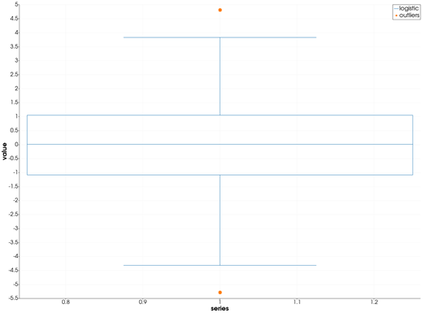
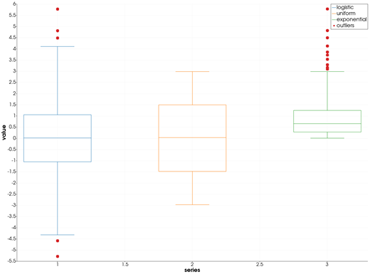
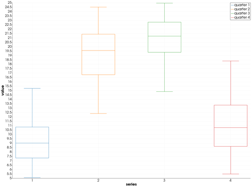

```@meta
CurrentModule = InteractiveGMT
```

# boxplot — Box Chart

The **boxplot** icon on the X,Y Plot tool's gallery row draws the Y values of every series of the
current page as a **box chart**: one box per series, with its median, quartiles, whiskers and
outliers. The boxes go on a **new page**; the series they were made from stay as they were. The
numbers come from GMT.jl's own `helper2_boxplot`, the helper behind GMT.jl's `boxplot`.

## Syntax

Draw the samples as curves, then click **boxplot**:

```julia
p = plot(y)
plot!(p, y2)                          # more samples: one box each
p = plot(x, Y; multicol=true)         # or one box per column of a matrix
```

## Description

- Each series of the page is one sample: its **Y values**. Its X values are not used.
- The boxes stand at X = 1, 2, 3, ..., in the order of the series, each in its own colour and named
  after its series. The new page is called **boxplot**, its axes **series** and **value**.
- **Outliers** are the values below `Q1 - 1.5·IQR` or above `Q3 + 1.5·IQR`, where `Q1` and `Q3` are
  the sample's first and third quartiles and `IQR = Q3 - Q1`. They are drawn as circles, all in one
  series named `outliers`, at the X of their box. With no outlier on the page there is no such
  series.
- The box, its median and its whiskers are computed from the values that remain once the outliers
  are taken out:
  - the **box** spans the first to the third quartile, 0.5 wide;
  - a line across it marks the **median**;
  - the **whiskers** go from the box down to the smallest and up to the largest remaining value,
    each ending in a cap half as wide as the box.
- Quartiles and median are Julia's `quantile` (linear interpolation between the sorted values).
- Values that are not finite (`NaN`, `Inf`) are left out. A series with fewer than two values is
  skipped; if none has two, the icon says so and draws nothing.

## Running the Examples

Paste each example into the iGMT window's **Julia console**, or into the Julia REPL after
`using InteractiveGMT`, then click **boxplot** on the gallery row. No series needs to be selected:
the icon takes every series of the page.

The examples build their samples without random numbers: `mod.((1:n) .* 0.6180339887, 1)` gives
`n` values spread evenly over (0, 1) in no particular order, and a distribution's inverse CDF turns
them into a sample of that distribution.

## Examples

### Create Box Chart

100 values of a logistic distribution. Its long tails put a value at each end past the whiskers:
those two are the outliers.

```julia
u = mod.((1:100) .* 0.6180339887, 1)
p = plot(log.(u ./ (1 .- u)); legend="logistic")
```



### Compare Several Samples

One box per series: a symmetric sample, a flat one and a skewed one.

```julia
u = mod.((1:200) .* 0.6180339887, 1)
p = plot(log.(u ./ (1 .- u)); legend="logistic")
plot!(p, 6 .* u .- 3; legend="uniform")
plot!(p, -log.(1 .- u); legend="exponential")
```



### Box Chart of a Matrix's Columns

A year of daily temperatures, cut into four quarters of 90 days, one column each. With
`multicol=true` each column is a series, and so a box.

```julia
t = 1:360
T = 15 .+ 8 .* sin.(2π .* (t .- 100) ./ 365) .+ 2 .* sin.(1.7 .* t)
p = plot(1:90, reshape(T, 90, 4); legend="quarter", multicol=true)
```



## Input Arguments

**`y` — sample**, the Y values of a series: at least two finite numbers.

**`Y` — samples**, a matrix drawn with `multicol=true`: each column is one series, and one box.

## See Also

[violin — Violin Plot](@ref) · [density — Kernel Density Estimate](@ref) ·
[qqnorm — Quantile-Quantile Plot Against the Normal](@ref) · [plot — 2-D Line Plot](@ref) ·
[X,Y Plot Tool](40-xyplot.md)
