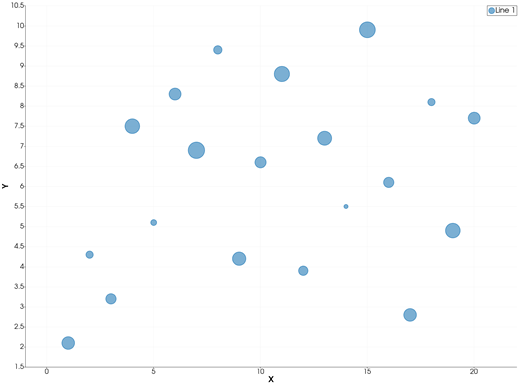
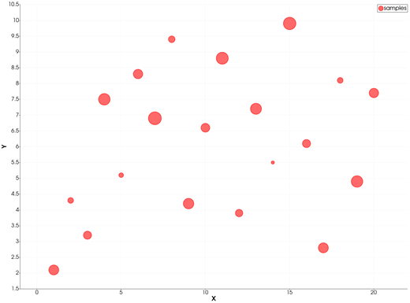
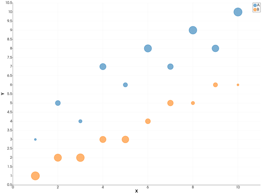

```@meta
CurrentModule = InteractiveGMT
```

# bubblechart — Bubble Chart

The **bubblechart** icon on the X,Y Plot tool's gallery row draws each series of the current page as
**bubbles**: a filled, see-through circle at every point, its size given by a third value per point.
From Julia, the sizes are given to [`plot`](@ref) as a vector `ms`, one size per point — GMT.jl's own
form of `bubblechart`.

## Syntax

```julia
p = plot(x, y; ms=sz)
p = plot(x, y; ms=sz, key=value, ...)

plot!(p, x, y; ms=sz)
```

## Description

- `plot(x, y; ms=sz)` draws a bubble at each point `(x, y)`, with `sz` holding one size value per
  point.
- The bubble **area** grows linearly with the size value, from the series' smallest value to its
  largest. The smallest is **5 points** across and the largest **20 points**, MATLAB's default
  bubble size range. When every value is the same, all bubbles are the middle size.
- A size that is `NaN` draws no bubble for that point.
- Bubbles are filled in the series' colour, see-through so overlapping bubbles show, with an outline
  of the same colour.

A number for `ms` (not a vector) is an ordinary marker size: see [`plot`](@ref).

### The bubblechart icon

Clicking **bubblechart** on the gallery row re-plots the current page as bubbles, with the sizes its
series carry. A series without sizes opens the **Bubble sizes** dialog for it:

- **Series** — the series that becomes bubbles.
- **Values from** — another series of the page (its Y values, row by row), or a **Constant**.
- **Value** — the constant.
- **Hide the series the values come from** — that series' numbers are now the sizes, so its own line
  is hidden (not deleted).

Series that still carry no sizes stay lines.

## Running the Examples

Paste each example into the iGMT window's **Julia console**, or into the Julia REPL after
`using InteractiveGMT`. Each one is complete on its own and draws a new page of the X,Y Plot window.

## Examples

### Create Bubble Chart

Define `x` and `y` as 20 points, and `sz` as their sizes.

```julia
x = 1:20
y = [2.1, 4.3, 3.2, 7.5, 5.1, 8.3, 6.9, 9.4, 4.2, 6.6, 8.8, 3.9, 7.2, 5.5, 9.9, 6.1, 2.8, 8.1, 4.9, 7.7]
sz = [9, 3, 6, 12, 2, 8, 15, 4, 10, 7, 13, 5, 11, 1, 14, 6, 9, 3, 12, 8]
p = plot(x, y; ms=sz)
```



### Specify the Bubble Colour

```julia
x = 1:20
y = [2.1, 4.3, 3.2, 7.5, 5.1, 8.3, 6.9, 9.4, 4.2, 6.6, 8.8, 3.9, 7.2, 5.5, 9.9, 6.1, 2.8, 8.1, 4.9, 7.7]
sz = [9, 3, 6, 12, 2, 8, 15, 4, 10, 7, 13, 5, 11, 1, 14, 6, 9, 3, 12, 8]
p = plot(x, y; ms=sz, lc=:red, legend="samples")
```



### Plot Two Sets of Bubbles

Each call adds one set, in the next colour of the palette. The two sets are sized independently:
each maps its own smallest and largest value to the bubble range.

```julia
x = 1:10
p = plot(x, [3, 5, 4, 7, 6, 8, 7, 9, 8, 10]; ms=[1, 4, 2, 6, 3, 8, 5, 9, 7, 10], legend="A")
plot!(p, x, [1, 2, 2, 3, 3, 4, 5, 5, 6, 6]; ms=[10, 8, 9, 6, 7, 4, 5, 2, 3, 1], legend="B")
```



### Take the Sizes from Another Series

With x, y and the sizes as the three columns of a table, draw it with `multicol=true`, then click
**bubblechart**: in the dialog keep **Series: Line 1** and pick **Values from: Series: Line 2**.

```julia
x = 1:15
p = plot([x sqrt.(x) x .^ 2]; multicol=true)
```

## Input Arguments

**`x`, `y` — the points**, as in [`plot`](@ref).

**`sz` — bubble sizes**, a vector with one value per point, in any units: only their spread matters,
mapped onto the bubble range.

## Keywords

| Keyword | Values | Default |
|---------|--------|---------|
| `ms`, `markersize`, `size` | a vector: one bubble size per point | none |
| `lc`, `linecolor` | the bubbles' colour | next palette colour |
| `legend` | the series' name, in the legend and the Object Manager | `"Line n"` |

The sizes are kept with the series: they are saved in an X,Y session, and **File > Plot with GMT.jl**
writes the bubbles as circles with a per-point `ms`.

## See Also

[plot — 2-D Line Plot](@ref) · [errorbar — Line Plot with Error Bars](@ref) · [X,Y Plot Tool](40-xyplot.md)
