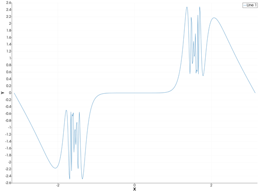
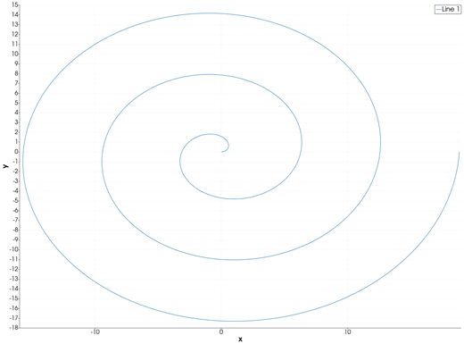
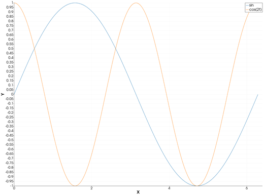

```@meta
CurrentModule = InteractiveGMT
```

# comet — Animated Comet Plot

The **comet** icon on the X,Y Plot tool's gallery row **animates** the series of the current page: each
curve is drawn in from its first point to its last over about two seconds, with a circle, the comet's
head, at its leading point. When the animation ends the page shows the curves as ordinary lines.
There is no `comet` function in iGMT: draw the curves with [`plot`](@ref) and [`plot!`](@ref), then
click **comet**.

## Syntax

Draw the curves, then click **comet**:

```julia
p = plot(x, y)
p = plot(y)                      # against the sample number 1:length(y)
plot!(p, x2, y2)                 # more curves: they run together
```

## Description

- First the page is re-plotted as lines on linear axes, as the **plot** icon does: a page drawn as
  bars, areas, stems, ... stays lines afterwards.
- Then every visible series with at least two points is hidden and drawn in again, point by point, in
  its own colour and line width, with a circle at its head. All the series run **at the same time**,
  each covering the same fraction of its points at every frame, and all finish together.
- The axes are held at the range of all the data while it runs, so nothing rescales as the curves
  grow. The legend is hidden meanwhile.
- At the end the head disappears and the real series come back, with their legend.

While a comet runs, the other gallery icons do nothing. Hidden series are not animated and stay
hidden.

The animation is the path the points take in the order they are stored. A curve whose `x` goes back
and forth (a circle, a spiral) is traced as it goes.

## Running the Examples

Paste each example into the iGMT window's **Julia console**, or into the Julia REPL after
`using InteractiveGMT`, then click **comet** on the gallery row. Each one is complete on its own and
draws a new page of the X,Y Plot window. The figures show each page as the animation leaves it.

## Examples

### Create Comet Plot

```julia
x = range(-π, π; length=400)
y = tan.(sin.(x)) .- sin.(tan.(x))
p = plot(x, y)
```



### Trace a Spiral

The comet follows the points in their order, round and round.

```julia
t = range(0, 6π; length=500)
p = plot(t .* cos.(t), t .* sin.(t); xlabel="x", ylabel="y")
```



### Run Two Comets Together

Both curves are drawn in at once, each in its own colour.

```julia
t = range(0, 2π; length=300)
p = plot(t, sin.(t); legend="sin")
plot!(p, t, cos.(2 .* t); legend="cos(2t)")
```



## Input Arguments

**`x`, `y` — the curve**, as in [`plot`](@ref).

## Keywords

There are no keywords of its own. The comet's trail takes the series' colour and line width, as set
with [`plot`](@ref)'s `lc`, `lw` or `pen`. The speed and the head are fixed: about two seconds per
run, a circle at the head.

## See Also

[plot — 2-D Line Plot](@ref) · [X,Y Plot Tool](40-xyplot.md)
