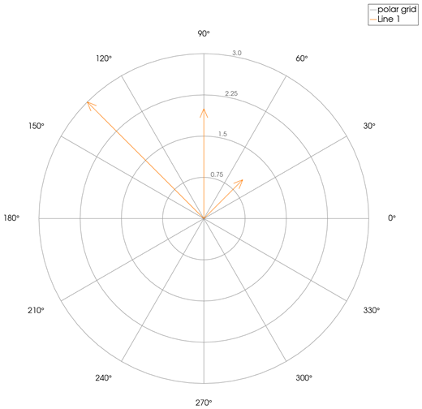
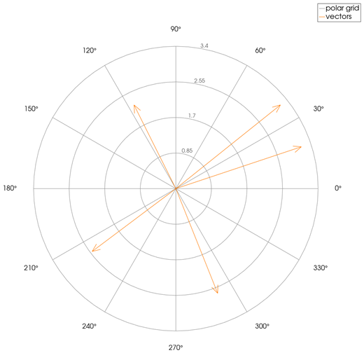
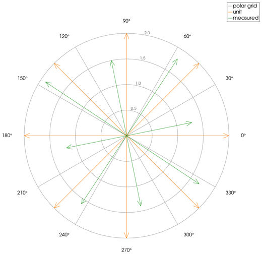

```@meta
CurrentModule = InteractiveGMT
```

# compassplot — Arrows from the Origin

The **compassplot** icon on the X,Y Plot tool's gallery row draws each point of each series of the
current page as an **arrow from the centre** of polar axes: its X value is the arrow's **angle**, in
radians, and its Y value its **length**. The plot goes on a **new page**; the curves it was made from
stay as they were.

## Syntax

Draw the angles and lengths as curves, then click **compassplot**:

```julia
p = plot(theta, rho)
plot!(p, theta2, rho2)          # more sets of arrows
```

## Description

- Each point `(θ, ρ)` becomes an arrow from the centre to that point, with a head at its end. The
  arrows of one series share its colour.
- `θ` is in **radians**, counted **counter-clockwise from the +X direction** (0 points right).
- `ρ` is the arrow's length. A negative length is drawn at its absolute value; a zero-length arrow is
  not drawn.
- The polar axes: circles at a quarter, a half, three quarters and all of the longest arrow
  (rounded up to a round number), labelled with their values; spokes and angle labels every 30°.
- The page is square and has no X,Y axes of its own.

To draw vectors given by their components `u` and `v`, give `atan.(v, u)` as the angles and
`hypot.(u, v)` as the lengths.

## Running the Examples

Paste each example into the iGMT window's **Julia console**, or into the Julia REPL after
`using InteractiveGMT`, then click **compassplot** on the gallery row.

## Examples

### Create Compass Plot

Three arrows, at 45°, 90° and 135°.

```julia
theta = [π/4, π/2, 3π/4]
rho = [1, 2, 3]
p = plot(theta, rho)
```



### Plot Vectors from Their Components

```julia
u = [3, -1, -2, 1, 2.5]
v = [1, 2, -1.5, -2.5, 2]
p = plot(atan.(v, u), hypot.(u, v); legend="vectors")
```



### Compare Two Sets of Arrows

```julia
theta = range(0, 2π; length=9)[1:8]
p = plot(theta, fill(2.0, 8); legend="unit")
plot!(p, theta .+ 0.2, [1.3, 1.8, 1.5, 1.9, 1.2, 1.6, 1.4, 1.7]; legend="measured")
```



## Input Arguments

**`theta` — arrow angles**, in radians, as the series' X values.

**`rho` — arrow lengths**, as the series' Y values, one per angle.

## See Also

[feather — Feather Plot](@ref) · [polarplot — Line Plot on Polar Axes](@ref) ·
[polarscatter — Scatter Plot on Polar Axes](@ref) · [X,Y Plot Tool](40-xyplot.md)
