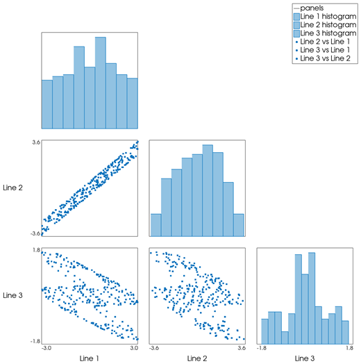
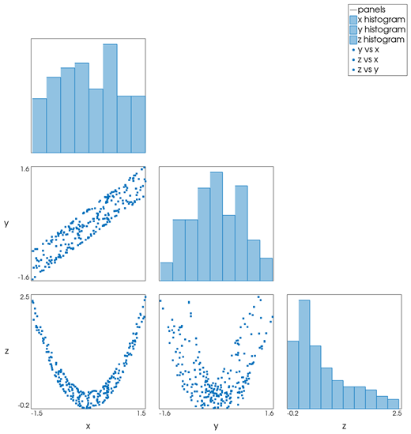
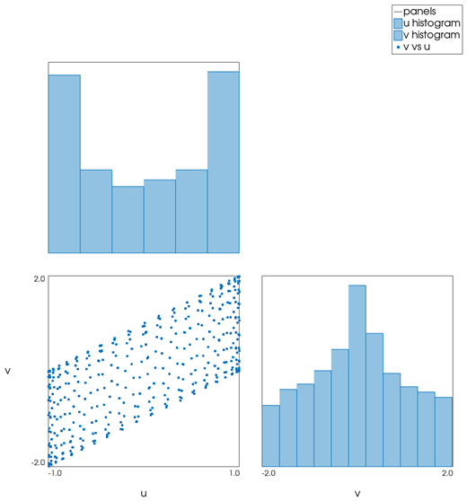

```@meta
CurrentModule = InteractiveGMT
```

# cornerplot — Corner Plot

The **cornerplot** icon on the X,Y Plot tool's gallery row draws the series of the current page as a
**corner plot**: a lower-triangular matrix of panels with each variable's **histogram** on the
diagonal and the **scatter plot of every pair** of variables below it. The plot goes on a **new
page**; the series it was made from stay as they were. It follows GMT.jl's `cornerplot` with
`scatter=true`.

## Syntax

Draw one series per variable, then click **cornerplot**:

```julia
p = plot(x, v1; legend="name1")
plot!(p, x, v2; legend="name2")    # more variables: one per series
p = plot(D; multicol=true)         # a table: one variable per column after the first
```

## Description

- Each series of the page is one variable; only its **Y values** are used. A series with fewer than
  two values is left out. There must be two or more variables.
- The observations are the rows of the variables put side by side: the series are cut to the length
  of the shortest one, and a row with any value that is not finite is left out.
- With `n` variables the matrix has `n` rows and `n` columns of square panels, filled on and below
  the diagonal:
  - the panel on the diagonal of row `k` is the **histogram** of variable `k`, as filled bars, the
    tallest one 95 % of the panel's height. The number of bins follows the Freedman–Diaconis rule
    (bin width `2·IQR·n^(-1/3)`), as the **histogram** icon does;
  - the panel at row `i`, column `j` below the diagonal is the **scatter** of variable `i` (up)
    against variable `j` (across), as dots.
- Each variable spans its panels over its own range, from its minimum to its maximum rounded out to
  round numbers. The ranges are written under the bottom row (for every variable) and left of the
  first column (for every variable but the first), with the variables' names (the series' names).
- The page is square and has no X,Y axes of its own. In the Object Manager the panel outlines are
  one row (`panels`), each histogram one (`<name> histogram`) and each scatter one
  (`<name> vs <name>`).

GMT.jl's `cornerplot` bins the scatter panels into hexagons above 1000 points; here they are always
drawn as dots.

## Running the Examples

Paste each example into the iGMT window's **Julia console**, or into the Julia REPL after
`using InteractiveGMT`, then click **cornerplot** on the gallery row. The icon uses every series of
the page, so no series needs to be selected.

## Examples

### Create Corner Plot

Three related variables of 300 observations, as the columns of a matrix after X. With
`multicol=true` they are the series `Line 1`, `Line 2` and `Line 3`.

```julia
t = 1:300
a = 2 .* sin.(0.1 .* t) .+ cos.(0.37 .* t)
b = a .+ 0.5 .* sin.(1.3 .* t)
c = cos.(0.05 .* t) .- 0.3 .* a
p = plot([t a b c]; multicol=true)
```



### Name the Variables

A table's column names name the series, and so the panels.

```julia
k = 1:250
x = sin.(0.7 .* k) .+ 0.5 .* sin.(2.3 .* k)
y = 0.8 .* x .+ 0.4 .* cos.(1.1 .* k)
z = x .^ 2 .+ 0.2 .* sin.(3.1 .* k)
D = mat2ds([k x y z], colnames=["n", "x", "y", "z"])
p = plot(D; multicol=true)
```



### Two Variables

With two variables the matrix is two histograms and one scatter.

```julia
k = 1:400
p = plot(k, sin.(0.9 .* k); legend="u")
plot!(p, k, sin.(0.9 .* k) .+ cos.(1.7 .* k); legend="v")
```



## Input Arguments

**`v1`, `v2`, ... — the variables**, the Y values of the series of the page, one series per
variable; the values at the same position form one observation.

## See Also

[marginalhist — Scatter Plot with Marginal Histograms](@ref) ·
[parallelplot — Parallel Coordinates Plot](@ref) · [biplot — Principal Component Biplot](@ref) ·
[plot — 2-D Line Plot](@ref) · [X,Y Plot Tool](40-xyplot.md)
