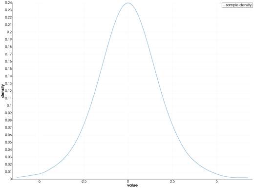
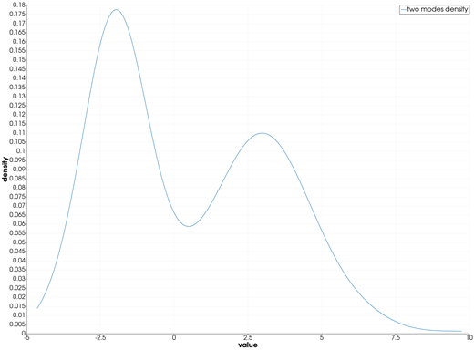
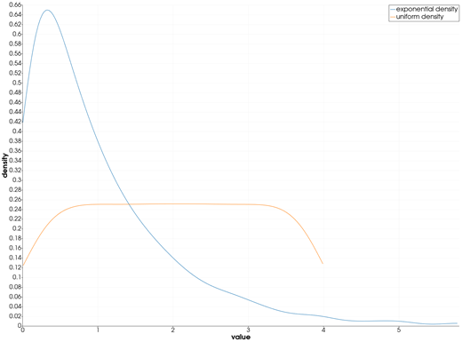

```@meta
CurrentModule = InteractiveGMT
```

# density — Kernel Density Estimate

The **density** icon on the X,Y Plot tool's gallery row estimates the **probability density** of the
Y values of every series of the current page, with a normal kernel, and draws one density curve per
series. The curves go on a **new page**; the series they were made from stay as they were. The
numbers come from GMT.jl's own `kernelDensity`, the helper behind GMT.jl's `density`.

## Syntax

Draw the samples as curves, then click **density**:

```julia
p = plot(y)
plot!(p, y2)          # more samples: one density curve each
```

## Description

- Each series of the page is one sample: its **Y values**. Its X values are not used.
- The estimate uses a **normal (Gaussian) kernel**. The bandwidth `h` is Silverman's rule of thumb,
  `h = 0.9 · min(σ, IQR/1.34) · n^(-1/5)`, with `σ` the sample's standard deviation, `IQR` its
  interquartile range and `n` its number of values.
- The density is evaluated at **200 points**, evenly spaced from the sample's **minimum to its
  maximum**. It is not extended past them, so a curve can end above zero at either side.
- Each curve is named `"<series> density"`, in the next colour of the palette. The new page is
  called **density**, its axes **value** and **density**.
- Values that are not finite (`NaN`, `Inf`) are left out. A series with fewer than two values is
  skipped; if none has two, the icon says so and draws nothing.

## Running the Examples

Paste each example into the iGMT window's **Julia console**, or into the Julia REPL after
`using InteractiveGMT`, then click **density** on the gallery row. No series needs to be selected:
the icon takes every series of the page.

The examples build their samples without random numbers: `mod.((1:n) .* 0.6180339887, 1)` gives
`n` values spread evenly over (0, 1) in no particular order, and a distribution's inverse CDF turns
them into a sample of that distribution.

## Examples

### Estimate the Density of a Sample

500 values of a logistic distribution.

```julia
u = mod.((1:500) .* 0.6180339887, 1)
y = log.(u ./ (1 .- u))
p = plot(y; legend="sample")
```



### Density of Bimodal Data

Two clusters, around -2 and 3: the density shows both modes.

```julia
u = mod.((1:400) .* 0.6180339887, 1)
z = log.(u ./ (1 .- u))
y = [-2 .+ 0.5 .* z[1:200]; 3 .+ z[201:400]]
p = plot(y; legend="two modes")
```



### Compare the Densities of Two Samples

Each series of the page gets its own curve, on the same axes.

```julia
u = mod.((1:300) .* 0.6180339887, 1)
p = plot(-log.(1 .- u); legend="exponential")
plot!(p, 4 .* u; legend="uniform")
```



## Input Arguments

**`y` — sample**, the Y values of a series: at least two finite numbers.

## See Also

[violin — Violin Plot](@ref) · [ecdfplot — Empirical Cumulative Distribution Plot](@ref) ·
[boxplot — Box Chart](@ref) · [plot — 2-D Line Plot](@ref) · [X,Y Plot Tool](40-xyplot.md)
