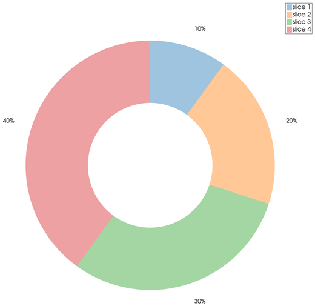
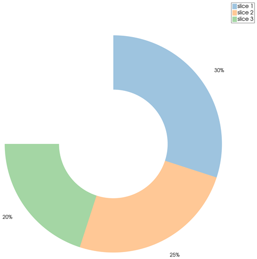
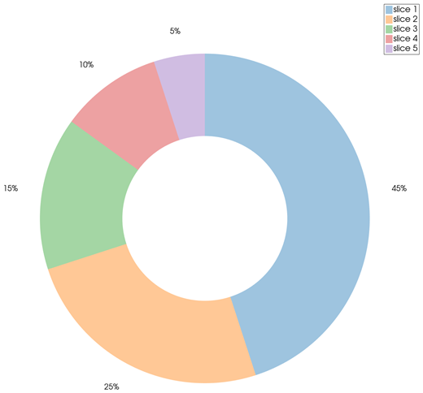

```@meta
CurrentModule = InteractiveGMT
```

# donutchart — Donut Chart

The **donutchart** icon on the X,Y Plot tool's gallery row draws the Y values of the **selected
series** as the slices of a **donut**: a pie with a hole in the middle, its inner radius half the
outer one (MATLAB's default). Each slice is labelled with its percentage. The donut goes on a **new
page**; the series it was made from stays as it was.

## Syntax

Draw the values as a curve, select it in the Object Manager, then click **donutchart**:

```julia
p = plot(data)
```

## Description

- Each value of the selected series is one slice. The slices start at 12 o'clock and go clockwise,
  in the order of the values, each in the next colour of the palette.
- When the values add up to **1 or more**, they are normalized and the donut is whole; when they
  add up to **less than 1**, each value is a fraction of the circle as it is, and the donut is
  **partial**.
- Each slice is labelled outside the donut with its percentage, rounded to a whole number.
- Values must not be negative. A zero value gives no slice.
- Each slice is its own row in the Object Manager (`slice 1`, `slice 2`, ...).

A donut is read exactly like a pie: see [piechart — Pie Chart](@ref).

## Running the Examples

Paste each example into the iGMT window's **Julia console**, or into the Julia REPL after
`using InteractiveGMT`. The series a `plot` call draws is the selected one, so click **donutchart**
on the gallery row right after it.

## Examples

### Create Donut Chart

```julia
data = [1, 2, 3, 4]
p = plot(data)
```



### Create Partial Donut Chart

These values add up to 0.75: the donut covers three quarters of a circle.

```julia
data = [0.3, 0.25, 0.2]
p = plot(data)
```



### Donut of a Budget

```julia
D = mat2ds([1 45; 2 25; 3 15; 4 10; 5 5], colnames=["item", "percent"])
p = plot(D)
```



## Input Arguments

**`data` — the slice values**, the Y values of the selected series: non-negative numbers, one per
slice.

## See Also

[piechart — Pie Chart](@ref) · [X,Y Plot Tool](40-xyplot.md)
