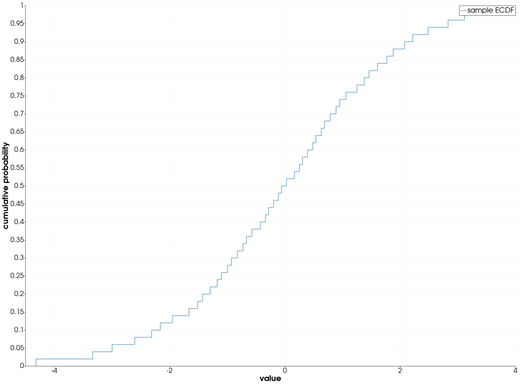
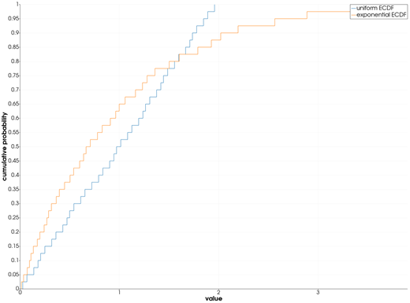
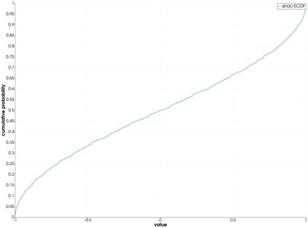

```@meta
CurrentModule = InteractiveGMT
```

# ecdfplot — Empirical Cumulative Distribution Plot

The **ecdfplot** icon on the X,Y Plot tool's gallery row draws the **empirical cumulative
distribution function** (ECDF) of the Y values of every series of the current page, as stairs, one
per series. The curves go on a **new page**; the series they were made from stay as they were. The
numbers come from GMT.jl's own `ecdf`, the helper behind GMT.jl's `ecdfplot`.

## Syntax

Draw the samples as curves, then click **ecdfplot**:

```julia
p = plot(y)
plot!(p, y2)          # more samples: one ECDF each
```

## Description

- Each series of the page is one sample: its **Y values**. Its X values are not used.
- The ECDF `F(v)` is the fraction of the sample's values that are `≤ v`. It is drawn as **stairs**:
  it starts at 0 just left of the smallest value, rises by `1/n` at each value (`n` the number of
  values) and reaches 1 at the largest.
- Each curve is named `"<series> ECDF"`, in the next colour of the palette. The new page is called
  **ECDF**, its axes **value** and **cumulative probability**.
- Values that are not finite (`NaN`, `Inf`) are left out. A series with fewer than two values is
  skipped; if none has two, the icon says so and draws nothing.

## Running the Examples

Paste each example into the iGMT window's **Julia console**, or into the Julia REPL after
`using InteractiveGMT`, then click **ecdfplot** on the gallery row. No series needs to be selected:
the icon takes every series of the page.

The examples build their samples without random numbers: `mod.((1:n) .* 0.6180339887, 1)` gives
`n` values spread evenly over (0, 1) in no particular order, and a distribution's inverse CDF turns
them into a sample of that distribution.

## Examples

### Create ECDF Plot

50 values of a logistic distribution.

```julia
u = mod.((1:50) .* 0.6180339887, 1)
p = plot(log.(u ./ (1 .- u)); legend="sample")
```



### Compare Two Samples

Each series of the page gets its own stairs, on the same axes: the uniform sample's ECDF is close to
a straight line, the exponential one's rises fast and then flattens.

```julia
u = mod.((1:40) .* 0.6180339887, 1)
p = plot(2 .* u; legend="uniform")
plot!(p, -log.(1 .- u); legend="exponential")
```



### ECDF of a Sequence

The sines of the integers 1 to 200 fill [-1, 1], most densely near its ends: the ECDF is steep at
both sides and flat in the middle.

```julia
y = sin.(1:200)
p = plot(y; legend="sin(k)")
```



## Input Arguments

**`y` — sample**, the Y values of a series: at least two finite numbers.

## See Also

[density — Kernel Density Estimate](@ref) · [qqplot — Quantile-Quantile Plot](@ref) ·
[stairs — Stairstep Plot](@ref) · [plot — 2-D Line Plot](@ref) · [X,Y Plot Tool](40-xyplot.md)
