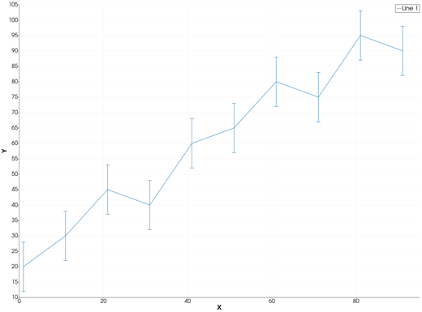
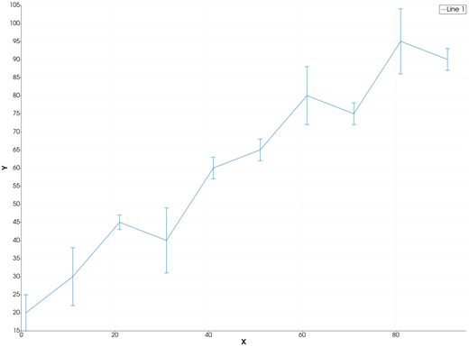
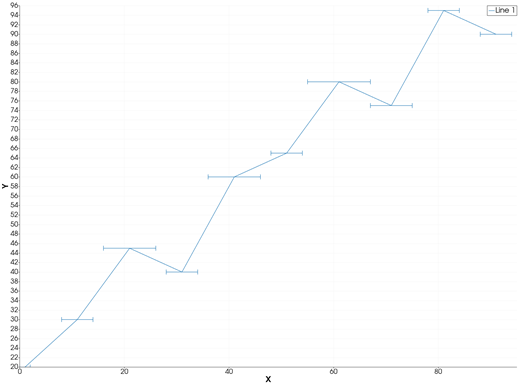
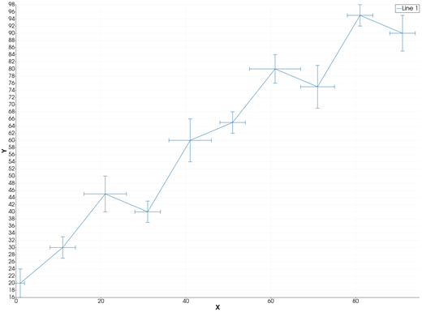
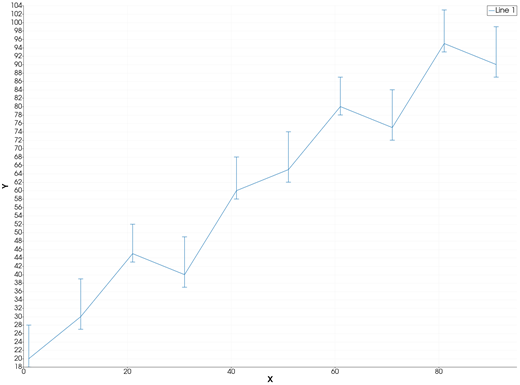
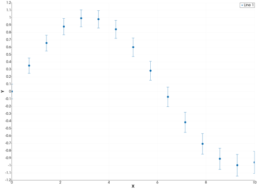
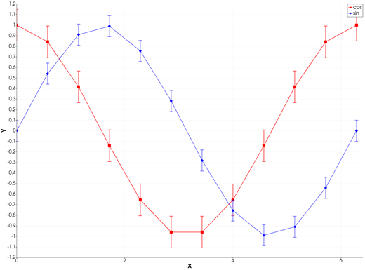

```@meta
CurrentModule = InteractiveGMT
```

# errorbar — Line Plot with Error Bars

The **errorbar** icon on the X,Y Plot tool's gallery row draws each series of the current page as a
line with an **error bar** at every point: a capped segment from the point's lower to its upper
limit, vertical, horizontal or both. From Julia, the errors are given to [`plot`](@ref) with GMT.jl's
`error_bars` keyword.

## Syntax

```julia
p = plot(x, y; error_bars=(y=err,))
p = plot(x, y; error_bars=(x=err,))
p = plot(x, y; error_bars=(x=xerr, y=yerr))
p = plot(x, y; error_bars=(y=[neg pos], asym=true))
p = plot(x, y; error_bars=(y=err,), key=value, ...)

plot!(p, x, y; error_bars=(y=err,))
```

## Description

- `plot(x, y; error_bars=(y=err,))` draws the line `(x, y)` with a vertical error bar at each point,
  from `y - err` to `y + err`.
- `error_bars=(x=err,)` draws horizontal error bars, from `x - err` to `x + err`.
- `error_bars=(x=xerr, y=yerr)` draws both.
- With `asym=true`, each axis takes a two-column matrix `[neg pos]`: the bar runs from `y - neg` to
  `y + pos`.
- `err` may also be a single number, the same for every point.
- The other keywords set the line, as in [`plot`](@ref): colour, width, style, markers, legend.

The axes always show the whole of every bar. One series carries its errors: a call with
`error_bars` draws one line.

### The errorbar icon

Clicking **errorbar** on the gallery row re-plots the current page with the error bars its series
carry. A series without errors opens the **Error bars** dialog for it:

- **Series** — the series that gets the error bars.
- **Values from** — another series of the page (its Y values, row by row), a **Constant**, or a
  **% of Y** of each point.
- **Value** — the constant, or the percentage.
- **Direction** — **Vertical (Y)**, **Horizontal (X)** or **Both**.
- **Hide the series the values come from** — that series' numbers are now the bars, so its own line
  is hidden (not deleted).

Series that still carry no errors stay lines. Click **errorbar** again to give them theirs.

## Running the Examples

Paste each example into the iGMT window's **Julia console**, or into the Julia REPL after
`using InteractiveGMT`. Each one is complete on its own and draws a new page of the X,Y Plot window.

## Examples

### Plot Vertical Error Bars of Equal Length

Create vectors `x` and `y`, and draw `y` against `x` with an error bar of length 8 above and below
each point.

```julia
x = 1:10:100
y = [20, 30, 45, 40, 60, 65, 80, 75, 95, 90]
p = plot(x, y; error_bars=(y=8,))
```



### Plot Vertical Error Bars That Vary in Length

```julia
x = 1:10:100
y = [20, 30, 45, 40, 60, 65, 80, 75, 95, 90]
err = [5, 8, 2, 9, 3, 3, 8, 3, 9, 3]
p = plot(x, y; error_bars=(y=err,))
```



### Plot Horizontal Error Bars

```julia
x = 1:10:100
y = [20, 30, 45, 40, 60, 65, 80, 75, 95, 90]
err = [1, 3, 5, 3, 5, 3, 6, 4, 3, 3]
p = plot(x, y; error_bars=(x=err,))
```



### Plot Vertical and Horizontal Error Bars

```julia
x = 1:10:100
y = [20, 30, 45, 40, 60, 65, 80, 75, 95, 90]
p = plot(x, y; error_bars=(x=[1, 3, 5, 3, 5, 3, 6, 4, 3, 3], y=[4, 3, 5, 3, 6, 3, 4, 6, 3, 5]))
```



### Plot Asymmetric Error Bars

Each row of the matrix is one point's `[neg pos]`: the bar runs further up than down.

```julia
x = 1:10:100
y = [20, 30, 45, 40, 60, 65, 80, 75, 95, 90]
neg = [2, 3, 2, 3, 2, 3, 2, 3, 2, 3]
pos = [8, 9, 7, 9, 8, 9, 7, 9, 8, 9]
p = plot(x, y; error_bars=(y=[neg pos], asym=true))
```



### Plot Error Bars with No Line

Draw markers at the points and no line joining them.

```julia
x = range(0, 10; length=15)
y = sin.(x / 2)
p = plot(x, y; error_bars=(y=0.1 .+ 0.05 .* x / 10,), ls=:none, marker=:circle, ms="5p")
```



### Control the Look

Colour, width and markers are the line's own keywords; the error bars are drawn in the line's colour
and width.

```julia
x = range(0, 2π; length=12)
y = cos.(x)
p = plot(x, y; error_bars=(y=0.15,), lc=:red, lw=1.5, marker=:square, ms="5p", legend="cos")
plot!(p, x, sin.(x); error_bars=(y=0.1,), lc=:blue, marker=:diamond, ms="5p", legend="sin")
```



### Take the Errors from Another Series

A file with three columns — x, y and its error — opens in the X,Y Plot tool as two series. Draw it
with `multicol=true` the same way, then click **errorbar**: in the dialog keep **Series: Line 1**, pick
**Values from: Series: Line 2**, and the second series becomes the first one's error bars.

```julia
x = 1:12
y = 10 .+ 3 .* sin.(x ./ 2)
p = plot([x y 0.4 .+ 0.2 .* cos.(x)]; multicol=true)
```

## Input Arguments

**`x`, `y` — the line**, as in [`plot`](@ref).

**`err` — error values**, a vector with one value per point, or a single number. Values are lengths
from the point, so they are taken as positive.

**`[neg pos]` — asymmetric errors** (with `asym=true`), a matrix with one row per point: the length
below (or left of) and above (or right of) the point.

## Keywords

| Keyword | Values | Default |
|---------|--------|---------|
| `error_bars`, `E`, `error`, `errorbars` | `(y=err,)`, `(x=err,)`, `(x=xerr, y=yerr)`; `asym=true` with `[neg pos]` matrices | none |
| `lc`, `lw`, `ls`, `pen`, `marker`, `ms`, `mc`, `legend` | the line, as in [`plot`](@ref) | |

The error bars are kept with the series: they are saved in an X,Y session, and **File > Plot with
GMT.jl** writes them as GMT.jl's `error_bars`.

## See Also

[plot — 2-D Line Plot](@ref) · [bubblechart — Bubble Chart](@ref) · [X,Y Plot Tool](40-xyplot.md)
