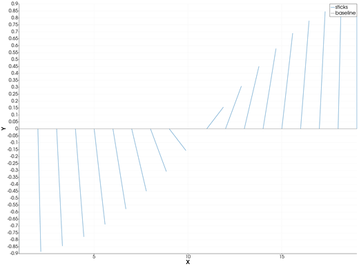
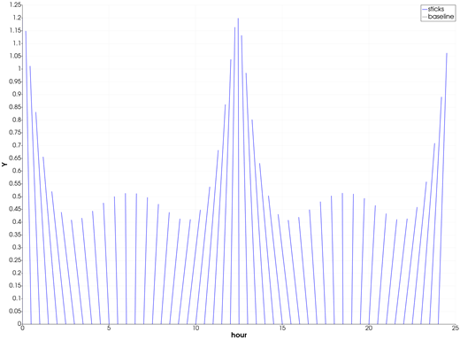
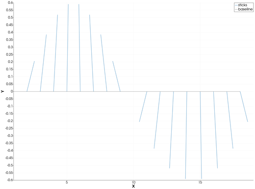

```@meta
CurrentModule = InteractiveGMT
```

# feather — Feather Plot

A **feather plot** draws a vector at each point along the X axis, starting on the `y = 0` baseline:
the classic picture of a current, a wind or a geomagnetic vector time series. From Julia it is
[`feather`](@ref), GMT.jl's own name; the **feather** icon on the X,Y Plot tool's gallery row draws
one from the curves of the current page.

## Syntax

```julia
p = feather(t, [u v])
p = feather([t u v])
p = feather(t, [θ r]; rtheta=true)
p = feather(D)                       # a GMTdataset with those columns
p = feather(t, [u v]; key=value, ...)
```

## Description

- `feather(t, [u v])` draws, at each `t[i]`, a stick from `(t[i], 0)` in the direction of the
  vector `(u[i], v[i])`.
- `feather([t u v])` takes the same three columns as one matrix. A four-column matrix
  `[t y u v]`, GMT.jl's form, is accepted when every `y` is 0.
- With `rtheta=true` the last two columns are an **angle** `θ`, in degrees counter-clockwise from
  the +X direction (GMT.jl's convention), and a **length** `r`.
- The sticks are scaled together, so their lengths compare: by default the longest one spans about
  5 % of the X range. `scale` sets the factor yourself.
- A grey baseline is drawn at `y = 0` under the sticks.

`feather` returns the X,Y Plot window's handle and, like [`plot`](@ref), draws on a new page of the
open window.

### The feather icon

Clicking **feather** on the gallery row takes the page's **first two curves** as `u` and `v`, with X
from the first one, and draws their feather plot on a **new page**. The page needs two curves.

## Running the Examples

Paste each example into the iGMT window's **Julia console**, or into the Julia REPL after
`using InteractiveGMT`. Each one is complete on its own.

## Examples

### Create Feather Plot

Vectors of the same length turning from pointing down to pointing up.

```julia
θ = -90:10:90
u = 2 .* cosd.(θ)
v = 2 .* sind.(θ)
p = feather(1:length(θ), [u v])
```


### Give the Vectors as Angle and Length

The same sticks from their angles and lengths, with `rtheta=true`.

```julia
θ = -90:10:90
p = feather(1:length(θ), [θ fill(2, length(θ))]; rtheta=true)
```



### A Current Over Two Tidal Cycles

Hours on X; the current turns with the tide and its speed changes.

```julia
t = 0:0.5:24
dir = 90 .+ 60 .* sin.(2π .* t ./ 12.42)            # degrees counter-clockwise from east
speed = 1 .+ 0.4 .* cos.(2π .* t ./ 12.42)
p = feather(t, [dir speed]; rtheta=true, lc=:blue, title="Current", xlabel="hour")
```



### Set the Stick Scale

`scale` multiplies the vectors: an X-axis length per unit of vector length.

```julia
θ = 0:20:340
p = feather(1:length(θ), [cosd.(θ) sind.(θ)]; scale=0.6)
```



### From Two Curves on a Page

Draw `u` and `v` as two curves, then click **feather** on the gallery row.

```julia
t = 0:0.25:10
p = plot(t, cos.(t); legend="u")
plot!(p, t, sin.(t ./ 2); legend="v")
```

## Input Arguments

**`t` — positions along X**, a vector.

**`[u v]` — the vectors**, a two-column matrix with one row per position: X and Y components.

**`[θ r]` — the vectors as angle and length** (with `rtheta=true`): degrees counter-clockwise from +X,
and length.

**`D` — dataset**, a `GMTdataset` with the same 3 (or 4) columns.

## Keywords

| Keyword | Values | Default |
|---------|--------|---------|
| `rtheta` | `true`: the last two columns are angle (degrees) and length | `false` |
| `scale` | X-axis length per unit of vector length, or `:auto` | `:auto` (longest ≈ 5 % of the X range) |
| `lc`, `lw`, `ls`, `pen` | the sticks' line | |
| `legend`, `title`, `xlabel`, `ylabel` | as in [`plot`](@ref) | `"sticks"`, `"Stick diagram"` |

The sticks are drawn without arrowheads.

## See Also

[plot — 2-D Line Plot](@ref) · [compassplot — Arrows from the Origin](@ref) · [X,Y Plot Tool](40-xyplot.md)
