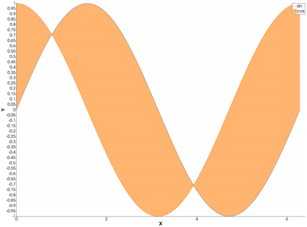
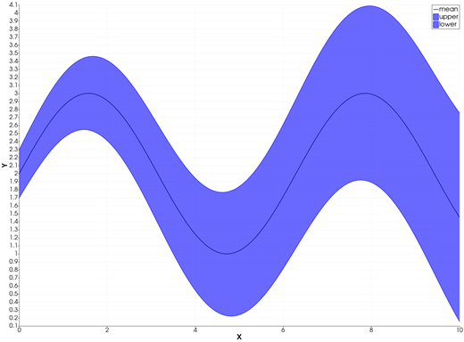
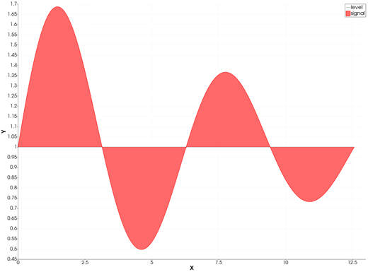

```@meta
CurrentModule = InteractiveGMT
```

# fill_between — Fill Between Two Curves

The **fill_between** icon on the X,Y Plot tool's gallery row fills the area **between the page's
first curve and each of the others**: the first curve stays a line, and every other curve is drawn
with a see-through fill in its own colour, down (or up) to the first one.

## Syntax

Draw the reference curve first, then the curves to fill against it, and click **fill_between**:

```julia
p = plot(x, y1)       # the reference: stays a line
plot!(p, x, y2)       # filled between y1 and y2
plot!(p, x, y3)       # filled between y1 and y3
```

## Description

- The page's **first** series is drawn as a line. Each further series is drawn as its curve plus the
  area between it and the first series, filled in its own colour, see-through so overlapping fills
  show.
- The two curves are matched **row by row**: the fill at a series' point `i` goes to the first
  series' Y at its point `i`. Give the curves the same X. Where a series has more points than the
  first one, the extra points are not filled.
- A point that is not finite breaks the fill, as it breaks a line.
- The page needs at least two curves: with fewer, the icon says *"fill_between needs two curves on
  this page."* and changes nothing.

### The fill_between icon

Clicking **fill_between** re-plots the current page as above, whatever type its series were drawn in
before. The axes go back to linear and are re-fitted to all the data. The icon acts on the page and
needs no series selected. The **plot** icon turns the fills back into lines.

## Running the Examples

Paste each example into the iGMT window's **Julia console**, or into the Julia REPL after
`using InteractiveGMT`, then click **fill_between** on the gallery row.

## Examples

### Fill Between Two Curves

```julia
x = range(0, 2π; length=200)
p = plot(x, sin.(x); legend="sin")
plot!(p, x, cos.(x); legend="cos")
```



### Show a Band Around a Curve

The reference is the middle curve; the curves above and below it are each filled to it, so the band
is filled on both sides.

```julia
x = range(0, 10; length=200)
m = 2 .+ sin.(x)
p = plot(x, m; legend="mean", lc=:black, lw=1.5)
plot!(p, x, m .+ 0.3 .+ 0.1 .* x; legend="upper", lc=:blue)
plot!(p, x, m .- 0.3 .- 0.1 .* x; legend="lower", lc=:blue)
```



### Fill a Curve Against a Constant Level

The reference can be any curve, here a horizontal line at `y = 1`.

```julia
x = range(0, 4π; length=300)
p = plot(x, fill(1.0, 300); legend="level", lc=:gray)
plot!(p, x, 1 .+ 0.8 .* sin.(x) .* exp.(-0.1 .* x); legend="signal", lc=:red)
```



## Input Arguments

**`x` — X values**, the same for every curve.

**`y1` — the reference curve**, the page's first series.

**`y2`, `y3`, … — the filled curves**, the page's further series, one value per point of `y1`.

## Keywords

The keywords of [`plot`](@ref), for each curve: `lc` is also the colour of the curve's fill.

## See Also

[plotyy — Plot with Two Y Axes](@ref) · [plot — 2-D Line Plot](@ref) ·
[X,Y Plot Tool](40-xyplot.md)
