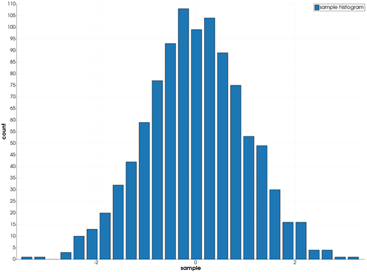
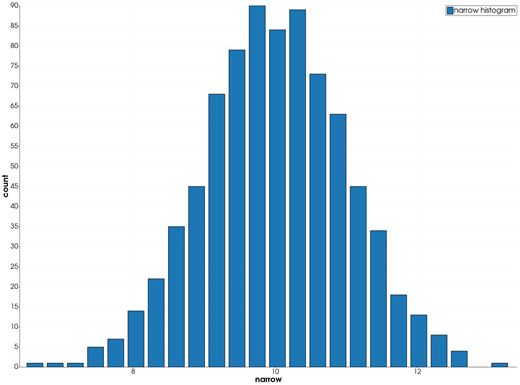
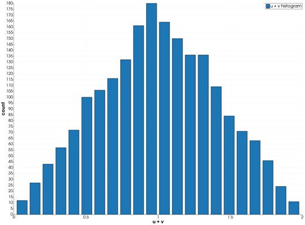
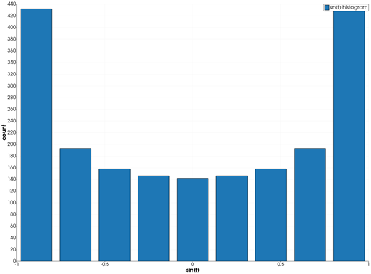

```@meta
CurrentModule = InteractiveGMT
```

# histogram — Histogram Plot

The **histogram** icon on the X,Y Plot tool's gallery row counts the **Y values of the selected
series** in equal-width bins and draws the counts as bars. The histogram goes on a **new page**; the
series it was made from stays as it was.

## Syntax

Draw the values as a series, select it, then click **histogram**:

```julia
p = plot(y)          # the values, against their sample number
p = plot(x, y)       # only y is counted
```

## Description

- Only the series' **Y values** are counted; its X values play no part. Values that are not finite
  (`NaN`, `Inf`) are left out. At least two finite values are needed.
- The bins have equal widths and span the values from the smallest to the largest. The largest value
  is counted in the last bin.
- The number of bins is chosen from the data (the Freedman–Diaconis rule): the bin width is
  `2·IQR·n^(-1/3)`, with `IQR` the interquartile range and `n` the number of values, and the bins
  are as many as it takes to cover the values, between 1 and 1000. When the interquartile range is
  zero (heavily repeated values), the count is `√n`, rounded up. A series whose values are all equal
  is one bin.
- Each bar stands at its bin's centre and is as tall as the bin's count.
- The new page is named `"<series> histogram"`; its X axis is titled with the series' name and its Y
  axis `count`.

### The histogram icon

Clicking **histogram** computes the histogram of the series selected in the **Object Manager**. With
no series selected it takes the page's last series — the one the last `plot` or `plot!` call drew.
The bins are chosen automatically.

## Running the Examples

Paste each example into the iGMT window's **Julia console**, or into the Julia REPL after
`using InteractiveGMT`. Select the series to count in the **Object Manager** (or leave the last one
drawn, which is used when nothing is selected), then click **histogram** on the gallery row.

## Examples

### Create Histogram

1000 values with a bell-shaped distribution, made without random numbers (Box–Muller on two
evenly spread sequences), drawn against their sample number.

```julia
k = 1:1000
u = mod.(k .* 0.6180339887, 1)
v = mod.(k .* 0.4142135624, 1)
y = sqrt.(-2 .* log.(u)) .* cos.(2π .* v)
p = plot(y; legend="sample")
```



### Histogram of One of Several Series

Two series on the page: the histogram counts the selected one. Here nothing is selected, so it is
the last one drawn, `"wide"`.

```julia
k = 1:800
u = mod.(k .* 0.6180339887, 1)
v = mod.(k .* 0.4142135624, 1)
z = sqrt.(-2 .* log.(u)) .* cos.(2π .* v)
p = plot(k, 10 .+ z; legend="narrow")
plot!(p, k, 10 .+ 3 .* z; legend="wide")
```



### Histogram of a Triangular Distribution

The sum of two evenly spread sequences is spread as a triangle between 0 and 2.

```julia
k = 1:2000
y = mod.(k .* 0.6180339887, 1) .+ mod.(k .* 0.4142135624, 1)
p = plot(y; legend="u + v")
```



### Histogram of a Measured Signal

A sine wave spends most of its time near its peaks, and its histogram shows it.

```julia
t = range(0, 20π; length=2000)
p = plot(t, sin.(t); legend="sin(t)")
```



## Input Arguments

**`y` — the values to count**, the series' Y values: a vector, with or without `x`.

## See Also

[bar — Bar Graph](@ref) · [plot — 2-D Line Plot](@ref) · [X,Y Plot Tool](40-xyplot.md)
