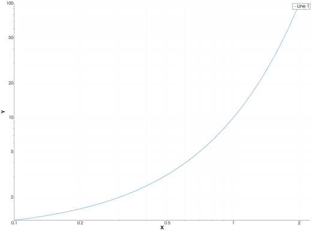
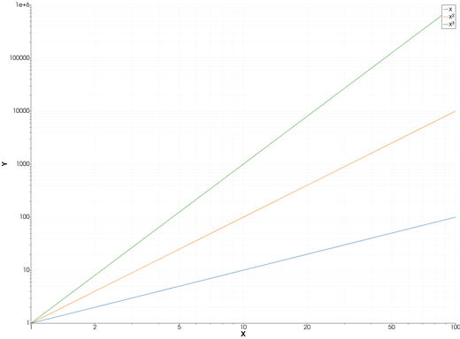
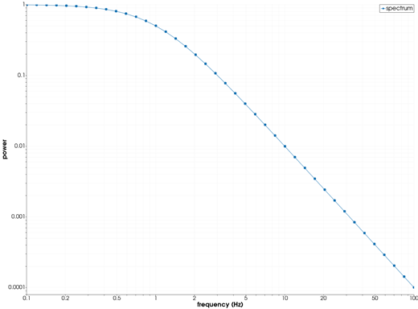
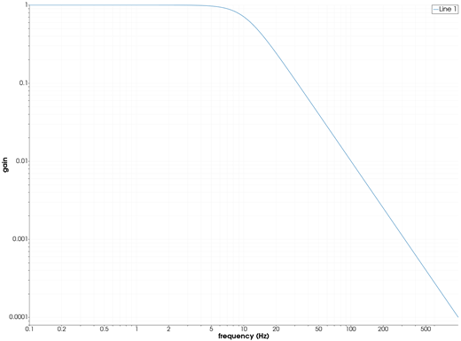

```@meta
CurrentModule = InteractiveGMT
```

# loglog — Log-Log Plot

The **loglog** icon on the X,Y Plot tool's gallery row re-plots each series of the current page as a
line, with **both axes base-10 logarithmic**. From Julia, the same axes are set with
[`plot`](@ref)'s GMT.jl keyword `proj=:loglog`, or with [`logscale!`](@ref).

## Syntax

Draw the data, then click **loglog**:

```julia
p = plot(x, y)
plot!(p, x, y2)                  # more lines
```

Or set the log axes from Julia:

```julia
p = plot(x, y; proj=:loglog)
logscale!(p; x=true, y=true)     # on an open page
logscale!(p; x=false, y=false)   # back to linear
```

## Description

- Every series of the page is drawn as a line, whatever type it was before (bars, area, stems, ...),
  keeping its data, name, colour and style.
- Both axes are logarithmic, base 10. The axes are re-fitted to the data.
- `x` and `y` must be **positive**: a logarithmic axis has no zero and no negative values.

A power law, `y = a·xᵇ`, is a straight line on these axes, with slope `b`.

### The loglog icon

Clicking **loglog** acts on the whole current page and needs no series selected. The **plot** icon
puts both axes back to linear; **semilogx** and **semilogy** make only one of them logarithmic. The
same switches are in the **Misc** menu, as **Log X axis** and **Log Y axis**.

`proj=:loglog` is a keyword of `plot` only: `plot!` adds lines to a page and leaves its axes as they
are.

## Running the Examples

Paste each example into the iGMT window's **Julia console**, or into the Julia REPL after
`using InteractiveGMT`, then click **loglog** on the gallery row (the last example needs no click).
Each one is complete on its own and draws a new page of the X,Y Plot window.

## Examples

### Create Log-Log Plot

`y = 10ˣ` for `x` from 0.1 to 2, equally spaced on a log scale.

```julia
x = 10 .^ range(-1, log10(2); length=50)
p = plot(x, 10 .^ x)
```



### Plot Power Laws

Three powers of `x`: three straight lines, with slopes 1, 2 and 3.

```julia
x = 10 .^ range(0, 2; length=60)
p = plot(x, x; legend="x")
plot!(p, x, x .^ 2; legend="x²")
plot!(p, x, x .^ 3; legend="x³")
```



### Plot a Spectrum with Markers

A power spectrum that falls as `1/f²` above its corner frequency.

```julia
f = 10 .^ range(-1, 2; length=40)
P = 1 ./ (1 .+ f .^ 2)
p = plot(f, P; marker=:circle, ms="4p", xlabel="frequency (Hz)", ylabel="power", legend="spectrum")
```



### Set the Log Axes from Julia

GMT.jl's `proj=:loglog` draws the page on log axes at once, with no click.

```julia
f = 10 .^ range(-1, 3; length=200)
H = 1 ./ sqrt.(1 .+ (f ./ 10) .^ 4)
p = plot(f, H; proj=:loglog, xlabel="frequency (Hz)", ylabel="gain")
```



## Input Arguments

**`x`, `y` — the line**, vectors of positive numbers, as in [`plot`](@ref).

## Keywords

| Keyword | Values | Default |
|---------|--------|---------|
| `proj`, `J` | `:logx` (log X), `:logy` (log Y), `:loglog` (both), `:linear` (`plot` only) | linear |
| `lc`, `lw`, `ls`, `pen`, `marker`, `ms`, `legend` | the line, as in [`plot`](@ref) | |

## See Also

[semilogx — Semilog Plot (X Axis Logarithmic)](@ref) ·
[semilogy — Semilog Plot (Y Axis Logarithmic)](@ref) · [plot — 2-D Line Plot](@ref) ·
[`logscale!`](@ref) · [X,Y Plot Tool](40-xyplot.md)
