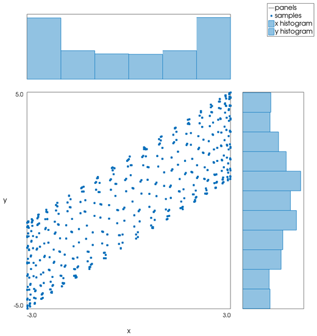
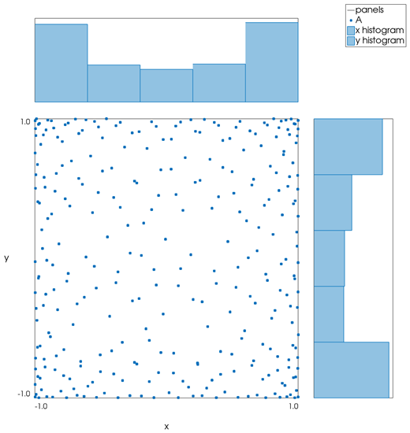
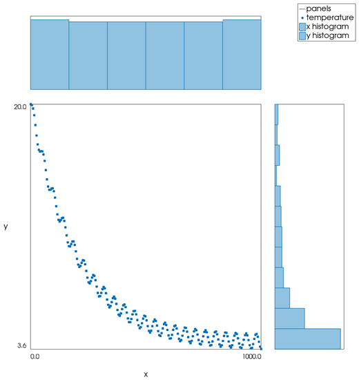

```@meta
CurrentModule = InteractiveGMT
```

# marginalhist — Scatter Plot with Marginal Histograms

The **marginalhist** icon on the X,Y Plot tool's gallery row draws the **selected series** as a
**scatter plot** of its X against its Y, with the **histogram of X** above it and the **histogram of
Y** on its right. The plot goes on a **new page**; the series it was made from stays as it was. It
follows GMT.jl's `marginalhist` (MATLAB calls this a scatter histogram chart).

## Syntax

Draw the points as a series, select it in the Object Manager, then click **marginalhist**:

```julia
p = plot(x, y)
```

## Description

- The points `(x, y)` of the selected series are drawn as dots in the main, square panel. A point
  with a coordinate that is not finite is left out. The series needs two or more points.
- Above the main panel, the histogram of the X values, with its bars rising upwards; on its right,
  the histogram of the Y values, with its bars pointing to the right. The tallest bar of each fills
  95 % of its margin panel. The number of bins follows the Freedman–Diaconis rule (bin width
  `2·IQR·n^(-1/3)`), as the **histogram** icon does.
- X and Y each span their range, from the minimum to the maximum rounded out to round numbers; a
  histogram shares the range of the scatter it stands beside. The two ranges are written along the
  bottom and the left side of the main panel, whose axes are titled `x` and `y`.
- The page is square and has no X,Y axes of its own. In the Object Manager the panel outlines are
  one row (`panels`), the dots another (named after the series), and `x histogram` and
  `y histogram` the margins.

GMT.jl's `marginalhist` bins the points into hexagons above 2000 points; here they are always drawn
as dots.

## Running the Examples

Paste each example into the iGMT window's **Julia console**, or into the Julia REPL after
`using InteractiveGMT`. The series a `plot` call draws last is the selected one, so click
**marginalhist** on the gallery row right after it; to use another series, click its row in the
Object Manager first.

## Examples

### Create Scatter Plot with Marginal Histograms

Five hundred points of two related quantities.

```julia
k = 1:500
x = 3 .* sin.(k)
y = x .+ 2 .* cos.(2.3 .* k)
p = plot(x, y; ls=:none, marker=:circle, legend="samples")
```



### Choose the Series

Two series on the page: the last one drawn, `B`, is the selected one. Click `A` in the Object
Manager before the icon to draw its histograms instead.

```julia
k = 1:300
p = plot(sin.(1.1 .* k), cos.(0.7 .* k); ls=:none, marker=:circle, legend="A")
plot!(p, 2 .+ sin.(k) .^ 3, 0.5 .* k ./ 300 .+ 0.3 .* sin.(2.9 .* k); ls=:none, marker=:circle, legend="B")
```



### Marginal Histograms of a Table

A table drawn with `plot` is its second column against its first: those are the scatter's Y and X.

```julia
depth = range(0, 1000; length=200)
temp  = 4 .+ 16 .* exp.(-depth ./ 200) .+ 0.5 .* sin.(depth ./ 7)
D = mat2ds([depth temp], colnames=["depth", "temperature"])
p = plot(D)
```



## Input Arguments

**`x` — X values**, the X coordinates of the selected series' points.

**`y` — Y values**, the Y coordinates of the selected series' points, one per X.

## See Also

[cornerplot — Corner Plot](@ref) · [rose — Rose Diagram](@ref) · [plot — 2-D Line Plot](@ref) ·
[X,Y Plot Tool](40-xyplot.md)
