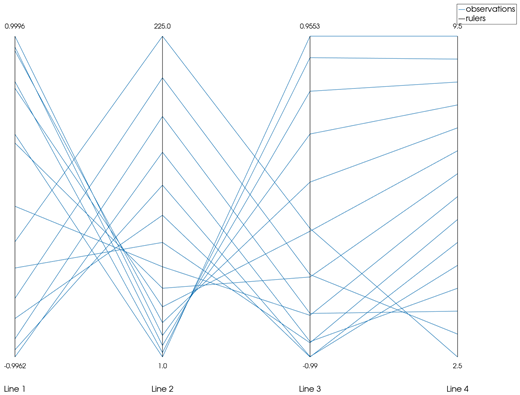
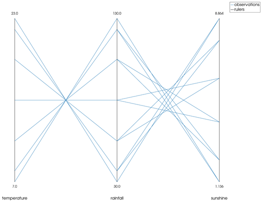
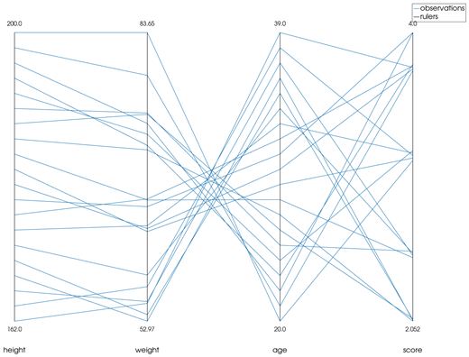

```@meta
CurrentModule = InteractiveGMT
```

# parallelplot — Parallel Coordinates Plot

The **parallelplot** icon on the X,Y Plot tool's gallery row draws the series of the current page
as a **parallel coordinates plot**: each series is one **variable**, with its own vertical ruler, and
each **observation** (the series' values at the same position) is a line joining its values across
the rulers. The plot goes on a **new page**; the series it was made from stay as they were. It
follows GMT.jl's `parallelplot` with its `normalize="range"`.

## Syntax

Draw one series per variable, then click **parallelplot**:

```julia
p = plot(x, v1; legend="name1")
plot!(p, x, v2; legend="name2")    # more variables: one per series
p = plot(D; multicol=true)         # a table: one variable per column after the first
```

## Description

- Each series of the page is one variable; only its **Y values** are used. A series with fewer than
  two values is left out. There must be two or more variables.
- The observations are the rows of the variables put side by side: the series are cut to the length
  of the shortest one, and a row with any value that is not finite (`NaN`, `Inf`) is left out.
- Each variable is scaled to its own range: its minimum sits at the bottom of its ruler and its
  maximum at the top (GMT.jl's `normalizeArray` with `"range"`).
- The rulers stand side by side, in the order of the series, each labelled with its maximum above
  it, its minimum below it, and the variable's name (the series' name) under that.
- All the observation lines are one series, `observations`, in one colour; the rulers are another,
  `rulers`.
- The page has no X,Y axes of its own.

## Running the Examples

Paste each example into the iGMT window's **Julia console**, or into the Julia REPL after
`using InteractiveGMT`, then click **parallelplot** on the gallery row. The icon uses every series
of the page, so no series needs to be selected.

## Examples

### Create Parallel Coordinates Plot

A matrix whose first column is X: with `multicol=true` each further column is a series, here
`Line 1` to `Line 4`, and each becomes one ruler.

```julia
k = 1:15
M = [k  sin.(0.4 .* k)  k .^ 2  cos.(0.3 .* k)  10 .- 0.5 .* k]
p = plot(M; multicol=true)
```



### Name the Variables

A table's column names name the series, and so the rulers.

```julia
month = 1:12
temp  = 15 .+ 8 .* sin.(2π .* (month .- 4) ./ 12)
rain  = 80 .- 50 .* sin.(2π .* (month .- 4) ./ 12)
sun   = 5 .+ 4 .* sin.(2π .* (month .- 3.5) ./ 12)
D = mat2ds([month temp rain sun], colnames=["month", "temperature", "rainfall", "sunshine"])
p = plot(D; multicol=true)
```



### Build the Variables One by One

Each `plot!` adds one variable. The rulers keep the order in which the series were drawn.

```julia
x = 1:20
p = plot(x, 160 .+ 2 .* x;              legend="height")
plot!(p, x, 50 .+ 1.5 .* x .+ 4 .* sin.(x); legend="weight")
plot!(p, x, 40 .- x;                    legend="age")
plot!(p, x, 3 .+ cos.(0.7 .* x);        legend="score")
```



## Input Arguments

**`v1`, `v2`, ... — the variables**, the Y values of the series of the page, one series per
variable; the values at the same position form one observation.

## See Also

[radar — Radar (Spider) Chart](@ref) · [cornerplot — Corner Plot](@ref) ·
[biplot — Principal Component Biplot](@ref) · [plot — 2-D Line Plot](@ref) ·
[X,Y Plot Tool](40-xyplot.md)
