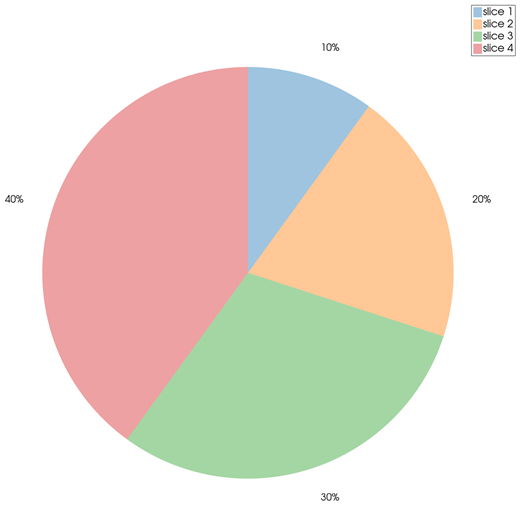
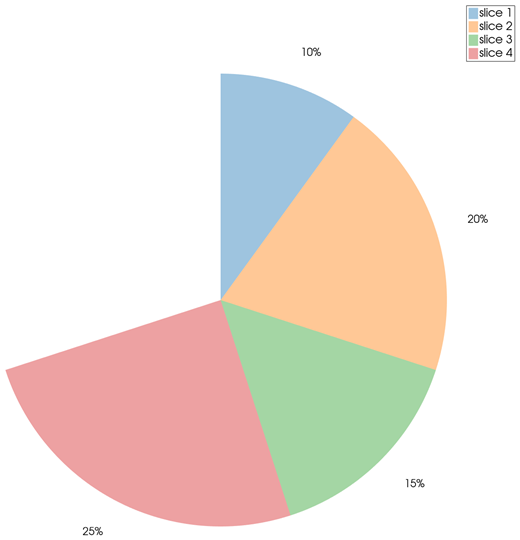
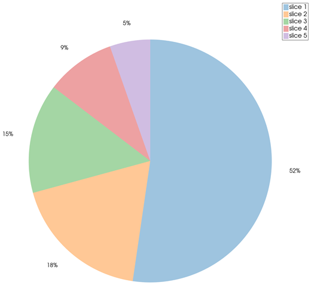

```@meta
CurrentModule = InteractiveGMT
```

# piechart — Pie Chart

The **piechart** icon on the X,Y Plot tool's gallery row draws the Y values of the **selected series**
as the slices of a **pie**, each labelled with its percentage. The pie goes on a **new page**; the
series it was made from stays as it was. It follows GMT.jl's `piechart`.

## Syntax

Draw the values as a curve, select it in the Object Manager, then click **piechart**:

```julia
p = plot(data)
```

## Description

- Each value of the selected series is one slice. The slices start at 12 o'clock and go clockwise,
  in the order of the values, each in the next colour of the palette.
- When the values add up to **1 or more**, they are normalized: each slice is its share of the
  total, and the pie is whole.
- When they add up to **less than 1**, each value is taken as a fraction of the whole circle as it
  is, and the pie is **partial** — the missing part shows what is left.
- Each slice is labelled outside the pie with its percentage, rounded to a whole number.
- Values must not be negative. A zero value gives no slice.
- Each slice is its own row in the Object Manager (`slice 1`, `slice 2`, ...), with its own colour.

## Running the Examples

Paste each example into the iGMT window's **Julia console**, or into the Julia REPL after
`using InteractiveGMT`. The series a `plot` call draws is the selected one, so click **piechart** on
the gallery row right after it.

## Examples

### Create Pie Chart

```julia
data = [1, 2, 3, 4]
p = plot(data)
```



### Create Partial Pie Chart

These values add up to 0.7, less than 1: the pie shows 70 % of a circle.

```julia
data = [0.1, 0.2, 0.15, 0.25]
p = plot(data)
```



### Pie of a Table's Column

Open a table, or draw one, and select the column to chart in the Object Manager.

```julia
D = mat2ds([1 340; 2 120; 3 95; 4 60; 5 35], colnames=["region", "sales"])
p = plot(D)
```



## Input Arguments

**`data` — the slice values**, the Y values of the selected series: non-negative numbers, one per
slice.

## See Also

[donutchart — Donut Chart](@ref) · [plot — 2-D Line Plot](@ref) · [X,Y Plot Tool](40-xyplot.md)
