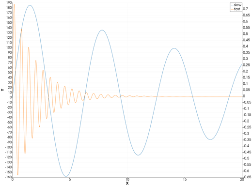
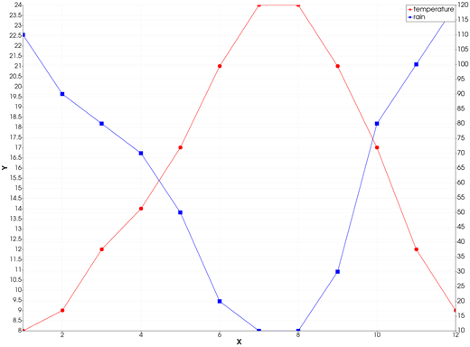
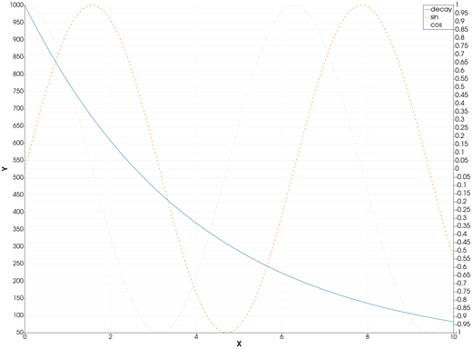

```@meta
CurrentModule = InteractiveGMT
```

# plotyy — Plot with Two Y Axes

The **plotyy** icon on the X,Y Plot tool's gallery row draws the current page with **two Y axes**: the
page's first curve on the **left** Y axis, and every other curve on a **right** Y axis with its own
range. Two quantities in different units, or of very different sizes, then share one X axis and are
both read at full scale.

## Syntax

Draw two curves (or more) on one page, then click **plotyy**:

```julia
p = plot(x, y1)       # the left Y axis
plot!(p, x, y2)       # the right Y axis
plot!(p, x, y3)       # also the right Y axis
```

## Description

- The page's **first** series is drawn against the left Y axis; the second and every further series
  against the right one.
- Each axis is fitted to the curves it carries. The X axis is shared.
- Every series is drawn as a line, with its colour, width, style, markers and name.
- The page needs at least two curves: with fewer, the icon says *"plotyy needs two curves on this
  page."* and changes nothing.

### The plotyy icon

Clicking **plotyy** re-plots every series of the current page as lines, the first on the left axis
and the others on the right, whatever type they were drawn in before. The axes go back to linear and
are re-fitted. The icon acts on the page and needs no series selected. The **plot** icon puts every
curve back on the one left axis.

## Running the Examples

Paste each example into the iGMT window's **Julia console**, or into the Julia REPL after
`using InteractiveGMT`, then click **plotyy** on the gallery row.

## Examples

### Create Chart with Two Y Axes

Two damped oscillations of very different amplitudes: on one axis the second would be a flat line.

```julia
x = range(0, 20; length=1000)
y1 = 200 .* exp.(-0.05 .* x) .* sin.(x)
y2 = 0.8 .* exp.(-0.5 .* x) .* sin.(10 .* x)
p = plot(x, y1; legend="slow")
plot!(p, x, y2; legend="fast")
```



### Plot Two Quantities in Different Units

Temperature (°C) on the left, rainfall (mm) on the right.

```julia
x = 1:12
p = plot(x, [8, 9, 12, 14, 17, 21, 24, 24, 21, 17, 12, 9]; legend="temperature", lc=:red, marker=:circle)
plot!(p, x, [110, 90, 80, 70, 50, 20, 10, 10, 30, 80, 100, 120]; legend="rain", lc=:blue, marker=:square)
```



### Put Several Curves on the Right Axis

The first curve is on the left axis, the next two share the right one.

```julia
t = range(0, 10; length=300)
p = plot(t, 1000 .* exp.(-t ./ 4); legend="decay")
plot!(p, t, sin.(t); legend="sin", ls=:dash)
plot!(p, t, cos.(t); legend="cos", ls=:dot)
```



## Input Arguments

**`x` — X values**, shared by the curves, as in [`plot`](@ref).

**`y1` — the left-axis curve**, the page's first series.

**`y2`, `y3`, … — the right-axis curves**, the page's further series.

## Keywords

The keywords of [`plot`](@ref), for each curve.

## See Also

[plot — 2-D Line Plot](@ref) · [fill_between — Fill Between Two Curves](@ref) ·
[X,Y Plot Tool](40-xyplot.md)
