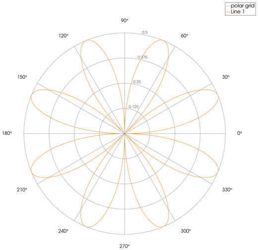
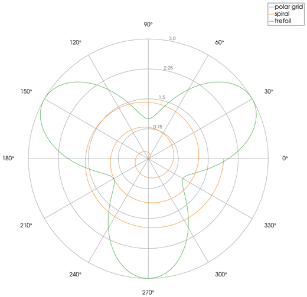
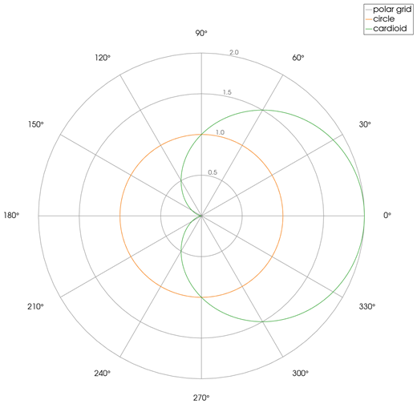

```@meta
CurrentModule = InteractiveGMT
```

# polarplot — Line Plot on Polar Axes

The **polarplot** icon on the X,Y Plot tool's gallery row draws each series of the current page as a
**line on polar axes**: its X values are the **angle**, in radians, and its Y values the **radius**.
The polar plot goes on a **new page**; the curves it was made from stay as they were.

## Syntax

Draw the angles and radii as curves, then click **polarplot**:

```julia
p = plot(theta, rho)
plot!(p, theta2, rho2)          # more curves: one line each
```

## Description

- Each series of the page becomes one line, joining its points `(θ, ρ)` in order, in its own colour.
- `θ` is in **radians**, counted **counter-clockwise from the +X direction** (0 points right).
- `ρ` is the distance from the centre. A negative radius is drawn at its absolute value.
- The polar axes: circles at a quarter, a half, three quarters and all of the largest radius
  (rounded up to a round number), labelled with their values; spokes and angle labels every 30°.
- The page is square, so circles stay circles, and has no X,Y axes of its own.

Points that are not finite (`NaN`, `Inf`) are left out.

## Running the Examples

Paste each example into the iGMT window's **Julia console**, or into the Julia REPL after
`using InteractiveGMT`, then click **polarplot** on the gallery row.

## Examples

### Create Polar Plot

A four-petal rose: `ρ = sin(2θ) cos(2θ)`.

```julia
theta = 0:0.01:2π
rho = sin.(2 .* theta) .* cos.(2 .* theta)
p = plot(theta, rho)
```



### Plot Several Lines

Each curve of the page is one line of the polar plot.

```julia
theta = range(0, 6π; length=400)
p = plot(theta, theta ./ 10; legend="spiral")
plot!(p, theta, 2 .+ sin.(3 .* theta); legend="trefoil")
```



### Plot a Circle and a Cardioid

```julia
theta = range(0, 2π; length=200)
p = plot(theta, fill(1.0, 200); legend="circle")
plot!(p, theta, 1 .+ cos.(theta); legend="cardioid")
```



## Input Arguments

**`theta` — angles**, in radians, as the series' X values.

**`rho` — radii**, as the series' Y values, one per angle.

## See Also

[polarscatter — Scatter Plot on Polar Axes](@ref) · [compassplot — Arrows from the Origin](@ref) ·
[plot — 2-D Line Plot](@ref) · [X,Y Plot Tool](40-xyplot.md)
