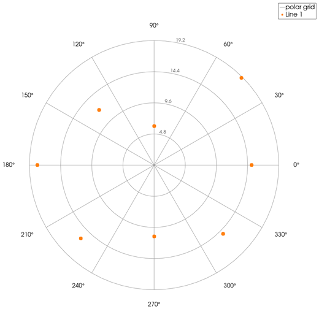
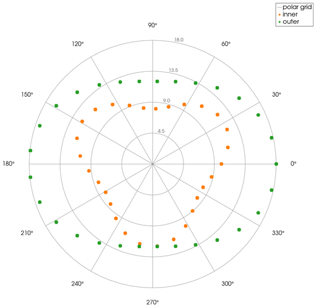
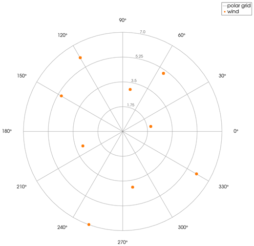

```@meta
CurrentModule = InteractiveGMT
```

# polarscatter — Scatter Plot on Polar Axes

The **polarscatter** icon on the X,Y Plot tool's gallery row draws each series of the current page as
**points on polar axes**: its X values are the **angle**, in radians, and its Y values the **radius**.
The plot goes on a **new page**; the curves it was made from stay as they were.

## Syntax

Draw the angles and radii as curves, then click **polarscatter**:

```julia
p = plot(theta, rho)
plot!(p, theta2, rho2)          # more sets of points
```

## Description

- Each series of the page becomes one set of circle markers at its points `(θ, ρ)`, in its own
  colour, with no line joining them.
- `θ` is in **radians**, counted **counter-clockwise from the +X direction** (0 points right).
- `ρ` is the distance from the centre. A negative radius is drawn at its absolute value.
- The polar axes: circles at a quarter, a half, three quarters and all of the largest radius
  (rounded up to a round number), labelled with their values; spokes and angle labels every 30°.
- The page is square and has no X,Y axes of its own.

Points that are not finite (`NaN`, `Inf`) are left out.

## Running the Examples

Paste each example into the iGMT window's **Julia console**, or into the Julia REPL after
`using InteractiveGMT`, then click **polarscatter** on the gallery row.

## Examples

### Create Polar Scatter Plot

```julia
theta = π/4:π/4:2π
rho = [19, 6, 12, 18, 16, 11, 15, 15]
p = plot(theta, rho)
```



### Plot Two Sets of Points

```julia
theta = range(0, 2π; length=30)
p = plot(theta, 10 .+ 2 .* sin.(3 .* theta); legend="inner")
plot!(p, theta, 15 .+ 3 .* cos.(2 .* theta); legend="outer")
```



### Plot Directions in Degrees

The angles are radians: convert degrees (a wind direction, an azimuth) first. An azimuth counted
clockwise from north becomes `deg2rad(90 - az)`.

```julia
az = [10, 35, 80, 120, 170, 200, 250, 300, 330]     # degrees clockwise from north
speed = [3, 5, 2, 6, 4, 7, 3, 5, 6]
p = plot(deg2rad.(90 .- az), speed; legend="wind")
```



## Input Arguments

**`theta` — angles**, in radians, as the series' X values.

**`rho` — radii**, as the series' Y values, one per angle.

## See Also

[polarplot — Line Plot on Polar Axes](@ref) · [compassplot — Arrows from the Origin](@ref) ·
[bubblechart — Bubble Chart](@ref) · [X,Y Plot Tool](40-xyplot.md)
