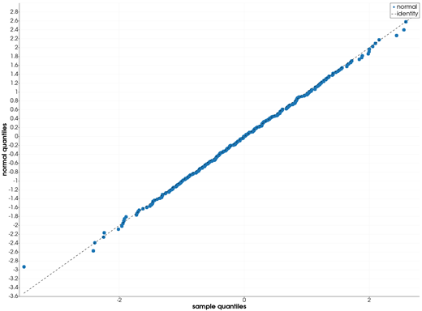
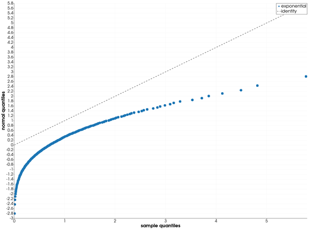
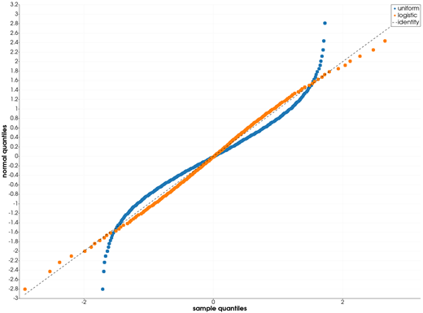

```@meta
CurrentModule = InteractiveGMT
```

# qqnorm — Quantile-Quantile Plot Against the Normal

The **qqnorm** icon on the X,Y Plot tool's gallery row plots the quantiles of the Y values of every
series of the current page against the quantiles of the **standard normal distribution**, with an
identity line for reference. The plot goes on a **new page**; the series it was made from stay as
they were. It follows GMT.jl's `qqnorm` (GMT.jl's `qqplot(x)` with its default `qqline=:identity`),
with the numbers from GMT.jl's own `qqbuild` and `erfinv`.

## Syntax

Draw the samples as curves, then click **qqnorm**:

```julia
p = plot(y)
plot!(p, y2)          # more samples: one set of points each
```

## Description

- Each series of the page is one sample: its **Y values**. Its X values are not used.
- For a sample of `n` values, the sorted values are paired with the standard normal quantiles at the
  probabilities `(i - 0.5)/n`, `i = 1, ..., n`. Each pair is one point: **X** the sample quantile,
  **Y** the normal quantile.
- Each sample's points are drawn as circles, with no line, named after its series, in its own
  colour. The new page is called **qqnorm**, its axes **sample quantiles** and **normal
  quantiles**.
- A dashed black line named `identity` is the line Y = X, drawn from the smallest to the largest
  sample quantile on the page. A **standard normal** sample lies along it. A normal sample with
  another mean or standard deviation lies along another straight line; a sample that is not normal
  bends away from a straight line.
- Values that are not finite (`NaN`, `Inf`) are left out. A series with fewer than two values is
  skipped; if none has two, the icon says so and draws nothing.

## Running the Examples

Paste each example into the iGMT window's **Julia console**, or into the Julia REPL after
`using InteractiveGMT`, then click **qqnorm** on the gallery row. No series needs to be selected:
the icon takes every series of the page.

The examples build their samples without random numbers: `mod.((1:n) .* 0.6180339887, 1)` gives
`n` values spread evenly over (0, 1) in no particular order, and a distribution's inverse CDF turns
them into a sample of that distribution.

## Examples

### Check a Sample for Normality

A standard normal sample, made with the Box–Muller transform from two such sequences: the points
follow the identity line.

```julia
k  = 1:300
u1 = mod.(k .* 0.6180339887, 1)
u2 = mod.(k .* 0.4142135624, 1)
z  = sqrt.(-2 .* log.(u1)) .* cos.(2π .* u2)
p  = plot(z; legend="normal")
```



### A Skewed Sample

An exponential sample is not normal: its points bend away from the line.

```julia
u = mod.((1:200) .* 0.6180339887, 1)
p = plot(-log.(1 .- u); legend="exponential")
```



### Short and Long Tails

Two samples with mean 0 and variance 1. Against the normal, the uniform one's tails are too short and
the logistic one's too long: their points bend away from the line in opposite directions.

```julia
u = mod.((1:200) .* 0.6180339887, 1)
p = plot(sqrt(12) .* (u .- 0.5); legend="uniform")
plot!(p, (sqrt(3) / π) .* log.(u ./ (1 .- u)); legend="logistic")
```



## Input Arguments

**`y` — sample**, the Y values of a series: at least two finite numbers.

## See Also

[qqplot — Quantile-Quantile Plot](@ref) · [ecdfplot — Empirical Cumulative Distribution Plot](@ref) ·
[density — Kernel Density Estimate](@ref) · [plot — 2-D Line Plot](@ref) · [X,Y Plot Tool](40-xyplot.md)
