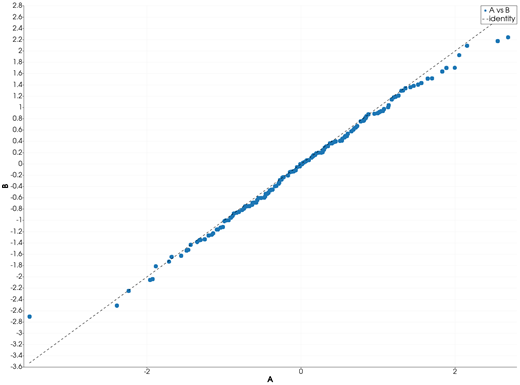
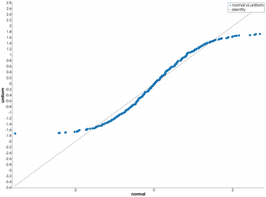
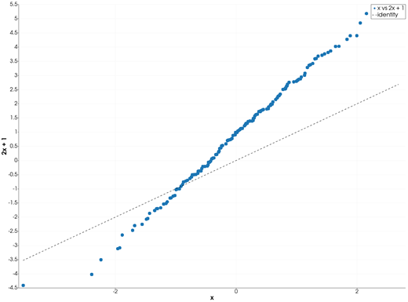

```@meta
CurrentModule = InteractiveGMT
```

# qqplot — Quantile-Quantile Plot

The **qqplot** icon on the X,Y Plot tool's gallery row plots the quantiles of the **first two
series** of the current page against each other, with an identity line for reference. The plot
goes on a **new page**; the series it was made from stay as they were. It follows GMT.jl's
`qqplot(x, y)` with its default `qqline=:identity`, with the numbers from GMT.jl's own `qqbuild`.

## Syntax

Draw the two samples as curves, then click **qqplot**:

```julia
p = plot(x)
plot!(p, y)
```

## Description

- The first series of the page is the sample `x`, the second the sample `y`: their **Y values**.
  Their X values are not used, and any further series of the page is ignored.
- With `n` the length of the shorter sample, both samples' quantiles are taken at the `n`
  probabilities `0, 1/(n-1), 2/(n-1), ..., 1` — from each sample's minimum to its maximum — with
  Julia's `quantile` (linear interpolation between the sorted values). The samples need not be the
  same length.
- Each pair of quantiles is one point, **X** from `x` and **Y** from `y`, drawn as circles with no
  line, in one series named `"<x> vs <y>"`. The new page is called **qqplot**, and its axes are
  titled with the two series' names.
- A dashed black line named `identity` is the line Y = X, drawn from the smallest to the largest
  quantile of `x`. Two samples of the **same distribution** lie along it. If they differ only in
  location and scale, the points lie along another straight line.
- Values that are not finite (`NaN`, `Inf`) are left out. A series with fewer than two values is
  skipped, and the next one takes its place. With fewer than two such series on the page, the icon
  says so and draws nothing.

## Running the Examples

Paste each example into the iGMT window's **Julia console**, or into the Julia REPL after
`using InteractiveGMT`, then click **qqplot** on the gallery row. No series needs to be selected:
the icon takes the page's first two series.

The examples build their samples without random numbers: two sequences such as
`mod.(k .* 0.6180339887, 1)` give values spread evenly over (0, 1) in no particular order, and the
Box–Muller transform turns a pair of them into a standard normal sample.

## Examples

### Compare Two Samples of the Same Distribution

Two normal samples, of 300 and 150 values: the points follow the identity line.

```julia
k  = 1:450
u1 = mod.(k .* 0.6180339887, 1)
u2 = mod.(k .* 0.4142135624, 1)
z  = sqrt.(-2 .* log.(u1)) .* cos.(2π .* u2)
p  = plot(z[1:300]; legend="A")
plot!(p, z[301:450]; legend="B")
```



### Compare Two Different Distributions

A normal sample against a uniform one, both of mean 0 and variance 1: the points bend away from the
line at both ends, where the uniform sample has no tails.

```julia
k  = 1:300
u1 = mod.(k .* 0.6180339887, 1)
u2 = mod.(k .* 0.4142135624, 1)
z  = sqrt.(-2 .* log.(u1)) .* cos.(2π .* u2)
p  = plot(z; legend="normal")
plot!(p, sqrt(12) .* (u2 .- 0.5); legend="uniform")
```



### Same Shape, Other Location and Scale

The second sample is the same distribution as the first, shifted by 1 and stretched by 2: the
points lie along the line Y = 2X + 1, not along the identity.

```julia
k  = 1:450
u1 = mod.(k .* 0.6180339887, 1)
u2 = mod.(k .* 0.4142135624, 1)
z  = sqrt.(-2 .* log.(u1)) .* cos.(2π .* u2)
p  = plot(z[1:300]; legend="x")
plot!(p, 1 .+ 2 .* z[301:450]; legend="2x + 1")
```



## Input Arguments

**`x` — first sample**, the Y values of the page's first series: at least two finite numbers.

**`y` — second sample**, the Y values of the page's second series: at least two finite numbers.

## See Also

[qqnorm — Quantile-Quantile Plot Against the Normal](@ref) ·
[ecdfplot — Empirical Cumulative Distribution Plot](@ref) · [plot — 2-D Line Plot](@ref) ·
[X,Y Plot Tool](40-xyplot.md)
