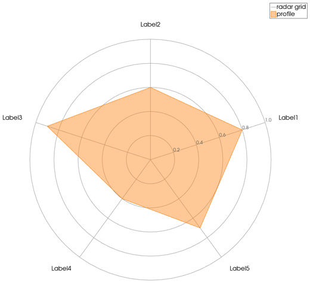
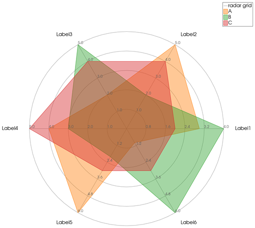
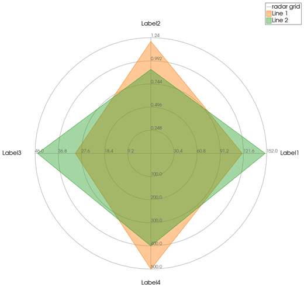

```@meta
CurrentModule = InteractiveGMT
```

# radar — Radar (Spider) Chart

The **radar** icon on the X,Y Plot tool's gallery row draws each series of the current page as one
**filled polygon on a radar (spider) chart**: the series' Y values are its values along the
**spokes**, one spoke per point. The chart goes on a **new page**; the series it was made from stay
as they were. It follows GMT.jl's `radar`, where each row of the data is one polygon and each column
one axis: here a row is a series of the page and its points are the axes.

## Syntax

Draw one series per polygon, all with the same number of points, then click **radar**:

```julia
p = plot(values)
plot!(p, values2)               # more polygons: one per series
p = plot(1:n, V; multicol=true) # V an n x m matrix: one polygon per column
```

## Description

- Each series of the page becomes one filled polygon, in its own colour, named after the series in
  the Object Manager. Only the **Y values** are used; X plays no part.
- Every series must have the **same number of points**, at least **3**: that number is the number
  of spokes. A series with fewer than 3 points is left out.
- The spokes are spread evenly around the circle, the first one pointing to the right (+X) and the
  next ones counter-clockwise. With **5** spokes the first one is turned by 18°, so that the second
  points straight up, as GMT.jl's `radar` does.
- **Normalized data**: when every value is between 0 and 1, all spokes share that 0–1 scale.
  Otherwise each spoke has its **own scale**, from 0 to the largest value of that spoke over all the
  series, rounded up to a round number.
- Rings at 0.2, 0.4, 0.6, 0.8 and 1 of each spoke's scale, labelled with their values: along the
  first spoke only for normalized data, along every spoke otherwise.
- The spokes are labelled `Label1`, `Label2`, ..., GMT.jl's default axis names. They cannot be
  renamed from the series.
- The page is square, so the rings stay circles, and has no X,Y axes of its own. The rings and
  spokes are one row in the Object Manager, `radar grid`.

## Running the Examples

Paste each example into the iGMT window's **Julia console**, or into the Julia REPL after
`using InteractiveGMT`, then click **radar** on the gallery row. The icon uses every series of the
page, so no series needs to be selected.

## Examples

### Create Radar Chart

Five values between 0 and 1: one pentagon, on a 0–1 scale shared by all spokes.

```julia
p = plot([0.8, 0.6, 0.9, 0.4, 0.7]; legend="profile")
```



### Compare Several Series

Three series of six values each, one polygon per series. The values are not between 0 and 1, so each
spoke is scaled to its own largest value.

```julia
x = 1:6
p = plot(x, [3, 5, 2, 4, 6, 1]; legend="A")
plot!(p, x, [4, 2, 5, 3, 2, 6]; legend="B")
plot!(p, x, [2, 4, 4, 5, 3, 3]; legend="C")
```



### Radar Chart of Quantities in Different Units

Each row of the matrix is one spoke and each column one polygon (`multicol=true` draws every column
as its own series). The rows are in different units — a speed, a mass, a price, a range — and each
spoke is labelled in its own scale.

```julia
V = [120  150
     1.2  0.9
      30   45
     500  400]
p = plot(1:4, V; multicol=true)
```



## Input Arguments

**`values` — the spoke values**, the Y values of each series of the page: one per spoke, the same
number (3 or more) in every series.

## See Also

[polarplot — Line Plot on Polar Axes](@ref) · [parallelplot — Parallel Coordinates Plot](@ref) ·
[rose — Rose Diagram](@ref) · [plot — 2-D Line Plot](@ref) · [X,Y Plot Tool](40-xyplot.md)
