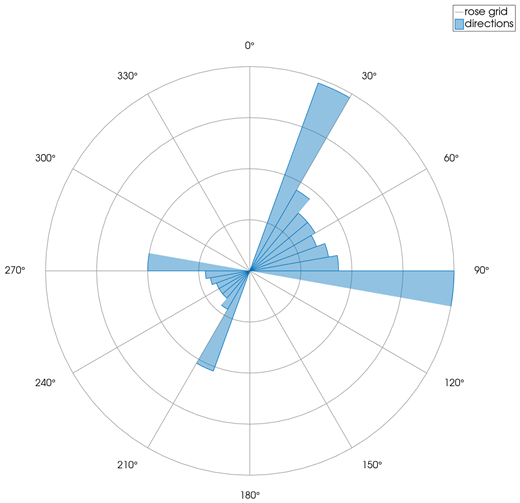
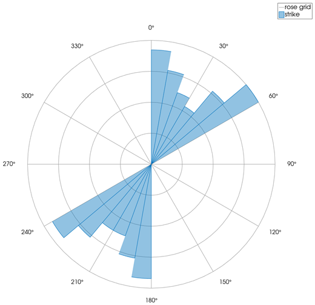
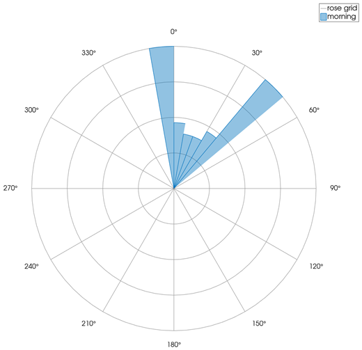

```@meta
CurrentModule = InteractiveGMT
```

# rose — Rose Diagram

The **rose** icon on the X,Y Plot tool's gallery row draws the Y values of the **selected series**
as **azimuths**, in degrees, and counts them in **10° sectors** around the circle: a **rose
diagram**, the angular histogram of the directions. The rose goes on a **new page**; the series it
was made from stays as it was. It follows GMT's `rose` (GMT.jl's `rose`, with 10° sectors drawn as
a rose and normalized lengths).

## Syntax

Draw the azimuths as a curve, select it in the Object Manager, then click **rose**:

```julia
p = plot(azimuths)
```

## Description

- The Y values of the selected series are the azimuths, in **degrees**, counted **clockwise from
  north** (0° points up, 90° to the right). X plays no part.
- Values outside 0–360 are wrapped into it (`mod(az, 360)`). Values that are not finite are left
  out. The series needs two or more values.
- The azimuths are counted in 36 sectors of 10°, from 0°, with GMT.jl's own histogram binning
  (`hst_floats`).
- Each sector is a filled wedge whose length is its count divided by the count of the **largest
  sector**: the fullest sector reaches the outer circle.
- The frame: circles at a quarter, a half, three quarters and all of the largest sector; spokes and
  angle labels every 30°, clockwise from north.
- The page is square and has no X,Y axes of its own. The wedges are one row in the Object Manager,
  named after the series; the circles and spokes are another, `rose grid`.

## Running the Examples

Paste each example into the iGMT window's **Julia console**, or into the Julia REPL after
`using InteractiveGMT`. The series a `plot` call draws last is the selected one, so click **rose** on
the gallery row right after it; to make the rose of another series, click its row in the Object
Manager first.

## Examples

### Create Rose Diagram

Three hundred directions in two lobes, around 60° and around 240°.

```julia
k = 1:300
az = mod.(60 .+ 40 .* sin.(k) .+ 180 .* (k .% 3 .== 0), 360)
p = plot(az; legend="directions")
```



### Rose of a Table's Column

The second column of the table is the series drawn, so it is the one the rose counts.

```julia
k = 1:120
strike = mod.(30 .+ 25 .* sin.(1.7 .* k) .+ 180 .* (k .% 2), 360)
D = mat2ds([k strike], colnames=["sample", "strike"])
p = plot(D)
```



### Choose the Series

Two series on the page: the last one drawn, `afternoon`, is the selected one. Click `morning` in the
Object Manager before the icon to make its rose instead.

```julia
k = 1:200
p = plot(mod.(20 .+ 30 .* sin.(k), 360); legend="morning")
plot!(p, mod.(200 .+ 50 .* cos.(1.3 .* k), 360); legend="afternoon")
```



## Input Arguments

**`azimuths` — the directions**, the Y values of the selected series, in degrees clockwise from
north.

## See Also

[polarplot — Line Plot on Polar Axes](@ref) · [radar — Radar (Spider) Chart](@ref) ·
[piechart — Pie Chart](@ref) · [plot — 2-D Line Plot](@ref) · [X,Y Plot Tool](40-xyplot.md)
