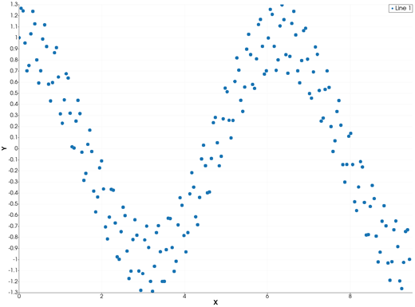
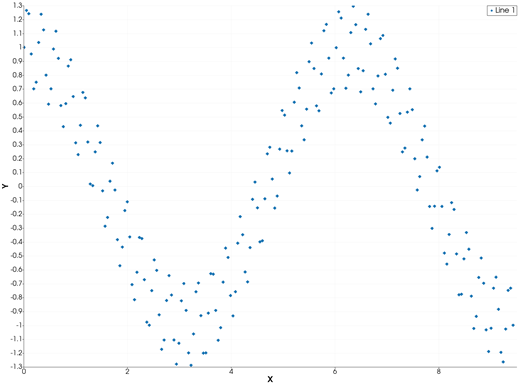
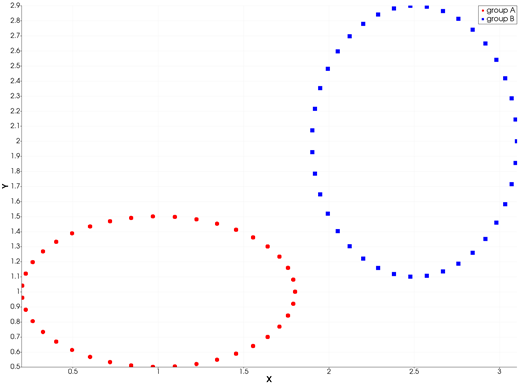
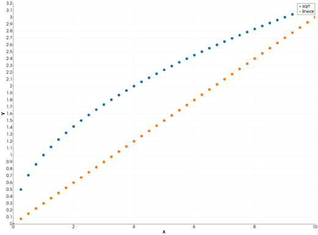

```@meta
CurrentModule = InteractiveGMT
```

# scatter — Scatter Plot

The **scatter** icon on the X,Y Plot tool's gallery row re-plots each series of the current page as a
**scatter plot**: a marker at every point, and no line joining them. There is no X,Y `scatter`
function in iGMT: draw the data with [`plot`](@ref) and [`plot!`](@ref), then click **scatter**.

## Syntax

Draw the data, then click **scatter**:

```julia
p = plot(x, y)
p = plot(x, y; marker=:diamond, ms="5p")   # the marker the points get
plot!(p, x2, y2)                           # more series: one set of points each
```

## Description

- Each point `(x, y)` of a series is one marker, in the series' colour. The points are not joined.
- The marker is the series' own (`marker=...`: circle, square, diamond, cross, plus); a series with
  no marker gets **circles**. `ms` sets their size.
- The axes are linear and re-fitted to the data.

### The scatter icon

Clicking **scatter** acts on the whole current page and needs no series selected. Each series keeps
its data, name, colour and style. Any log axis goes back to linear. Click **plot** to go back to
lines.

A marker size per point is a different plot: a vector `ms` draws the series as bubbles, see
[bubblechart — Bubble Chart](@ref).

## Running the Examples

Paste each example into the iGMT window's **Julia console**, or into the Julia REPL after
`using InteractiveGMT`, then click **scatter** on the gallery row. Each one is complete on its own
and draws a new page of the X,Y Plot window.

## Examples

### Create Scatter Plot

Two hundred points along a cosine, with a fast ripple on top.

```julia
x = range(0, 3π; length=200)
y = cos.(x) .+ 0.3 .* sin.(23 .* x)
p = plot(x, y)
```



### Change the Marker

Small diamonds instead of circles.

```julia
x = range(0, 3π; length=200)
y = cos.(x) .+ 0.3 .* sin.(23 .* x)
p = plot(x, y; marker=:diamond, ms="4p")
```



### Plot Two Groups

Two series, two colours, a legend for each.

```julia
t = range(0, 2π; length=40)
p = plot(1 .+ 0.8 .* cos.(t), 1 .+ 0.5 .* sin.(t); legend="group A", lc=:red)
plot!(p, 2.5 .+ 0.6 .* cos.(t), 2 .+ 0.9 .* sin.(t); legend="group B", lc=:blue, marker=:square, ms="5p")
```



### Scatter the Columns of a Table

A `GMTdataset` with `multicol=true`: every column after the first is one series of points, named
after its column.

```julia
x = 0:0.25:10
D = mat2ds([x sqrt.(x) 0.3 .* x], colnames=["x", "sqrt", "linear"])
p = plot(D; multicol=true)
```



## Input Arguments

**`x`, `y` — the points**, as in [`plot`](@ref).

## Keywords

There are no keywords of its own: the points' look comes from [`plot`](@ref)'s keywords.

| Keyword | Values | Default |
|---------|--------|---------|
| `lc`, `linecolor`, `mc` | the markers' colour | next palette colour |
| `marker`, `shape` | `:circle`, `:square`, `:diamond`, `:cross`, `:plus` | `:circle` |
| `ms`, `markersize` | marker size, cm or a string with its unit (one number: a vector draws bubbles) | tool default |
| `legend` | the series' name | `"Line n"` |

## See Also

[plot — 2-D Line Plot](@ref) · [stem — Stem Plot of Discrete Data](@ref) ·
[bubblechart — Bubble Chart](@ref) · [X,Y Plot Tool](40-xyplot.md)
