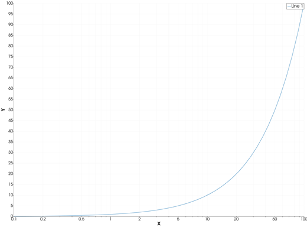
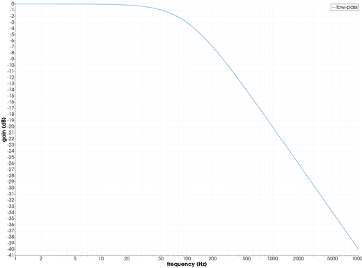
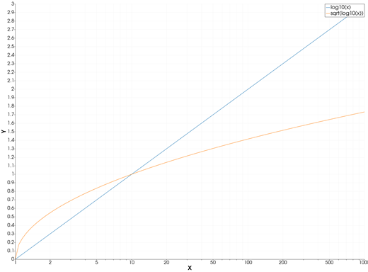
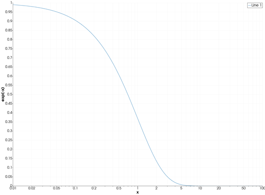

```@meta
CurrentModule = InteractiveGMT
```

# semilogx — Semilog Plot (X Axis Logarithmic)

The **semilogx** icon on the X,Y Plot tool's gallery row re-plots each series of the current page as a
line, with a **base-10 logarithmic X axis** and a linear Y axis. From Julia, the same axes are set
with [`plot`](@ref)'s GMT.jl keyword `proj=:logx`, or with [`logscale!`](@ref).

## Syntax

Draw the data, then click **semilogx**:

```julia
p = plot(x, y)
plot!(p, x, y2)                  # more lines
```

Or set the log axis from Julia:

```julia
p = plot(x, y; proj=:logx)
logscale!(p; x=true)             # on an open page
logscale!(p; x=false)            # back to linear
```

## Description

- Every series of the page is drawn as a line, whatever type it was before (bars, area, stems, ...),
  keeping its data, name, colour and style.
- The X axis is logarithmic, base 10; the Y axis is linear. The axes are re-fitted to the data.
- `x` must be **positive**: a logarithmic axis has no zero and no negative values.

### The semilogx icon

Clicking **semilogx** acts on the whole current page and needs no series selected. It also puts the
Y axis back to linear, if it was logarithmic. The **plot** icon puts both axes back to linear; the
**semilogy** and **loglog** icons set the others.

`proj=:logx` is a keyword of `plot` only: `plot!` adds lines to a page and leaves its axes as they
are.

## Running the Examples

Paste each example into the iGMT window's **Julia console**, or into the Julia REPL after
`using InteractiveGMT`, then click **semilogx** on the gallery row (the last example needs no click).
Each one is complete on its own and draws a new page of the X,Y Plot window.

## Examples

### Create Semilog Plot

Fifty values from 0.1 to 100, equally spaced on a log scale, plotted against themselves: the line
bends, because only X is logarithmic.

```julia
x = 10 .^ range(-1, 2; length=50)
p = plot(x, x)
```



### Plot a Frequency Response

The gain, in decibels, of a first-order low-pass filter with its corner at 100 Hz.

```julia
f = 10 .^ range(0, 4; length=200)
gain = -10 .* log10.(1 .+ (f ./ 100) .^ 2)
p = plot(f, gain; xlabel="frequency (Hz)", ylabel="gain (dB)", legend="low-pass")
```



### Plot Several Lines

Each line keeps its own colour and legend.

```julia
x = 10 .^ range(0, 3; length=100)
p = plot(x, log10.(x); legend="log10(x)")
plot!(p, x, sqrt.(log10.(x)); legend="sqrt(log10(x))")
```



### Set the Log Axis from Julia

GMT.jl's `proj=:logx` draws the page on a log X axis at once, with no click.

```julia
x = 10 .^ range(-2, 2; length=120)
p = plot(x, exp.(-x); proj=:logx, xlabel="x", ylabel="exp(-x)")
```



## Input Arguments

**`x` — X values**, a vector of positive numbers.

**`y` — Y values**, as in [`plot`](@ref).

## Keywords

| Keyword | Values | Default |
|---------|--------|---------|
| `proj`, `J` | `:logx` (log X), `:logy` (log Y), `:loglog` (both), `:linear` (`plot` only) | linear |
| `lc`, `lw`, `ls`, `pen`, `marker`, `ms`, `legend` | the line, as in [`plot`](@ref) | |

## See Also

[semilogy — Semilog Plot (Y Axis Logarithmic)](@ref) · [loglog — Log-Log Plot](@ref) ·
[plot — 2-D Line Plot](@ref) · [`logscale!`](@ref) · [X,Y Plot Tool](40-xyplot.md)
