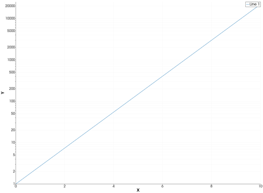
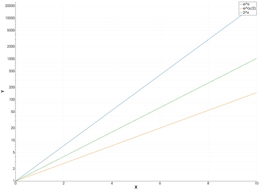
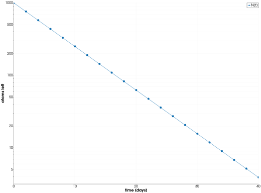
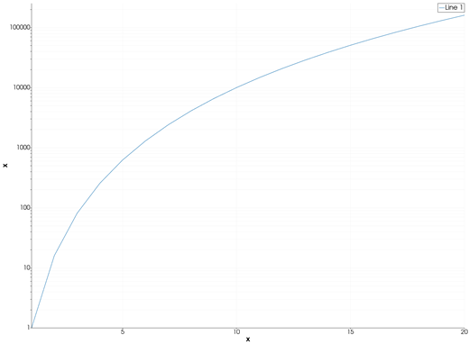

```@meta
CurrentModule = InteractiveGMT
```

# semilogy — Semilog Plot (Y Axis Logarithmic)

The **semilogy** icon on the X,Y Plot tool's gallery row re-plots each series of the current page as a
line, with a linear X axis and a **base-10 logarithmic Y axis**. From Julia, the same axes are set
with [`plot`](@ref)'s GMT.jl keyword `proj=:logy`, or with [`logscale!`](@ref).

## Syntax

Draw the data, then click **semilogy**:

```julia
p = plot(x, y)
plot!(p, x, y2)                  # more lines
```

Or set the log axis from Julia:

```julia
p = plot(x, y; proj=:logy)
logscale!(p; y=true)             # on an open page
logscale!(p; y=false)            # back to linear
```

## Description

- Every series of the page is drawn as a line, whatever type it was before (bars, area, stems, ...),
  keeping its data, name, colour and style.
- The X axis is linear; the Y axis is logarithmic, base 10. The axes are re-fitted to the data.
- `y` must be **positive**: a logarithmic axis has no zero and no negative values.

An exponential, `y = a·bˣ`, is a straight line on these axes.

### The semilogy icon

Clicking **semilogy** acts on the whole current page and needs no series selected. It also puts the
X axis back to linear, if it was logarithmic. The **plot** icon puts both axes back to linear; the
**semilogx** and **loglog** icons set the others.

`proj=:logy` is a keyword of `plot` only: `plot!` adds lines to a page and leaves its axes as they
are.

## Running the Examples

Paste each example into the iGMT window's **Julia console**, or into the Julia REPL after
`using InteractiveGMT`, then click **semilogy** on the gallery row (the last example needs no click).
Each one is complete on its own and draws a new page of the X,Y Plot window.

## Examples

### Create Semilog Plot

The exponential `eˣ` from 0 to 10: a straight line on a log Y axis.

```julia
x = 0:0.1:10
p = plot(x, exp.(x))
```



### Plot Several Lines

Three growth rates; each is a straight line with its own slope.

```julia
x = 0:0.1:10
p = plot(x, exp.(x); legend="e^x")
plot!(p, x, exp.(x ./ 2); legend="e^(x/2)")
plot!(p, x, 2 .^ x; legend="2^x")
```



### Plot a Decay Curve

Radioactive decay with a half-life of 5 days, with markers at the measurements.

```julia
t = 0:2:40
N = 1000 .* 0.5 .^ (t ./ 5)
p = plot(t, N; marker=:circle, ms="5p", xlabel="time (days)", ylabel="atoms left", legend="N(t)")
```



### Set the Log Axis from Julia

GMT.jl's `proj=:logy` draws the page on a log Y axis at once, with no click.

```julia
x = 1:20
p = plot(x, x .^ 4; proj=:logy, xlabel="x", ylabel="x⁴")
```



## Input Arguments

**`x` — X values**, as in [`plot`](@ref).

**`y` — Y values**, a vector of positive numbers.

## Keywords

| Keyword | Values | Default |
|---------|--------|---------|
| `proj`, `J` | `:logx` (log X), `:logy` (log Y), `:loglog` (both), `:linear` (`plot` only) | linear |
| `lc`, `lw`, `ls`, `pen`, `marker`, `ms`, `legend` | the line, as in [`plot`](@ref) | |

## See Also

[semilogx — Semilog Plot (X Axis Logarithmic)](@ref) · [loglog — Log-Log Plot](@ref) ·
[plot — 2-D Line Plot](@ref) · [`logscale!`](@ref) · [X,Y Plot Tool](40-xyplot.md)
