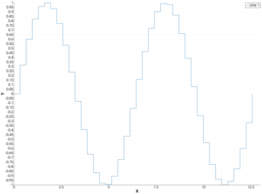
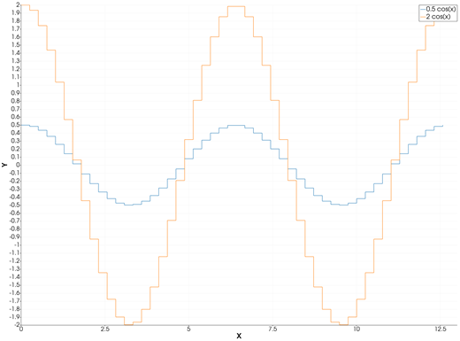
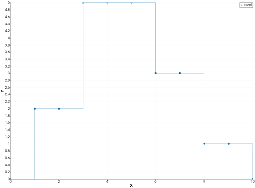
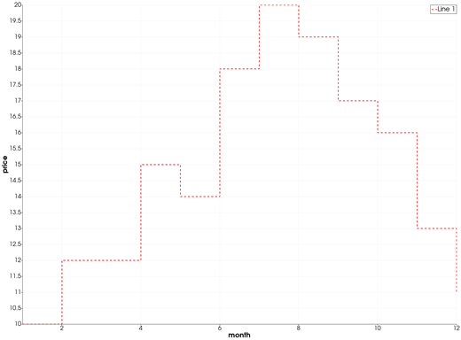

```@meta
CurrentModule = InteractiveGMT
```

# stairs — Stairstep Plot

The **stairs** icon on the X,Y Plot tool's gallery row re-plots each series of the current page as a
**stairstep** line: each value is held flat until the next `x`, where the line steps straight up or
down to the next value. There is no `stairs` function in iGMT: draw the data with [`plot`](@ref) and
[`plot!`](@ref), then click **stairs**.

## Syntax

Draw the data, then click **stairs**:

```julia
p = plot(x, y)
p = plot(y)                      # against the sample number 1:length(y)
plot!(p, x, y2)                  # more series: one stairstep line each
```

## Description

- From each point `(x[i], y[i])` the line runs horizontally to `(x[i+1], y[i])`, then vertically to
  `(x[i+1], y[i+1])`. The last point ends the line.
- The line has the series' colour, width and style. Markers, if the series has them
  (`marker=...`), are drawn at the points, which are the corners where each step lands.
- The axes are linear and re-fitted to the data.

A `NaN` in the data breaks the line, as it breaks a plain line.

### The stairs icon

Clicking **stairs** acts on the whole current page and needs no series selected. Each series keeps
its data, name, colour and style. Any log axis goes back to linear. Click **plot** to go back to
lines.

## Running the Examples

Paste each example into the iGMT window's **Julia console**, or into the Julia REPL after
`using InteractiveGMT`, then click **stairs** on the gallery row. Each one is complete on its own and
draws a new page of the X,Y Plot window.

## Examples

### Create Stairstep Plot

Forty values of a sine wave.

```julia
x = range(0, 4π; length=40)
p = plot(x, sin.(x))
```



### Plot Several Stairstep Lines

Two series on one page, each in its own colour.

```julia
x = range(0, 4π; length=50)
p = plot(x, 0.5 .* cos.(x); legend="0.5 cos(x)")
plot!(p, x, 2 .* cos.(x); legend="2 cos(x)")
```



### Mark the Points

With markers, each point shows where its step lands.

```julia
x = 0:10
y = [0, 2, 2, 5, 5, 5, 3, 3, 1, 1, 0]
p = plot(x, y; marker=:circle, ms="5p", legend="level")
```



### Change the Line

A thick red dashed stairstep.

```julia
x = 1:12
y = [10, 12, 12, 15, 14, 18, 20, 19, 17, 16, 13, 11]
p = plot(x, y; lc=:red, lw=2, ls=:dash, xlabel="month", ylabel="price")
```



## Input Arguments

**`x`, `y` — the points**, as in [`plot`](@ref).

## Keywords

There are no keywords of its own: the line's look comes from [`plot`](@ref)'s keywords.

| Keyword | Values | Default |
|---------|--------|---------|
| `lc`, `lw`, `ls`, `pen` | the line's colour, width and style | as in [`plot`](@ref) |
| `marker`, `ms` | markers at the points | no marker |
| `legend` | the series' name | `"Line n"` |

## See Also

[plot — 2-D Line Plot](@ref) · [stem — Stem Plot of Discrete Data](@ref) ·
[area — Filled Area Plot](@ref) · [X,Y Plot Tool](40-xyplot.md)
