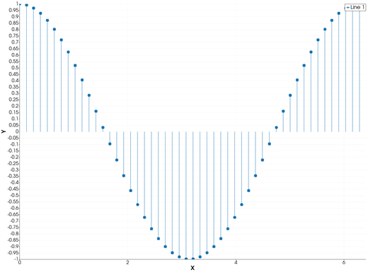
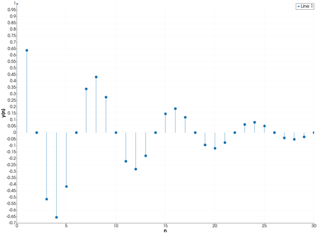
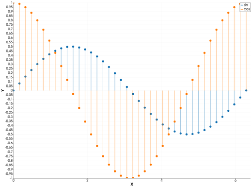
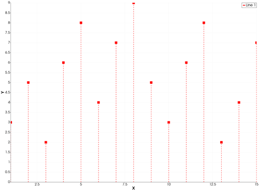

```@meta
CurrentModule = InteractiveGMT
```

# stem — Stem Plot of Discrete Data

The **stem** icon on the X,Y Plot tool's gallery row re-plots each series of the current page as a
**stem plot**: a vertical stick from `y = 0` up (or down) to every point, with a marker on its top.
There is no `stem` function in iGMT: draw the data with [`plot`](@ref) and [`plot!`](@ref), then
click **stem**.

## Syntax

Draw the data, then click **stem**:

```julia
p = plot(x, y)
p = plot(y)                      # against the sample number 1:length(y)
plot!(p, x, y2)                  # more series: one set of stems each
```

## Description

- Each point `(x, y)` of a series is drawn as a stick from `(x, 0)` to `(x, y)`, with a marker on
  the point. The points are **not** joined by a line.
- The marker is the series' own (`marker=...`); a series with no marker gets **circles**.
- Sticks and markers are drawn in the series' colour; the sticks take its line width and style.
- The axes are linear and re-fitted to the data, and always include `y = 0`, so every stick is
  whole.

A point that is `NaN` gets no stick.

### The stem icon

Clicking **stem** acts on the whole current page and needs no series selected. Each series keeps
its data, name, colour and style. Any log axis goes back to linear. Click **plot** to go back to
lines.

If you make the Y axis logarithmic afterwards (the **semilogy** icon), the sticks start at the lowest point of the series,
since a log axis has no zero.

## Running the Examples

Paste each example into the iGMT window's **Julia console**, or into the Julia REPL after
`using InteractiveGMT`, then click **stem** on the gallery row. Each one is complete on its own and
draws a new page of the X,Y Plot window.

## Examples

### Create Stem Plot

Fifty values of the cosine between 0 and 2π.

```julia
x = range(0, 2π; length=50)
p = plot(x, cos.(x))
```



### Plot a Discrete Signal

A decaying oscillation sampled at the integers, drawn against the sample number.

```julia
n = 0:30
y = 0.9 .^ n .* cos.(n .* π / 4)
p = plot(n, y; xlabel="n", ylabel="y[n]")
```



### Plot Two Series of Stems

Each series has its own colour.

```julia
x = range(0, 2π; length=40)
p = plot(x, 0.5 .* sin.(x); legend="sin")
plot!(p, x, cos.(x); legend="cos")
```



### Change the Marker and the Colour

Square heads, in red, on thicker dashed sticks.

```julia
x = 1:15
y = [3, 5, 2, 6, 8, 4, 7, 9, 5, 3, 6, 8, 2, 4, 7]
p = plot(x, y; marker=:square, ms="6p", lc=:red, lw=1.5, ls=:dash)
```



## Input Arguments

**`x`, `y` — the points**, as in [`plot`](@ref).

## Keywords

There are no keywords of its own: the stems' look comes from [`plot`](@ref)'s keywords.

| Keyword | Values | Default |
|---------|--------|---------|
| `lc`, `linecolor` | sticks and markers | next palette colour |
| `lw`, `ls`, `pen` | the sticks' width and style | tool default, `:solid` |
| `marker`, `ms` | the marker on each stick, and its size | `:circle` |
| `legend` | the series' name | `"Line n"` |

## See Also

[plot — 2-D Line Plot](@ref) · [stairs — Stairstep Plot](@ref) · [area — Filled Area Plot](@ref) ·
[scatter — Scatter Plot](@ref) · [X,Y Plot Tool](40-xyplot.md)
