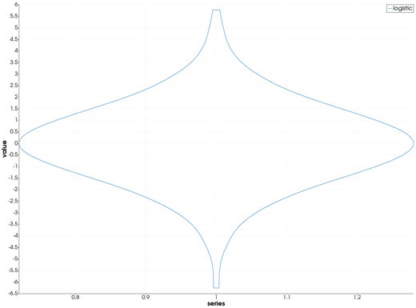
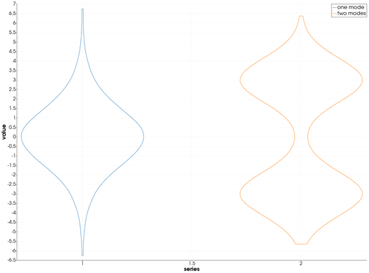
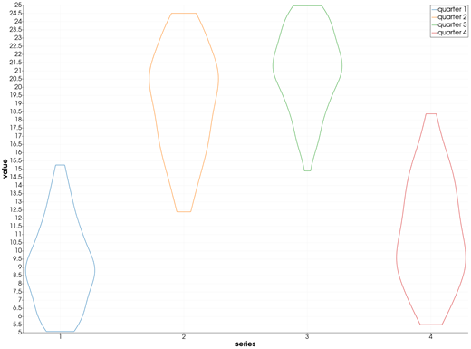

```@meta
CurrentModule = InteractiveGMT
```

# violin — Violin Plot

The **violin** icon on the X,Y Plot tool's gallery row draws the Y values of every series of the
current page as a **violin**: the sample's density estimate, mirrored about a vertical axis, one
violin per series. The violins go on a **new page**; the series they were made from stay as they
were. The shapes come from GMT.jl's own `helper1_violin`, the helper behind GMT.jl's `violin`.

## Syntax

Draw the samples as curves, then click **violin**:

```julia
p = plot(y)
plot!(p, y2)                          # more samples: one violin each
p = plot(x, Y; multicol=true)         # or one violin per column of a matrix
```

## Description

- Each series of the page is one sample: its **Y values**. Its X values are not used.
- The shape is the sample's kernel density estimate, as the **density** icon computes it (normal
  kernel, Silverman's bandwidth), here at **100 points** from the sample's minimum to its maximum.
  The violin is that curve drawn on both sides of its centre line, as a closed outline; it is cut
  flat at the minimum and the maximum.
- The violins stand at X = 1, 2, 3, ..., in the order of the series, each in its own colour and
  named after its series. The new page is called **violin**, its axes **series** and **value**.
- Every violin is scaled to its own widest point, which is 0.28 from its centre on each side. The
  widths show the shape of each sample, not how one sample's density compares with another's.
- Values that are not finite (`NaN`, `Inf`) are left out. A series with fewer than two values is
  skipped; if none has two, the icon says so and draws nothing.

## Running the Examples

Paste each example into the iGMT window's **Julia console**, or into the Julia REPL after
`using InteractiveGMT`, then click **violin** on the gallery row. No series needs to be selected:
the icon takes every series of the page.

The examples build their samples without random numbers: `mod.((1:n) .* 0.6180339887, 1)` gives
`n` values spread evenly over (0, 1) in no particular order, and a distribution's inverse CDF turns
them into a sample of that distribution.

## Examples

### Create Violin Plot

300 values of a logistic distribution.

```julia
u = mod.((1:300) .* 0.6180339887, 1)
p = plot(log.(u ./ (1 .- u)); legend="logistic")
```



### Show What a Box Chart Hides

Two samples centred on zero: one has a single mode, the other two. A box shows only the median and
quartiles; the violin shows the two modes, and the gap between them.

```julia
u = mod.((1:400) .* 0.6180339887, 1)
z = log.(u ./ (1 .- u))
p = plot(z; legend="one mode")
plot!(p, [-3 .+ 0.5 .* z[1:200]; 3 .+ 0.5 .* z[201:400]]; legend="two modes")
```



### Violin Plot of a Matrix's Columns

A year of daily temperatures, cut into four quarters of 90 days, one column each. With
`multicol=true` each column is a series, and so a violin.

```julia
t = 1:360
T = 15 .+ 8 .* sin.(2π .* (t .- 100) ./ 365) .+ 2 .* sin.(1.7 .* t)
p = plot(1:90, reshape(T, 90, 4); legend="quarter", multicol=true)
```



## Input Arguments

**`y` — sample**, the Y values of a series: at least two finite numbers.

**`Y` — samples**, a matrix drawn with `multicol=true`: each column is one series, and one violin.

## See Also

[boxplot — Box Chart](@ref) · [density — Kernel Density Estimate](@ref) ·
[plot — 2-D Line Plot](@ref) · [X,Y Plot Tool](40-xyplot.md)
