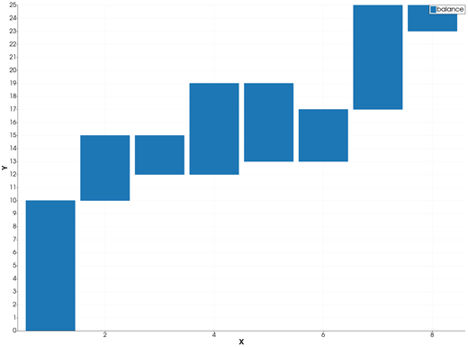
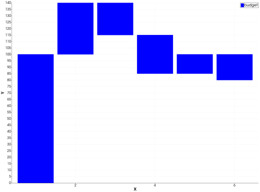

```@meta
CurrentModule = InteractiveGMT
```

# waterfall — Waterfall Chart

The **waterfall** icon on the X,Y Plot tool's gallery row re-plots every series of the current page as
a **waterfall chart**: each bar starts where the previous one ended, so a series of changes shows its
running total. It is GMT.jl's waterfall bar chart (`bar(...; stacked=:water)`), not MATLAB's
`waterfall`, which is a 3-D mesh.

## Syntax

Draw the changes as a curve, then click **waterfall**:

```julia
p = plot(x, dy)
```

## Description

- The first bar of a series goes from `0` to its first value. Each next bar starts at the sum of all
  the values before it and is as tall as its own value: up for a positive value, down for a negative
  one. The top of the last bar is the series' total.
- A value that is not finite adds nothing to the running sum.
- Each series runs its own sum. Several series on one page are drawn at their own X, in page order,
  and are not stacked on one another.
- Each series keeps its colour and name; its bars are filled in its colour.
- The bar width is 90 % of the median spacing of the series' X values. A series that was already
  drawn as bars keeps its bar width.

### The waterfall icon

Clicking **waterfall** re-plots every series of the current page as a waterfall, whatever type it was
drawn in before. The axes go back to linear and are re-fitted to show every bar whole. The icon acts
on the page and needs no series selected. The **bar** icon draws the values from `0` again; the
**plot** icon turns them back into lines.

## Running the Examples

Paste each example into the iGMT window's **Julia console**, or into the Julia REPL after
`using InteractiveGMT`, then click **waterfall** on the gallery row.

## Examples

### Create Waterfall Chart

A balance that changes month by month: gains go up from the running total, losses down.

```julia
x = 1:8
dy = [10, 5, -3, 7, -6, 4, 8, -2]
p = plot(x, dy; legend="balance")
```



### Show a Budget

A start value, then the incomes and expenses that follow it.

```julia
x = 1:6
dy = [100, 40, -25, -30, 15, -20]
p = plot(x, dy; lc=:blue, legend="budget")
```



## Input Arguments

**`x` — bar positions**, a vector. Ranges are accepted.

**`dy` — the changes**, a vector of the same length as `x`: each one is the height of its bar, from
the sum of the ones before it.

## Keywords

The keywords of [`plot`](@ref): `lc` is the bars' colour, `lw` their outline width, `legend` the
series' name. A series drawn with [`bar!`](@ref) and a `width` keeps that width.

## See Also

[bar stack — Stacked Bar Graph](@ref) · [bar — Bar Graph](@ref) · [plot — 2-D Line Plot](@ref) ·
[X,Y Plot Tool](40-xyplot.md)
