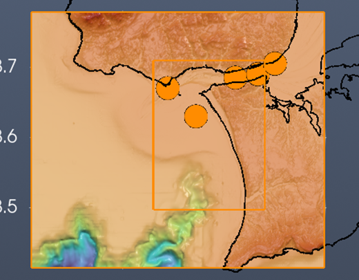
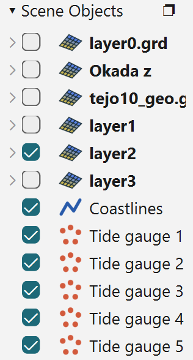
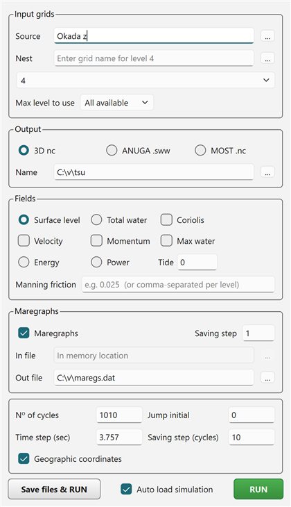
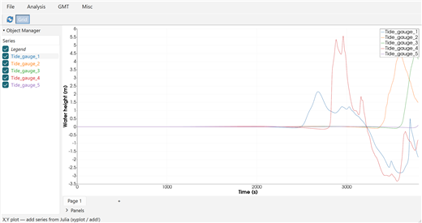
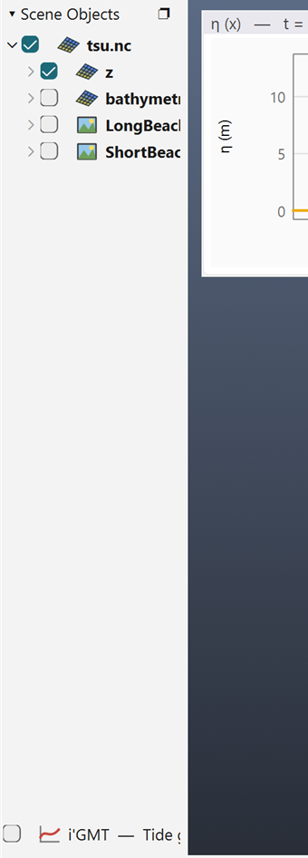

# Tutorial: Virtual Tide Gauges

A **virtual tide gauge** is a point where an NSWING run records the water height through time,
like a real tide gauge (maregraph) would. You place the gauges with the mouse, on the bathymetry
the run uses. NSWING takes them **from memory**: there is no positions file to write or keep.

This tutorial assumes a window already set up for NSWING: bathymetry, an Okada source and,
optionally, nested levels. See [Running NSWING](66-nswing.md). The pictures come from the set-up of
that tutorial (the source SW of Cape São Vicente, levels down to the Tejo estuary), run with
**Max level to use** = 2.

## 1. Place the gauges

In the **Geophysics** menu, switch to the **Tsunamis** discipline (*Geophysics › → Tsunamis*), then
pick **Plot virtual tide gauges**. The cursor becomes a cross: **click once** where the gauge goes.
Each pick of the menu places **one** gauge. Pick it again for the next one.

Each gauge is a circle named **Tide gauge 1**, **Tide gauge 2**, … in Scene Objects.

Here five gauges sit in and around the mouth of the Tejo: (1) off Costa da Caparica, (2) in the
channel at Belém, (3) at Alcântara, (4) off Carcavelos and (5) at Terreiro do Paço. All of them are inside the nested levels (the orange
rectangles), in water 15 to 31 m deep.





!!! tip "Where to put them"
    Put gauges **in the water**, and inside the **finest nested grid** that covers them. NSWING
    computes the series on the innermost grid. A gauge outside it is skipped, with a warning in the
    console. A gauge on land records nothing useful.

## 2. Edit them

A gauge is an ordinary symbol, edited like any other:

- **Move:** double-click the gauge (a yellow square appears in it), then drag it.
- **Size, colour, outline:** right-click the gauge, or use its properties in Scene Objects.
- **Leave one out of a run:** uncheck its row in Scene Objects. Only **visible** gauges are used.
- **Delete:** *Remove* in its Scene Objects row.

## 3. Open the NSWING dialog

Pick **NSWING tsunami…** from the same Tsunamis menu. When the window has visible gauges, the
**Maregraphs** box of the dialog is set up for them:

| Field | What it shows |
|---|---|
| **Maregraphs** | Ticked. |
| **In file** | *In memory location*, grayed out. The gauges are passed to NSWING directly, so there is no file to choose. Its tooltip says how many gauges were found. |
| **Out file** | `maregs.dat`, as a **full path**, in the folder of the bathymetry file. When the bathymetry has no file of its own, it uses the folder of the session file the window was saved to or loaded from. You can change it with the **...** button. |
| **Saving step** | One sample every that many time steps (1 = every step). |



The dialog reads the gauges again each time it comes to the front, so you can add, move or remove
gauges while it is open. With no visible gauges left, **In file** becomes an editable file field
again.

## 4. Run

Press **RUN**. The gauge positions go to NSWING with the grids, and the series is written to the
**Out file** when the run ends.

With **Auto load simulation** ticked, two windows open when the run finishes:

- the simulation, in a **new** iGMT window with the **Aquamoto** viewer;
- an **X,Y Plot** of the gauges: time in seconds on X, one curve per gauge, named after it.



The wave reaches the gauges outside the estuary first: Costa da Caparica (gauge 1) at about
2500 s, Carcavelos (gauge 4) at about 2800 s. Belém and Alcântara (2, 3) follow at 3400–3600 s, and
Terreiro do Paço (5), furthest up the estuary, only starts to rise as the 63-minute run ends.

The X,Y Plot belongs to the simulation window. Closing it or minimising it parks it as a row in that
window's Scene Objects (bottom of the panel below), and a double-click on the row brings it back.



**Save files & RUN** writes the gauges as `tide_gauges.dat` next to the other saved files, and the
command line it shows names that file. It is then a normal `lon lat name` positions file, usable as
the **In file** of a later run.

## 5. The output file

`maregs.dat` is a plain text table that GMT, Mirone and the X,Y Plot tool read directly. It starts
with six header rows, then a short note (written by iGMT) on what they mean, then the data after a
`>XY` line:

```
#	Tide_gauge_1	Tide_gauge_2	Tide_gauge_3	Tide_gauge_4	Tide_gauge_5
#		-9.27000	-9.20000	-9.16000	-9.32000	-9.13000
#		38.63000	38.68467	38.69000	38.67000	38.70467
#		14.9	30.9	22.5	17.7	17.9
# X		-9.27000	-9.20000	-9.16000	-9.32000	-9.13000
# Y		38.63000	38.68467	38.69000	38.67000	38.70467
# --- What the header rows above mean (written by InteractiveGMT) ---
# ...
>XY
1.879	0.01126	0.01090	0.01068	0.01160	0.01053
5.636	0.01126	0.01090	0.01068	0.01160	0.01053
...
```

Gauge 2 was placed at 38.685 N; row 3 says 38.68467, the nearest node of the grid it was computed
on.

| Row | Content |
|---|---|
| 1 | The gauge names, one per column. |
| 2 | X (longitude) of the grid node where each gauge is computed. A gauge is moved to the nearest node of the grid it is computed on, so this can differ slightly from where you clicked. |
| 3 | Y (latitude) of that node. |
| 4 | Water depth at that node, in metres, positive down (negative = land). |
| 5, 6 | `# X` / `# Y`: the same coordinates again, in the form Mirone reads. |
| data | Column 1: time in seconds since the start of the simulation. Then one column per gauge: the water surface height in metres, in the order of the header columns. |

## 6. Sessions

The gauges are saved with the window by *File → Save Session…*. Loading the session brings them back
as gauges: still draggable, and found again by the NSWING dialog.

## Related tutorials

- [Running NSWING](66-nswing.md): the full run set-up.
- [Nested Grids](64-nested-grids.md): the levels the gauges should sit inside.
- [X,Y Plot Tool](40-xyplot.md): working with the gauge curves.
