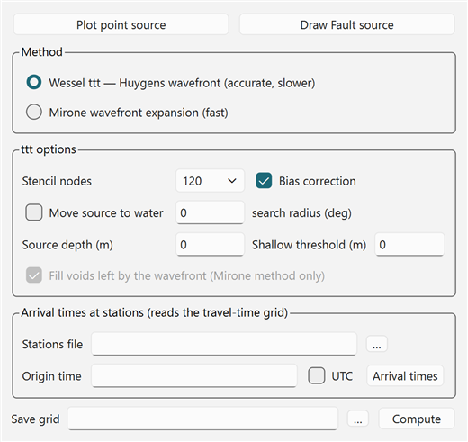
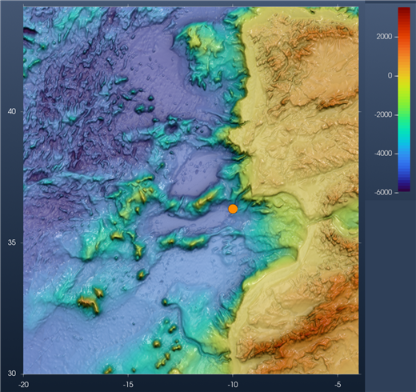
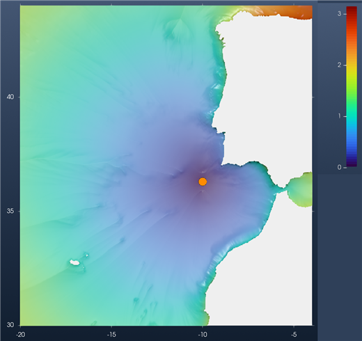
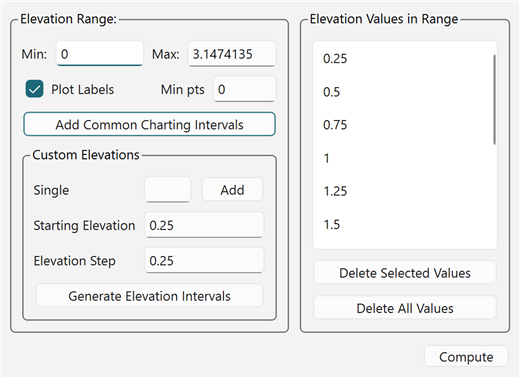
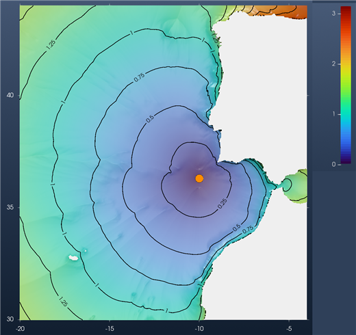
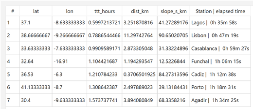
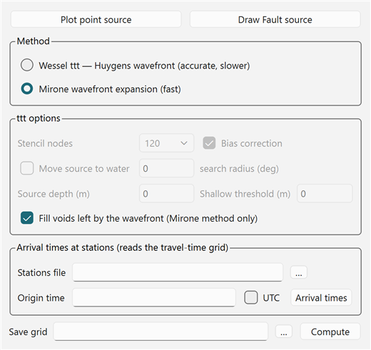
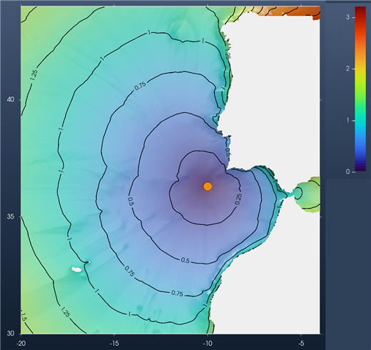

# Tutorial: Tsunami Travel Times

A **tsunami travel-time** map shows how long a tsunami takes to get from its source to each point
of the ocean. The speed of a long wave depends only on the water depth (``c = \sqrt{g\,h}``), so
the map is computed from a **bathymetry grid** and a **source**. Nothing else is needed: no fault
model, no simulation.

The result is a new grid, **Travel time (h)**, in hours. This tutorial computes one for a source
SW of Cape São Vicente (the region of the 1755 Lisbon earthquake), draws its isochrones every
**0.25 hours** (15 minutes), reads the arrival times at a few ports, and compares the two methods
the tool offers.

## 1. Load the bathymetry

The travel times are computed **on the window's bathymetry**, the level 0 grid. They come back on
exactly the same nodes. Any other grid in the window is ignored, even when it is the one on display:
a nested grid (*layer1*, *layer2*, …) is never used. The grid must be in **geographic** coordinates (longitude/latitude), with ocean depths
**negative** (metres below sea level), like the GMT `@earth_relief` grids.

Here the grid is `@earth_relief_02m` cut to `-20/-4/30/44`: a 481 × 421 grid at 2 arc-minutes,
from Galicia to southern Morocco, with Madeira in the SW corner. From the REPL:

```julia
using GMT, InteractiveGMT
G = grdcut("@earth_relief_02m", region=(-20, -4, 30, 44))
view_grid(G)
```

Or open the file with *File → Open*, or drag it onto the window. Switch the view to **2D** (toolbar
button) to place the source more easily.

## 2. Open *Tsunami travel times*

In the **Geophysics** menu, switch to the **Tsunamis** discipline (*Geophysics › → Tsunamis*), then
pick **Tsunami travel times…**.



The dialog has three parts: the **source**, the **method**, and the **arrival times** at stations.

## 3. Place the source

There is no default source. Place one with one of the two buttons at the top:

- **Plot point source**: click once on the map. That point is the source.
- **Draw Fault source**: draw a line on the map (double-click ends it). Every vertex is a point
  source, and so is the middle of the line. Use it for a long rupture: the waves then leave from
  the whole fault, not from one point.

The source is drawn as an orange circle and gets a **TTT source** row in Scene Objects. It can be
moved like any other symbol: double-click it, then drag. Here the point is at 10.0°W, 36.3°N.



!!! note "The source must be in the water"
    A source on a land node is refused. Tick **Move source to water** (Wessel method) to move it
    to the nearest water node, within the **search radius** (degrees).

## 4. Choose the method

| Method | What it does |
|---|---|
| **Wessel ttt — Huygens wavefront** | Wessel's (2009) *ttt* algorithm. The wavefront is expanded from each node to its neighbours with a Huygens stencil. Accurate. The default. |
| **Mirone wavefront expansion** | The faster expansion from Mirone. Good for a first look on a large grid. |

Options of the **Wessel** method:

| Option | Meaning |
|---|---|
| **Stencil nodes** | How many neighbours each node reaches in one step: 8, 16, 32, 48, 64 or 120. More nodes give more directions of propagation, so rounder and more accurate wavefronts, at a higher cost. 120 is the default. |
| **Bias correction** | The wavefront bias correction of the *ttt* algorithm. On by default. |
| **Move source to water** + **search radius** | See the note above. |
| **Source depth (m)** | The source must be at least this deep. Negative down, 0 = no constraint. |
| **Shallow threshold (m)** | Shallow-water depth threshold. Negative down, 0 = none. |

**Fill voids left by the wavefront** applies to the Mirone method only. **Save grid** (optional)
also writes the result to a file. The result always goes to Scene Objects, with or without it.

## 5. Compute

Press **Compute**. A busy notice stays up while it runs. On this grid, the Wessel
method with 120 stencil nodes took about 4 seconds.



The result is a new layer named **Travel time (h)**, with its own axes and its own colour bar, in
hours (here 0 to 3.15 h). The bathymetry (**Surface**) is unchecked but stays in the window. Land
has no travel time and is left blank.

Already in the colours, the wave runs much faster over the deep abyssal plains to the west (blue
to green) than on the shelf. It crosses the whole region westward in less than 2 hours, but needs
almost 3 hours to go around Cape Finisterre into the Bay of Biscay (orange, top right).

!!! tip "Computing again"
    You can move the source, change the method or the stencil, and press **Compute**
    again. The dialog stays open. The new result **replaces** **Travel time (h)**, and it is always
    computed over the bathymetry, even while the travel times are on display.

## 6. Isochrones every 0.25 hours

Contour lines of the travel-time grid are **isochrones**: lines that the wavefront reaches at the
same time. Make sure **Travel time (h)** is the layer on display (it is, right after Compute), then
pick *Grid Tools → Contours → Contour Tool…*.



**Min** and **Max** are read from the travel-time layer: 0 and 3.147 hours. To get a line every
0.25 hours:

1. In **Custom Elevations**, set **Starting Elevation** to `0.25` and **Elevation Step** to `0.25`.
2. Press **Generate Elevation Intervals**. The list on the right gets the twelve levels 0.25, 0.5,
   … , 3.0.
3. Tick **Plot Labels** to write each time on its line.
4. Press **Compute**.

The isochrones are drawn on top of the travel times, under one **Contours** group in Scene
Objects (each level is its own row inside it). Pressing **Compute** again redraws the whole list
and replaces the previous set.



How to read the map:

- The lines are **15 minutes** apart in time. Where they are **far apart**, the wave is fast (deep
  water). Where they **crowd together**, it is slow (shelf, shallow banks).
- The wave reaches the Algarve in about 0.6 h, Lisbon in about 0.8 h and Madeira in about 1.1 h
  (see the table in step 7). Cádiz, closer than Madeira, is reached later (1.2 h): the last stretch
  is over the shallow shelf of the Gulf of Cádiz.

!!! tip "A quick alternative"
    *Grid Tools → Contours → Automatic* contours the layer on display at round intervals chosen for
    you, with no dialog. Use the Contour Tool when you want a fixed interval, like 0.25 h here.

## 7. Arrival times at ports

The lower part of the dialog reads the arrival times off the travel-time grid at a list of
**stations**. Write them in a text file, one per line: longitude, latitude and an optional name.

```
-9.14 38.69 Lisbon
-8.67 37.10 Lagos
-6.30 36.53 Cadiz
-7.62 33.61 Casablanca
-16.91 32.64 Funchal
-9.60 30.42 Agadir
-8.68 41.15 Porto
```

Every station must be inside the grid region. Choose the file in **Stations file**. Optionally set
an **Origin time** (ISO format, e.g. `1755-11-01T09:40:00`), to get clock times instead of elapsed
times, and tick **UTC** if that time is UTC. Then press **Arrival times**.



The table opens in its own window, **sorted by arrival time**:

| Column | Meaning |
|---|---|
| **lat**, **lon** | Where the time was read. A station on a land node (a port often is, at 2′) is moved to the nearest water node, so these can differ slightly from the file. |
| **ttt_hours** | The travel time, in hours. |
| **dist_km** | Distance from the station to the node used, in km. |
| **slope_s_km** | Travel-time gradient at the station, in s/km. |
| **Station \| elapsed time** | The station name from the file, and the arrival time written as hours, minutes and seconds. With an **Origin time**, the column is *Station \| arrival time* and shows the clock time. |

Here the wave reaches Lagos first (36 min), then Lisbon (47 min), Casablanca (59 min), Funchal
(1 h 06 min), Cádiz (1 h 13 min), Porto (1 h 19 min) and Agadir (1 h 34 min). **Save…** writes the
table, names included, to a tab-separated text file.

The arrival times are read off **whatever travel-time grid is on display**, whichever method made
it. They work the same way with the Mirone method below.

## 8. The other method: Mirone

Now compute the same source with the second method. In the dialog, select **Mirone wavefront
expansion (fast)**. The *ttt options* gray out, except **Fill voids left by the wavefront**, which
belongs to this method. Leave it ticked: it fills the few water nodes the expansion can skip.



The source does not need to be placed again: it is still on the map. Press **Compute**. The new grid **replaces** *Travel time (h)*. The isochrones do not follow by themselves:
press **Compute** in the Contour Tool again (its list of 0.25 h levels is still there) to trace
them on the new grid.



The two maps are very close. Side by side:

| | Wessel *ttt* (120 nodes) | Mirone |
|---|---|---|
| Compute time, this grid | about 4.5 s | about 0.6 s |
| Largest travel time | 3.15 h | 3.21 h |
| Lagos | 0h 35m 58s | 0h 36m 40s |
| Lisbon | 0h 47m 19s | 0h 45m 23s |
| Casablanca | 0h 59m 27s | 0h 59m 28s |
| Funchal | 1h 06m 15s | 1h 06m 50s |
| Cádiz | 1h 12m 38s | 1h 12m 04s |
| Porto | 1h 18m 31s | 1h 26m 05s |
| Agadir | 1h 34m 25s | 1h 36m 01s |

Most arrivals agree within a minute or two. The biggest difference is at Porto, about 8 minutes.
The Mirone method is several times faster, so
use it to try sources quickly, and the Wessel method for the final map.

!!! note "A travel time is not a wave height"
    The map says **when** the first wave arrives, not **how big** it is. For wave heights, run a
    tsunami simulation: see [Running NSWING](66-nswing.md) and
    [Virtual Tide Gauges](66b-tide-gauges.md).
