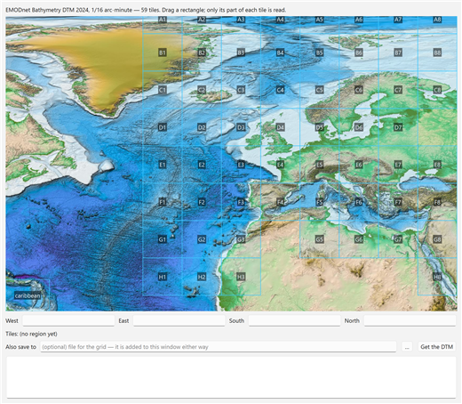

# EMODNET

*Tools → EMODNET*

The [EMODnet Bathymetry](https://emodnet.ec.europa.eu/en/bathymetry) Digital Terrain Model (DTM)
over a region you draw. EMODnet publishes its DTM as a fixed set of tiles (`A1` … `H8`, plus one
`caribbean` tile), each one a zipped 32-bit float GeoTIFF of several hundred MB. This tool does not
make you download whole tiles: you drag a rectangle, and only that region comes back, as one grid,
even when it crosses several tiles.



## Using it

1. **Tools → EMODNET.** The dialog opens on the ground the DTM covers, with every tile drawn and
   named over the etopo basemap. The tile list is read from EMODnet's own catalogue each session
   (the WFS layer `emodnet:download_tiles`), so a new DTM release appears without updating iGMT.
2. **Drag a rectangle** over the map. The **West / East / South / North** boxes fill in, and the line
   under them names the tiles the region crosses. Drag a corner of the rectangle to adjust it, or
   type the four numbers instead. The wheel and `+`/`-` zoom, the arrow keys pan.
   The rectangle stays on the DTM: it is cut to the tiles it touches, and one that touches no tile
   is dropped. A new drag replaces it; **right-click → Delete the rectangle**, or the `Delete` key
   over the map, removes it.
3. Optionally give a file in **Also save to** (netCDF or GeoTIFF).
4. Press **Get the DTM.** The grid is added to the window as a new layer, with its own axes, named
   `EMODnet DTM <release> (W/E/S/N)`.

**Right-click a tile** → *Download the entire tile*: GDAL reads the whole tile, as EMODnet publishes
it (its two-cell overlap with the neighbours included), straight into memory, and it is added to
the window as a new layer named `EMODnet DTM <release> tile <name>`. No file is written; the log
shows the same progress lines. Tile C6, for instance, is a 9485 × 9004 grid and took 18 s.

Closing, minimising or `Esc` parks the dialog in Scene Objects; its row brings it back with the
region still drawn.

## What happens on **Get the DTM**

- The region is widened to whole DTM cells (1/16 arc-minute = 1/960°), so the result sits on the
  DTM's own nodes.
- For each tile the region touches, GDAL opens the tile straight on EMODnet's server
  (`/vsizip//vsicurl/<tile>.tif.zip/<tile>.tif`) and `gdal_translate -projwin` takes the part of
  the region inside that tile. Tiles overlap their neighbours by two cells; each piece is cut to its
  tile's nominal box, so the pieces meet edge to edge.
- The pieces are mosaicked by a GDAL VRT into one grid. Cells with no DTM value are
  `NaN`.

## The log

The pane at the bottom of the dialog reports each tile while GDAL reads it: every 2 s while data
arrive (amount, percentage of the tile's zip, current rate, time left), once when the transfer
ends, and once when the tile is done. The numbers are GDAL's own record of the byte ranges it
requests from the server.

```
region 13.5/13.6/71.0/71.2 crosses 1 tile(s): C6
[1/1] tile C6: GDAL is reading 13.5/13.6/71.0/71.2 …
   C6: downloaded 46.0 of 99.3 MB (46%), 7.9 MB/s, ~7 s left
   …
   C6: done in 15 s, 99.3 MB transferred
mosaicking 1 piece(s) …
```

What GDAL downloads is kept in memory for the duration of the read, so it crosses the network once
per tile.
