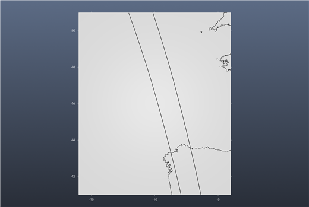
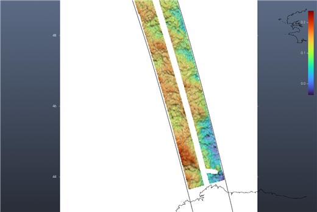
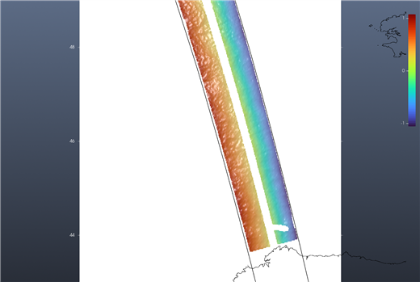
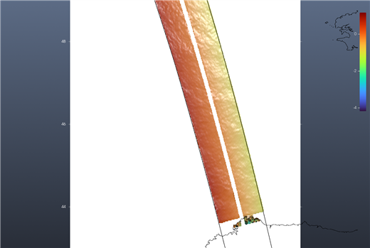
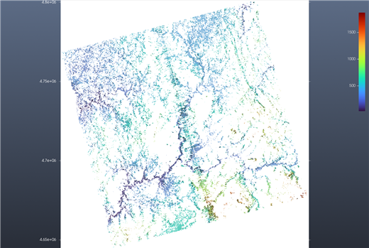
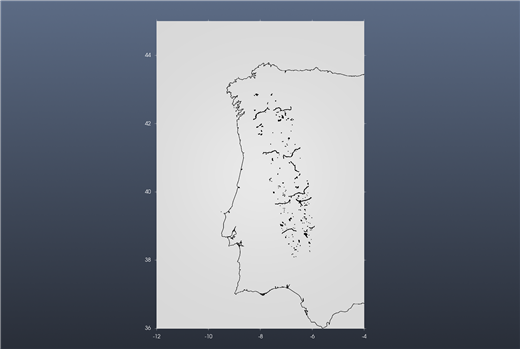

# Tutorial: SWOT sea surface and water heights

*Satellite → SWOT…* — the green **?** at the bottom of the dialog opens this page.

This tutorial goes through four real examples, then explains every variable the dialog offers. The
reference for each button is the [SWOT](74b-swot.md) page.

What you need:

- a free **NASA Earthdata** account, saved once in the dialog's **Accounts** tab (for the L2
  products: ocean, raster, rivers, lakes);
- an **AVISO+** account, saved in the same tab, only for the L3 ocean products.

Searching never needs an account; downloading does.

## Example 1 — The ocean: sea surface height anomaly in the Bay of Biscay

1. Open *Satellite → SWOT…* on an empty window.
2. **Region**: W −14, E −6, S 43, N 49. **Product**: *LR sea surface height, Basic (2 km)*.
   **From**/**To**: any month since July 2023 (here September 2026).
3. Press **Find the passes**. The files are listed in **Pass**, and the swaths of their passes are
   drawn over a map of the region: two parallel strips, 50 km wide each, with the 20 km gap under
   the satellite between them.

   

4. Press **Pick a pass** and click one of the swath lines (or right-click the line and choose
   **Show this pass (SWOT)**). The pass is downloaded (about 10 MB) and its **Variable**, here
   `ssha_karin`, is gridded over the region at 0.02° and shown.

   

   That is the sea surface height **anomaly**: a few tens of centimetres of ocean eddies and fronts,
   0 to 0.24 m on this pass.

### Why the two options under it matter

The same pass, without the **Crossover correction** (unticked):

The swath now goes from −1 m on one edge to +1 m on the other. That is not the ocean: it is the
instrument's roll error, which the L2 heights still carry, and which the file's own
`height_cor_xover` removes. Measured on this pass, the scatter over the swath falls from 0.63 m to
0.05 m once it is added. **Leave the box ticked** for the L2 heights; it does nothing to the other
variables, and the L3 products (example 2) are already corrected.

And with **Quality** set to *Good and suspect* instead of *Good only*, a few coastal pixels flagged as
suspect come in with values of several metres and stretch the colour scale over them (−4.2 to
+1.2 m on this pass, against −1.1 to +1.1 m with *Good only*; both without the crossover correction):

Start with *Good only*; widen it only when you need the coast.

## Example 2 — The same ocean, already calibrated: AVISO's Level 3

Choose **Product** *LR sea surface height L3, Basic (AVISO, 2 km)* and press **Find the passes**
again: the files now come from AVISO's catalogue (no login needed to search). Picking a pass shows
`ssha_filtered`: the same kind of anomaly, already calibrated, edited and with the measurement noise
removed by CNES/CLS. The **Crossover correction** box is greyed out: it does not apply.
Downloading needs the AVISO+ login.

## Example 3 — Rivers and lakes as a water-elevation raster

**Product**: *HR water surface, Raster 250 m* (or 100 m), a region over land, e.g. W −10, E −6,
S 36, N 44. Each file is a 128 km tile in its UTM zone (`UTM29T 040F` in the Pass list). Picking a
pass shows its tile's `wse` — water surface elevation above the geoid, in metres — on the tile's own
UTM grid, with its own axes in metres. Only water pixels have a value: here the rivers and
reservoirs of Galicia and northern Portugal (42–43.4° N), from about 15 m near the sea to several
hundred metres inland. With *Good only* the scattered isolated pixels go away.

## Example 4 — Rivers and lakes as lines and outlines

**Product**: *HR rivers, reaches (shapefile)*, *HR rivers, nodes (shapefile)* or *HR lakes, prior
lakes (shapefile)*. Each file is one pass over one continent (`EU` in the Pass list). Picking a pass
draws the river reaches (lines), the river nodes (points) or the lakes (outlines) that lie in the
region, as ONE layer over what the window already shows. Hovering a feature shows its id and the value
of the chosen **Variable**, e.g. `reach_id 21603400064  wse = 123.25 m`, or `no value` where SWOT
measured nothing on that pass.

## What the variables are

The **Variable** list shows the usual ones first, then everything else the file holds. All heights
are in metres. The descriptions below are the files' own (their `long_name` and comments).

### LR sea surface height, Basic and Expert (L2, NASA)

| Variable | What it is |
|---|---|
| `ssha_karin` | **Sea surface height anomaly**: the height with the mean sea surface, the tides (solid earth, ocean, internal), the pole tide and the atmospheric (DAC) effect removed. The one to look at for currents and eddies. Use with the crossover correction. |
| `ssh_karin` | **Sea surface height** above the reference ellipsoid, fully corrected for the measurement (troposphere, sea state bias) but with nothing geophysical removed: it is dominated by the geoid (tens of metres). |
| `ssha_karin_2`, `ssh_karin_2` | The same two, with a **model** wet-troposphere correction instead of the radiometer's. Use them near the coast or wherever the radiometer is unreliable. |
| `mean_sea_surface_cnescls` | The CNES/CLS **mean sea surface** that `ssha_karin` subtracts. |
| `geoid` | **Geoid height**. `ssh_karin − geoid` approximates the absolute dynamic topography. |
| `internal_tide_hret` | The coherent **internal tide** (HRET model) removed from the anomaly. |
| `height_cor_xover` | The **crossover calibration** the dialog adds when the box is ticked. Show it on its own to see the error it removes. |
| `distance_to_coast` | Distance to the coast (m). |
| `num_pt_avg` | Number of samples averaged into each 2 km pixel. |
| `sig0_karin` *(Expert)* | Radar backscatter coefficient σ0 of the sea surface. |
| `swh_karin` *(Expert)* | Significant wave height from KaRIn. |
| `wind_speed_karin` *(Expert)* | Wind speed from KaRIn. |

Quality: `<variable>_qual` is a set of flags. *Good only* keeps pixels with no flag; *Good and
suspect* also keeps those flagged only as suspect.

### LR sea surface height L3 (AVISO)

| Variable | What it is |
|---|---|
| `ssha_filtered` | Sea surface height anomaly, calibrated and edited, with the measurement noise removed. The one to look at first. |
| `ssha_unfiltered` | The same before the noise removal. AVISO recommends it if you use your own mean sea surface. |
| `ssha_unedited` *(Expert)* | Calibrated but without the editing: for events (storms, hurricanes) the editing would remove. |
| `mdt` | **Mean dynamic topography**. `ssha_filtered + mdt` is the absolute dynamic topography. |
| `ugos_filtered`, `vgos_filtered` *(Expert)* | Absolute **geostrophic velocity**, east and north components (m/s). |
| `ugosa_filtered`, `vgosa_filtered` *(Expert)* | Geostrophic velocity **anomalies** (m/s). |
| `mss`, `ocean_tide`, `dac`, `internal_tide` *(Expert)* | The mean sea surface and the corrections already applied. |
| `sigma0` *(Expert)* | Radar backscatter. |

Quality: `quality_flag`, one code per pixel. *Good only* keeps 0. *Good and suspect* keeps codes up
to 30, AVISO's own advice for events such as hurricanes.

### HR water surface, Raster (L2, NASA)

| Variable | What it is |
|---|---|
| `wse` | **Water surface elevation above the geoid**, fully corrected. |
| `wse_uncert` | Its uncertainty. |
| `water_area` | Water surface area of the pixel (m²). |
| `water_frac` | Fraction of the pixel that is water (0–1). |
| `sig0` | Radar backscatter σ0. |
| `inc`, `cross_track` | Incidence angle (degrees) and cross-track position (m) of the pixel. |
| `geoid`, `solid_earth_tide`, `load_tide_fes`, `load_tide_got`, `pole_tide`, `model_dry_tropo_cor`, `model_wet_tropo_cor`, `iono_cor_gim_ka`, `height_cor_xover` | The geoid and the corrections already applied to `wse`. |
| `n_wse_pix`, `n_water_area_pix`, `n_sig0_pix` | Number of measurements aggregated into the pixel. |
| `dark_frac` | Fraction of the area that is dark water (water the radar barely sees). |
| `layover_impact`, `ice_clim_flag`, `ice_dyn_flag` | Layover error estimate and ice flags. |

Quality: `<variable>_qual`: 0 good, 1 suspect, 2 degraded, 3 bad.

### HR rivers and lakes (shapefiles, L2, NASA)

| Attribute | What it is |
|---|---|
| `wse` | Water surface elevation above the geoid (reach / node: fitted; lake: lake average). |
| `wse_u` | Its total one-sigma uncertainty. |
| `width` | River width (m). |
| `slope` | Water surface slope along the reach (m/m). |
| `dschg_c` | **Discharge** from the consensus algorithm (m³/s). |
| `area_total` | Total water area including dark water — m² for reaches and nodes, km² for lakes. |
| `wse_std` *(lakes)* | Spread of the elevation over the lake's pixels. |
| `reach_id`, `node_id`, `lake_id` | Identifiers in the SWOT river (SWORD) and prior lake databases. |

Quality: `reach_q`, `node_q`, `quality_f`: 0 nominal, 1 suspect, 2 degraded, 3 bad. A value of
−999999999999 in a file means "not measured on this pass", shown as `no value`.

## Tips

- One SWOT **cycle** is 21 days: the same passes come back over the same place every 21 days, so a
  month holds one or two looks at each pass.
- The LR files are whole passes, pole to pole: the region only decides what is gridded, so a small
  region is fast and a large one takes longer.
- A file is downloaded once into the **Folder**; `(on disk)` in the Pass list marks it.
- A new **Find the passes** replaces the previous swaths. The swath lines are guides: right-click one
  for **Show this pass (SWOT)**.
