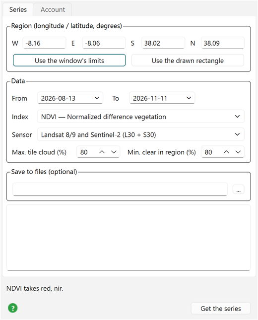

# HLS time series (Harmonized Landsat Sentinel-2)

!!! tip "Tutorial"
    A worked example over irrigated fields, step by step: [Tutorial: HLS time series](74e-hls-tutorial.md) (the **Tutorial** button in the dialog; the green **?** opens this page).

*Satellite → Remote sensing → HLS time series…*

HLS (NASA, LP DAAC) is Landsat 8/9 and Sentinel-2 put on ONE grid: 30 m pixels on the Sentinel-2
MGRS tiles, atmospherically corrected, with the view-angle effects removed and the Sentinel-2 bands
adjusted to Landsat's. So the two satellites mix in one series, with a clear look at a field every
2 to 3 days instead of every 5 to 16. This dialog computes a spectral index (NDVI, NDMI, …) for every
clear date over a region and puts each date in the window.

Only the region is read, never the whole 110 km tiles: HLS files are Cloud-Optimized GeoTIFFs, and
GDAL fetches just the bytes of the region's pixels.

## The two products

| Product | Satellite | From | Bands the dialog uses |
|---|---|---|---|
| **L30** | Landsat 8 and 9 (OLI) | April 2013 | blue B02, green B03, red B04, NIR **B05**, SWIR1 B06, SWIR2 B07 |
| **S30** | Sentinel-2 A, B, C (MSI) | December 2015 | blue B02, green B03, red B04, red-edge B05–B07, NIR **B8A**, SWIR1 B11, SWIR2 B12 |

The same band number is not the same band in the two products (NIR is B05 in L30 and B8A in S30);
the dialog asks for bands by what they are, never by number. Landsat has no red-edge bands, so the
red-edge indices (NDREI1, NDREI2) use only the S30 dates.

## The Series tab



**Region** — West, East, South, North in degrees. **Use the window's limits** fills them with what
the window shows; **Use the drawn rectangle** with the last rectangle drawn in the window
(*Draw → Rectangle*). A projected window's box is turned into degrees. Keep regions small (a field,
a farm, a valley): every date reads the region's pixels again.

**From / To** — the period, both days included.

**Index** — computed with the same engine as *Spectral indices* (RemoteS):

| Index | Bands | What it shows |
|---|---|---|
| NDVI | red, NIR | green vegetation |
| EVI | blue, red, NIR | vegetation, does not saturate over dense canopy |
| SAVI, MSAVI | red, NIR | vegetation over bright soil (sparse crops) |
| NDMI | NIR, SWIR1 | water in the leaves (crop water stress) |
| NDWI | green, NIR | open water |
| MNDWI | green, SWIR2 | open water, better near built areas |
| NBRI | NIR, SWIR2 | burned areas |
| NDREI1, NDREI2 | red-edge (S30 only) | chlorophyll, late in the season |

**Sensor** — both products (the default and the densest series), Landsat only, Sentinel-2 only, or
**Sentinel-2 L2A, 10 m (Earth Search, no login)**: Sentinel-2 at its own resolution, not HLS (see
below).

**Max. tile cloud (%)** — dates whose WHOLE-TILE cloud cover is above this are skipped before
anything is read. Keep it high: a 110 km tile half covered in cloud can still be clear over your field.

**Min. clear in region (%)** — what really decides. Each date's cloud mask (Fmask) is read over the
region first, and a date is kept only if at least this share of the region's pixels is free of
cirrus, cloud, cloud edges, cloud shadow and snow. The masked pixels of a kept date are NaN.

**Save to files (optional)** — empty: every date is added to the window as its own grid. A file name
(e.g. `D:/hls/field.nc`): its folder receives

- `field_<yyyymmdd>_<L30|S30>.tif` — each date's index grid (GeoTIFF, UTM);
- `field_cube.nc` — all dates in one cube, one layer per date (time in decimal years), opened in the
  window with its layer slider;
- `field_series.csv` — date, product, region mean of the index, clear share.

**Get the series** — searches NASA's catalogue (CMR-STAC), keeps the MGRS tile most dates share (so
every date is on the same pixels), reads the cloud masks, then the bands of the clear dates, all in
parallel, and computes the index. A progress bar shows each step. The box at the bottom of the tab
lists the series: each date, its satellite, the region mean of the index and its clear share.

## Sentinel-2 at 10 m (Earth Search)

The last **Sensor** entry reads Sentinel-2 Level-2A scenes from Element84's
[Earth Search](https://earth-search.aws.element84.com/v1) catalogue — the ESA product as
Cloud-Optimized GeoTIFFs on AWS — instead of HLS. No account is needed. Everything else in the dialog
works the same way; what changes:

| | HLS | Sentinel-2 L2A (Earth Search) |
|---|---|---|
| Pixel size | 30 m | **10 m** for indices of blue, green, red and NIR (NDVI, EVI, SAVI, MSAVI, NDWI; NIR = B08); **20 m** for those with red-edge or SWIR (NDMI, MNDWI, NBRI, NDREI1, NDREI2; NIR = B8A) |
| Satellites | Landsat 8/9 + Sentinel-2 | Sentinel-2 A, B, C only |
| Cloud mask | Fmask | Scene classification (SCL): no data, saturated, cloud shadow, clouds, cirrus and snow are masked |
| Login | NASA Earthdata | none |

The 20 m cloud mask is laid on the 10 m pixels cell by cell. Over the same field on the same day
(Faro, 13 April 2024) the two agree: NDVI 0.520 from Sentinel-2 at 10 m, 0.525 from HLS at 30 m.
Choose Sentinel-2 when the fields are small; choose HLS when you want the densest series (Landsat
dates added) or a series back to 2013. Grids are named like *NDVI 2024-04-13 S2B — Sentinel-2 T29SNB*.

## The Account tab

Reading HLS needs a free NASA Earthdata account ([register here](https://urs.earthdata.nasa.gov/users/new)).
Type the login (the user name, not the e-mail address) and the password once and press
**Save login**: they go to your `.netrc` file (`machine urs.earthdata.nasa.gov`), where iGMT, GDAL,
curl and wget all look for them; every other entry of the file is kept. It is the same login the
MODIS scenes and SWOT dialogs use, so saving it in any of them serves all. Searching needs no login;
reading the pixels does.

## From Julia

The dialog runs `InteractiveGMT.RemoteS.hls_series`:

```julia
using InteractiveGMT.RemoteS
S = hls_series([-8.16, -8.06, 38.02, 38.09]; from = "2026-08-13", to = "2026-11-11", index = "NDVI")
S.time, S.product, S.mean, S.clear     # one entry per clear date
S.grids                                # the index grids (GMTgrid, UTM, masked pixels NaN)
```

`hls_search` alone lists the dates (no login needed to search). The Sentinel-2 entry runs
`s2_series` (and `s2_search`), with the same arguments minus `products`:

```julia
S2 = s2_series([-8.16, -8.06, 38.02, 38.09]; from = "2026-08-13", to = "2026-11-11", index = "NDVI")
```
