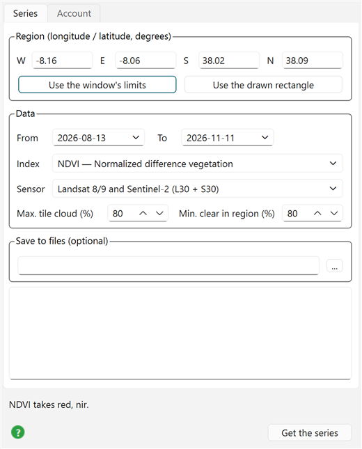
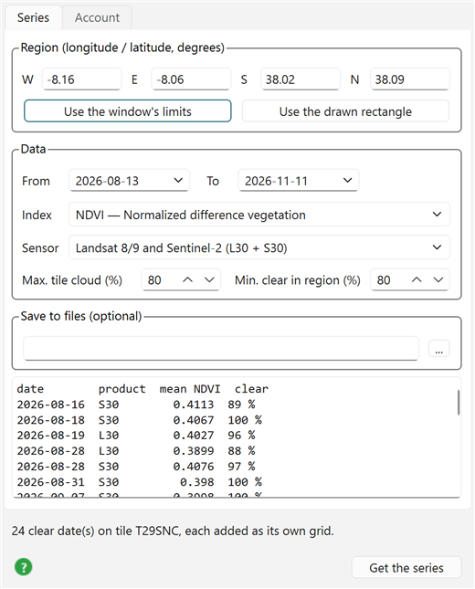
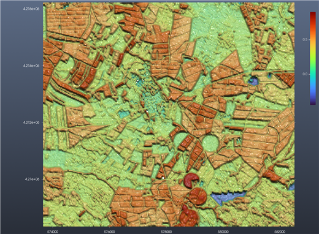
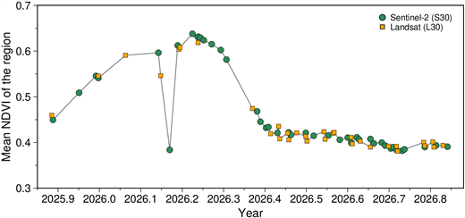

# Tutorial: HLS time series

*Satellite → Remote sensing → HLS time series…* — the **Tutorial** button at the bottom of the dialog
opens this page; the green **?** beside it opens the reference for every field, the
[HLS time series](74d-hls.md) page.

This tutorial follows the vegetation of a block of farmland through the seasons, using Landsat and
Sentinel-2 together. The place is the irrigated farmland around Ferreira do Alentejo, in southern
Portugal: dry-farmed cereals and pastures beside fields watered by centre pivots, which makes the
difference between the two kinds of field easy to see.

What you need: a free **NASA Earthdata** account. Open the dialog's **Account** tab, type the login
and the password, and press **Save login** — once, ever: the same login serves the MODIS scenes and
SWOT dialogs too.

## Example 1 — The last three months, every clear date as a grid

1. Open *Satellite → Remote sensing → HLS time series…* on an empty window.
2. **Region**: W −8.16, E −8.06, S 38.02, N 38.09 (about 9 × 8 km). Keep the default period (the
   last 90 days), **Index** *NDVI*, **Sensor** *Landsat 8/9 and Sentinel-2*, and the two cloud limits
   at 80 %.

   

3. Press **Get the series**. A progress bar follows the work: the search (NASA's catalogue found the
   region on MGRS tile T29SNC), the cloud masks of every date, then the red and NIR bands of the
   dates that are clear. Here it took about a minute.

   

   24 dates out of the 90 days were at least 80 % clear over the region, a mix of Sentinel-2 (S30)
   and Landsat (L30) — a clear look every 3 to 4 days. Each one is listed with the mean NDVI of the
   region and how much of it was clear.

4. Every date is now a grid in the window, named like *NDVI 2026-11-04 S30 — HLS T29SNC*, in Scene
   Objects; the last date is the one showing. Tick another one to see it instead.

   

   The map is in the tile's own UTM coordinates (metres), 30 m pixels. The dark red disks are
   centre-pivot fields, still green at the start of November, so most likely watered; the field
   mosaic in orange and green is irrigated and dry-farmed land in between; the blue patches (NDVI
   below 0) are farm reservoirs. Pixels a date's cloud mask flagged are left empty (NaN).

## Example 2 — A whole year, and what the curve says

Change **From** to 2025-11-01 and **To** to 2026-11-10 and press **Get the series** again. The
catalogue has 165 HLS scenes over the region in that year, cloudy or not; 73 of them were clear
enough (41 Sentinel-2, 32 Landsat), read in about 2.5 minutes. Their means, drawn against time:



- **November to March**: the autumn rains green the pastures and the winter cereals; NDVI climbs from
  0.45 to its peak, 0.64, at the end of March.
- **April and May**: the cereals ripen and are harvested, the pastures dry: NDVI falls from 0.58 in
  late April to 0.42 by early June.
- **June to November**: a long, flat 0.38–0.44. The dry-farmed land is bare or straw; what keeps the
  mean up is the irrigated fields — compare a centre pivot with its neighbours in any summer date of
  Example 1.
- **The dip on 4 March (0.38)**: one Sentinel-2 date far below the dates either side of it (0.60 and
  0.61), although its cloud mask called the region 100 % clear. No crop changes that much in a week:
  most likely thin cloud or haze the mask missed. Compare that date's grid with its neighbours'.
  Leaving such a date out is the analyst's call; the dialog keeps every date the mask accepts.

Landsat and Sentinel-2 points fall on the same curve: that is what *harmonized* buys — the two
sensors' bands are adjusted to each other, so their dates can be mixed in one series.

## Keeping the results

Give a file name under **Save to files**, e.g. `D:/hls/ferreira.nc`, and run again. Its folder
receives one GeoTIFF per date (`ferreira_20260404_S30.tif`, …), all dates in one cube
(`ferreira_cube.nc`, opened in the window with a slider to step through the dates), and
`ferreira_series.csv`: date, satellite, mean, clear share — the numbers behind the plot above, ready
for a spreadsheet.

The plot itself was drawn from Julia with the function the dialog runs:

```julia
using InteractiveGMT.RemoteS, GMT
S = hls_series([-8.16, -8.06, 38.02, 38.09]; from = "2025-11-01", to = "2026-11-10", index = "NDVI")
s2 = S.product .== "S30"
x = yeardecimal.(S.time)
basemap(region = (2025.85, 2026.88, 0.3, 0.7), figsize = (14, 6), frame = (axes = :WSen,),
        xaxis = (annot = 0.1, label = "Year"), yaxis = (annot = 0.1, label = "Mean NDVI of the region"))
plot!(x, S.mean, pen = (0.75, :gray50))
plot!(x[s2], S.mean[s2], marker = :circle, ms = 0.2, fill = :seagreen, label = "Sentinel-2 (S30)")
plot!(x[.!s2], S.mean[.!s2], marker = :square, ms = 0.2, fill = :orange, label = "Landsat (L30)",
      legend = (pos = :TR, box = :none), show = true)
```

## Try next

- **Ten times the pixels**: set **Sensor** to *Sentinel-2 L2A, 10 m (Earth Search, no login)* and run
  Example 1 again. The same fields at 10 m instead of 30 m (no account needed): nine pixels where HLS
  has one, so small fields and their edges come out.
- **One field only**: *Draw → Rectangle* over a single centre pivot in the window, then **Use the
  drawn rectangle** and **Get the series**. Its curve stays high all summer, unlike the region's.
- **NDMI** (water in the leaves) over the same year: it drops as soon as a crop goes short of
  water, so the watered fields should stand apart from the rest through the summer.
- **NDWI** on the reservoirs: follow their water area through the summer as they are drawn down.
- **Sentinel-2 only** with **NDREI1**: the red-edge bands Landsat lacks, more sensitive to chlorophyll
  late in the season.
