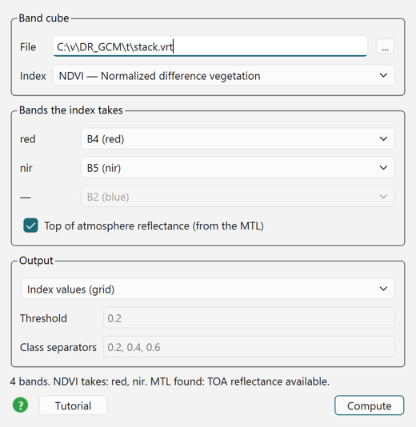
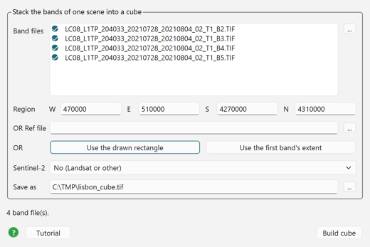
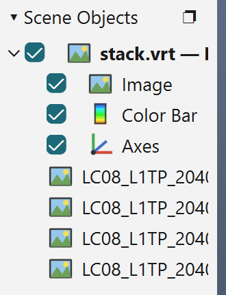
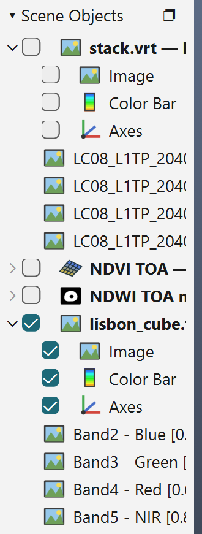

# Remote sensing: Spectral indices and Band cube

*Satellite → Remote sensing → Spectral indices…* and *Satellite → Remote sensing → Band cube (cut)…*
— the green **?** at the bottom of either dialog opens this page; the **Tutorial** button beside it
opens a worked example, [Tutorial: Landsat bands to NDVI and a water mask](74g-remote-sensing-tutorial.md).

Both tools work on a **band stack**: the bands of one satellite scene, one raster per band. A stack
comes in one of two shapes:

- a **.vrt** that points at the scene's own band files (one GeoTIFF per band, as USGS ships a Landsat
  scene) — nothing is copied, the .vrt only lists them;
- a **cube**: one multi-band GeoTIFF holding the bands themselves, cut to a region. *Band cube* makes
  one from a scene's band files.

## Band names

Wherever a tool lists the bands of a stack — the band pickers of every *Remote sensing* dialog, and the
rows in Scene Objects — a band goes by its real name, never "Layer 3":

- its **description**, when the file carries one. A cube made by *Band cube* does:
  `Band4 - Red [0.64-0.67]`;
- otherwise the **name of its file**, cut to the part that tells the bands apart: a .vrt of
  `LC08_L1TP_204033_20210728_20210804_02_T1_B2.TIF` … `_B5.TIF` lists `B2` … `B5`;
- and, for a scene whose sensor is recognised from its product name, the band's **role** after it:
  `B4 (red)`, `B5 (nir)`. Recognised are Landsat 8/9 OLI (`LC08_`, `LC09_`), Landsat 4/5/7 TM/ETM+
  (`LT04`, `LT05`, `LE07` — their bands are numbered differently), Sentinel-2 MSI (`S2A_`…, `MSIL2A`,
  tile names such as `T29SNC_…_B04_10m`) and HLS (`HLS.L30`, `HLS.S30`).

The role is what an index's band slots are filled by: NDVI's *red* slot takes `B4 (red)` on Landsat 8
and `B3 (red)` on Landsat 7, and never a band whose name merely contains the word (`B5 (redEdge1)`).

## Spectral indices



**File** — the band stack (a .vrt, a cube, any multi-band raster). Opened from a window that shows
one, it is already filled in.

**Index** — the index to compute. Picking one names its band slots below and fills them:

| Index | Bands | | Index | Bands |
|:------|:------|-|:------|:------|
| NDVI   | red, nir | | CLG    | green, redEdge3 |
| EVI    | blue, red, nir | | CLRE   | redEdge1, redEdge3 |
| EVI2   | red, nir | | MTCI   | red, redEdge1, redEdge2 |
| SAVI   | red, nir | | MCARI  | green, red, redEdge1 |
| MSAVI  | red, nir | | NDREI1 | redEdge1, redEdge2 |
| SATVI  | red, swir1, swir2 | | NDREI2 | redEdge1, redEdge3 |
| SLAVI  | red, nir, swir2 | | NDWI   | green, nir (McFeeters, open water) |
| GNDVI  | green, nir | | NDWI2  | nir, swir2 (Gao, water in leaves) |
| GLI    | red, green, blue | | MNDWI  | green, swir2 |
| TGI    | red, green, blue | | NBRI   | nir, swir2 (burn ratio) |
| VARI   | red, green, blue | | NDMI   | nir, swir1 (moisture) |

The red-edge indices need Sentinel-2: Landsat has no red-edge bands.

**Bands the index takes** — one picker per band the index needs, labelled with its role. Each is
pre-selected by that role when the sensor is recognised (see *Band names*); change it when your stack
is ordered differently. Changing the *Output* never re-picks them — only a new file or a new index does.

**Top of atmosphere reflectance (from the MTL)** — compute the index on reflectance instead of on the
raw digital numbers: each band is calibrated with the scene's **MTL** (its gain, offset and the sun's
elevation), the same calibration *Landsat calibration…* applies. It can be ticked only when the MTL is
at hand, and is ticked by default when it is:

- a .vrt of Landsat band files, with the scene's `…_MTL.txt` beside them;
- a cube made by *Band cube* from Landsat bands — it keeps the MTL in its own metadata.

A Level-2 surface-reflectance band (`…_SR_B4.TIF`) comes out as its surface reflectance. Indices are
meant to be computed on reflectance: on raw numbers each band's own gain skews the ratio.

**Output** — what the index is turned into:

| Output | Result |
|:-------|:-------|
| Index values (grid) | the index itself, a grid (NDVI runs from −1 to 1) |
| Threshold: NaN below it (grid) | the same grid, every pixel below *Threshold* left empty |
| Mask (≥ threshold) | a black/white image: white where the index ≥ *Threshold* |
| Mask (< threshold) | the reverse: white where the index < *Threshold* |
| Classes (up to 3 separators) | an image of classes 0–3, cut at the *Class separators* |

**Threshold** — the index value that splits the pixels; used by the Threshold and the two Mask
outputs (greyed out otherwise). E.g. 0.2 for NDVI vegetation, 0 for an NDWI water mask.

**Class separators** — up to three increasing values, comma-separated; used by *Classes* only. With
`0.2, 0.4, 0.6`: below 0.2 → class 0, from 0.2 → 1, from 0.4 → 2, from 0.6 → 3 (bare, sparse, moderate,
dense vegetation for NDVI).

**Compute** — the result joins the window as a new layer of its own, with its own axes and colour bar,
named after the index, the calibration and the output: `NDVI TOA — stack`, `NDWI TOA mask ≥ 0 — stack`.
A pixel where any band the index takes has no data (the fill around a satellite swath, DN 0) has no
index either: it stays empty, it is never "NDVI 0".

## Band cube



Cuts the bands of one scene to a region and stacks them into one multi-band GeoTIFF, which then opens
in the window. Landsat bands get their descriptions (`Band4 - Red [0.64-0.67]`) and the scene's MTL is
kept in the cube's metadata, so *Spectral indices* and *Landsat calibration* can calibrate it later.

**Band files** — the band files, in the order they go into the cube. Only the **checked** ones are
used. Opened from a window that shows a .vrt, the list holds that .vrt's band files, all checked.
- **...** adds files (several at once; press it again to add more, from another folder too). A file
  already listed is not added twice.
- **Drag** a file up or down to change its place in the cube.
- Hover a file for its full path.

**Region** — W / E / S / N in the band files' own coordinates (UTM metres for Landsat and Sentinel-2).
All four empty: the whole scene. Three ways to fill it besides typing:
- **OR Ref file** — pick a grid or image: its extent becomes the region, converted to the bands'
  coordinates when it is in another system. Limits you typed are left alone until you pick a new one.
- **OR Use the drawn rectangle** — the last rectangle drawn in the window (*Draw → Rectangle*), over
  the image it shows, converted to the bands' coordinates when the window is in another system.
- **Use the first band's extent** — the whole scene's extent, to trim by hand.

**Sentinel-2** — Sentinel-2 file names do not say which band set they are; say whether these are the
10 m, 20 m or 60 m bands so their descriptions can be assigned. *No* for Landsat and anything else.

**Save as** — the GeoTIFF to write. It is opened in the window when it is done.

**Build cube** — cuts, stacks, writes and opens.

## In Scene Objects

A band stack's group lists what it is made of, below its usual rows:

| A .vrt lists its band files | A cube lists its bands |
|:---:|:---:|
|  |  |

These rows have no checkbox — they are not on screen, they are what the stack holds. Click one:
- a **file** row offers **Load file**: that band file opens in the window, as *File → Open* would open it;
- a **band** row offers **Load band**: that band joins the window as a layer of its own, named
  `<cube> — <band>`.

Hover a row for the file's full path, or the band's number and full name.

## From Julia

The dialogs run InteractiveGMT's RemoteS functions, which work on their own too:

```julia
using InteractiveGMT.RemoteS
# a cube of bands 2-5, cut to a block of the scene (UTM metres), MTL kept in its metadata
cutcube(names = ["…_B2.TIF", "…_B3.TIF", "…_B4.TIF", "…_B5.TIF"],
        region = [470000, 510000, 4270000, 4310000], save = "lisbon_cube.tif")
# NDVI on TOA reflectance: the cube's band 4 (red) and band 5 (nir), calibrated with its MTL
R = dn2reflectance("lisbon_cube.tif", band = 4)
N = dn2reflectance("lisbon_cube.tif", band = 5)
G = ndvi(R, N)
```

Every index has its function of the same name (`evi`, `ndwi`, `mndwi`, …), and `threshold=`,
`mask=` and `classes=` give the other outputs.
