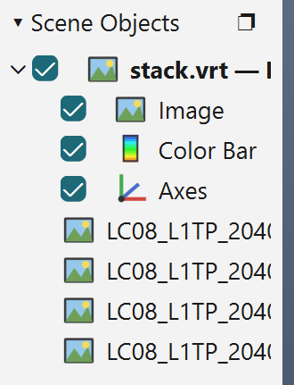
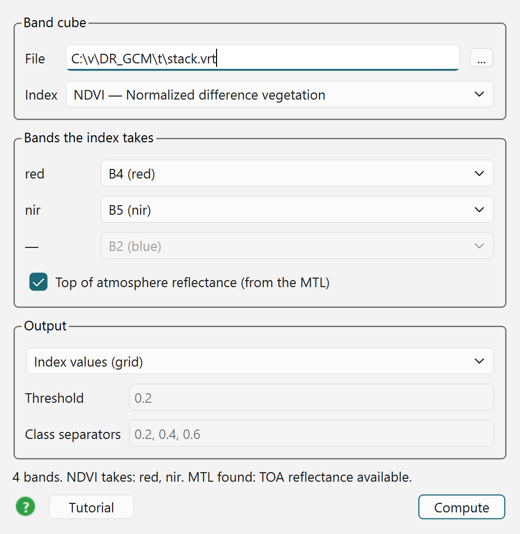
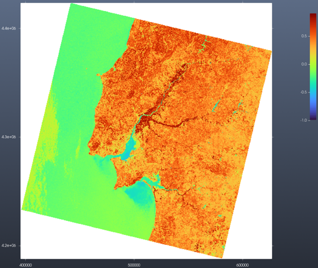
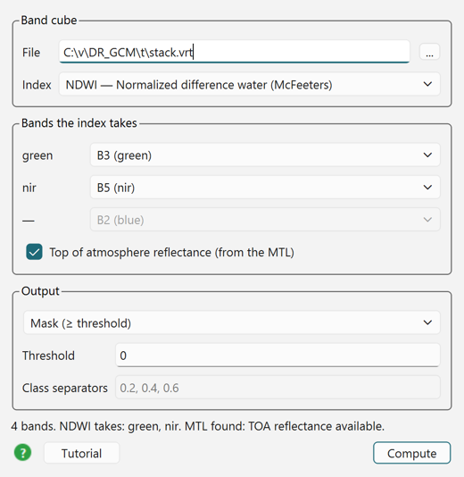
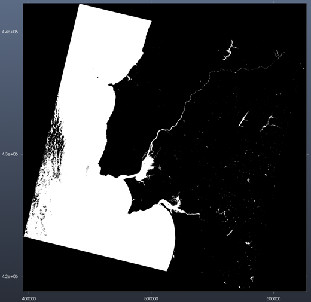
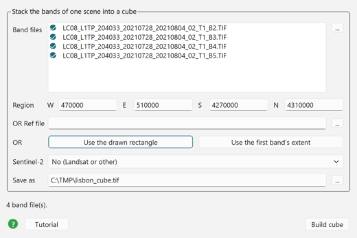
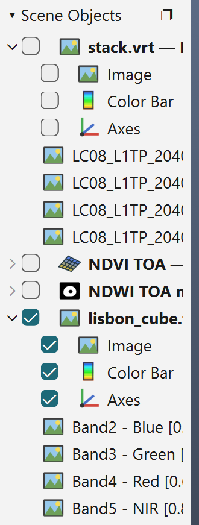
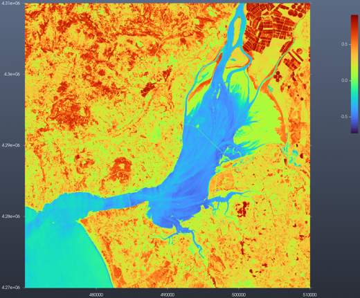

# Tutorial: Landsat bands to NDVI and a water mask

*Satellite → Remote sensing → Spectral indices…* and *Band cube (cut)…* — the **Tutorial** button at
the bottom of either dialog opens this page; the green **?** beside it opens the reference for every
field, the [Remote sensing](74f-remote-sensing.md) page.

This tutorial takes one Landsat 8 scene of the Lisbon region, on 28 July 2021, from its band files to
a vegetation index (NDVI), a water mask, and a cube of the city and the Tagus estuary.

## The data

The scene is `LC08_L1TP_204033_20210728_20210804_02_T1`: Landsat 8, path 204, row 033, Collection 2
Level-1. Get it from USGS EarthExplorer (<https://earthexplorer.usgs.gov>, a free account): search that
ID under *Landsat → Landsat Collection 2 Level-1 → Landsat 8-9 OLI/TIRS C2 L1*, and from the product's
options download the bands **B2, B3, B4, B5** (blue, green, red, near infrared) and the **MTL.txt**,
all into one folder.

Stack the four bands with a `.vrt` — a small text file that lists them, nothing is copied — from Julia:

```julia
using GMT
cd("C:/landsat")       # the folder with the bands
b = ["LC08_L1TP_204033_20210728_20210804_02_T1_B$k.TIF" for k in 2:5]
gdalbuildvrt(b, ["-separate"]; save = "stack.vrt")
```

(or `gdalbuildvrt -separate stack.vrt …_B2.TIF …_B3.TIF …_B4.TIF …_B5.TIF` in a terminal).

## Example 1 — Open the stack

*File → Open* `stack.vrt`. The window shows its first band, B2. Its group in Scene Objects lists the
four band files below the usual rows:



Click one of them for **Load file**: that band opens in the window on its own, as *File → Open* would
open it. Hover one for its full path.

## Example 2 — NDVI, on reflectance

Open *Satellite → Remote sensing → Spectral indices…*. The **File** is the window's `stack.vrt`, the
**Index** is NDVI, and its two band slots are already filled: **red** with `B4 (red)` and **nir** with
`B5 (nir)` — the file names tell which Landsat bands these are. The MTL is beside the bands, so **Top
of atmosphere reflectance** is ticked: each band is calibrated to reflectance before the index is
computed.



Press **Compute**. *NDVI TOA — stack* joins the window:



- the land is orange to dark red: vegetation, dry in late July except where it is watered or wooded;
  the dark red band across the middle is the farmland and woods along the Tagus valley;
- water is green to blue (NDVI at or below 0): the ocean, the Tagus and Sado estuaries, the
  reservoirs inland;
- the yellow-green streaks along the scene's western edge are clouds over the ocean;
- the corners outside the scene's swath have no data, and stay empty.

## Example 3 — A water mask

In the same dialog, set **Index** to *NDWI — Normalized difference water (McFeeters)*: its slots
become **green** (`B3 (green)`) and **nir** (`B5 (nir)`). Set **Output** to *Mask (≥ threshold)* and
**Threshold** to 0 — open water is where NDWI is positive.



**Compute** gives a black and white image, white where there is water:



The ocean and both estuaries are one white body; inland the Tagus can be followed upstream, and the
reservoirs stand out. Where the clouds are over the sea the mask breaks into black specks: clouds are
not water.

## Example 4 — A cube of Lisbon and the estuary

A whole scene is 7721 × 7851 pixels a band. Cut the four bands to a 40 × 40 km block around the
estuary, into one file: open *Satellite → Remote sensing → Band cube (cut)…*. Opened over the .vrt,
**Band files** already lists its four bands, all checked. Type the **Region** in the bands' own UTM
metres — W 470000, E 510000, S 4270000, N 4310000 — and a **Save as** file:



(**Use the first band's extent** fills the four boxes with the whole scene's limits, to trim by hand;
**OR Use the drawn rectangle** takes a rectangle drawn on the window with *Draw → Rectangle*.)

Press **Build cube**. The cube opens in the window, and its group lists its four bands by name:



Click a band for **Load band**: it joins the window as a layer of its own.

The cube keeps the scene's MTL in its metadata. In *Spectral indices*, point **File** at the cube and
compute NDVI again — **Top of atmosphere reflectance** is available, with no MTL file beside it:



At 30 m the block shows the city's parks and woods (red) among the built-up land (yellow), the
estuary's tidal flats and channels (blue), and, upstream in the north-east, the watered fields of the
Tagus lezíria — centre pivots included.

## Try next

- **Classes**: NDVI with *Output* *Classes (up to 3 separators)* and `0.2, 0.4, 0.6` — bare, sparse,
  moderate and dense vegetation as four classes.
- **The other side of the mask**: *Mask (< threshold)* with the same NDWI 0 gives the land.
- **One field only**: *Draw → Rectangle* over the lezíria, then in *Band cube* **OR Use the drawn
  rectangle** and **Build cube**.
- **More bands**: download B6 and B7 (SWIR) too and add them to the .vrt or the cube's file list.
  MNDWI (green, swir2) is the better water index where water lies next to built-up land; NBRI and
  NDMI need them as well.
- **Untick a band**: in *Band cube*, untick the files you do not need — only the checked ones go into
  the cube — or drag them into another order.
