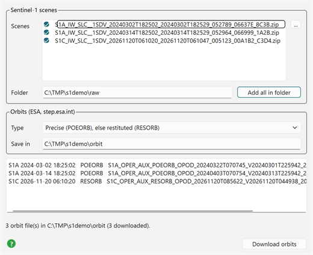

# Sentinel-1 orbits

*Geophysics → GMTSAR → Sentinel-1 orbits…*

This dialog downloads the **orbit file** of each Sentinel-1 scene from ESA's public orbit archive
and unzips it to the `.EOF` file GMTSAR reads. It does the same job as GMTSAR's
`download_sentinel_orbits.csh`, with the same server and the same rule for choosing a file. It does
not need `csh`, `wget`, `unzip` or a BSD/GNU `date`, so it runs on Windows, Linux and macOS alike.

It does not need the [GMTSAR plugin](81-gmtsarplugin.md), and it does not need a map in the window.
The entry is always in the GMTSAR menu.

## Why InSAR needs orbit files

The orbit stored inside a Sentinel-1 product is a prediction made at acquisition time. It is good to
a few metres. Interferometry needs the satellite's position to a few centimetres, to remove the
flat-earth and topographic phase and to co-register the scenes of a stack. ESA computes better
orbits after the acquisition and publishes them separately:

| Type | Name in the archive | Accuracy | Published | One file covers |
|------|---------------------|----------|-----------|-----------------|
| Precise | `AUX_POEORB` | ~5 cm | ~20 days after the acquisition | ~26 hours (one day, plus an hour each side) |
| Restituted | `AUX_RESORB` | ~10 cm | a few hours after | ~3 hours |

Use **precise** orbits whenever they exist. Use **restituted** orbits only for scenes from the last
three weeks, for which no precise orbit has been published yet. Redo the processing with precise
orbits when they come out if the result matters.

GMTSAR's Sentinel-1 preprocessing (`make_s1a_tops`, `align_tops.csh`, `preproc_batch_tops.csh`,
`preproc_batch_tops_esd.csh`) is given one `.EOF` file per scene.

## The dialog

The dialog has two boxes, a log, a status line and one action button.



### Sentinel-1 scenes

**Scenes** is the list of scenes whose orbits you want. Only the **checked** scenes are used:
untick a scene to leave it out of a download without removing it. Hover over a scene to see its full
path.

The dialog never opens the files. It reads the **satellite** (S1A, S1B, S1C or S1D) and the
**acquisition start and stop times** from each file's **name**. So the list accepts:

* **A product zip**, as downloaded from the Copernicus Data Space or by the
  [Sentinel-1 SAR products](73b-sentinel1.md) dialog:
  `S1A_IW_SLC__1SDV_20240302T182502_20240302T182529_052789_06637E_8C3B.zip`
* **An unzipped `.SAFE` folder.** A file dialog cannot choose a folder, so choose the
  `manifest.safe` file inside it. The dialog uses the name of the folder that holds it.
* **A measurement file** (`.tiff`) or its annotation (`.xml`), as GMTSAR's `raw/` folder holds or
  links them: `s1a-iw1-slc-vv-20240302t182503-20240302t182528-052789-06637e-004.tiff`

Two ways to fill the list:

* The **…** button opens a file dialog. Several files can be chosen at once, and pressing the button
  again **adds** to the list; a file already in it is not added twice.
* **Folder** and **Add all in folder**: type a folder and press the button. It adds every scene in
  that folder (not its sub-folders): the `.SAFE` folders and `.zip` products whose names start with
  `S1A_` … `S1D_`. If the folder has none of those, it adds the measurement files (`s1a-…`, `.tiff`
  or `.xml`) instead, which is what a GMTSAR `raw/` folder holds. If **Save in** is empty, it is set
  to that folder.

Each change of the list rewrites the **log** with one line per path, saying how its name was read:

```
S1A 2024-03-02 18:25:02   S1A_IW_SLC__1SDV_20240302T182502_20240302T182529_052789_06637E_8C3B.SAFE
S1A 2024-03-14 18:25:02   S1A_IW_SLC__1SDV_20240314T182502_20240314T182529_052964_066999_1A2B.zip
(not a Sentinel-1 scene name)   foo.zip
```

A path marked *(not a Sentinel-1 scene name)* is skipped. Rename the file to its original ESA name,
or add the measurement files instead. The status line gives the number of scenes, their satellites
and the date range.

### Orbits

* **Type**:
    * **Precise (POEORB), else restituted (RESORB)**: the default. Each scene gets a precise orbit
      if one exists and a restituted orbit otherwise. A mixed list (old and recent scenes) is
      handled in one go; the log says which type each scene got.
    * **Precise only (POEORB)**: a scene with no precise orbit yet gets none, and the log says so.
    * **Restituted only (RESORB)**.
* **Save in**: the folder the `.EOF` files are written to. It is created if it does not exist. If you
  leave it empty, the folder of the first scene in the list is used, and it is filled in for you when
  scenes are added. An orbit file that is already in this folder is not downloaded again, so it is
  safe to run the same list twice, or to point several projects at one shared orbit folder.

### Download orbits

**Download orbits** does, for each checked scene, in list order:

1. It reads the archive's listing for that satellite and orbit type, for the month of the day
   before the acquisition and for the month of the acquisition. The archive files an orbit under the
   month its validity **starts**, so a scene on the first of a month may need the previous month's
   listing. Each listing is read once per run, however many scenes need it.
2. It keeps the orbit files that cover the scene **with at least 50 minutes to spare at both
   ends**: valid from at least 50 minutes before the scene starts to at least 50 minutes after it
   ends. This is the rule `download_sentinel_orbits.csh` uses. Of those, it takes the one with the
   most time to spare on its shorter side, and the most recently produced one if two are equal.
3. If **Type** allows a fallback and no precise orbit qualifies, it tries the restituted ones the
   same way.
4. It downloads the `.EOF.zip`, checks that a zip arrived, unzips the `.EOF` into **Save in** and
   deletes the zip.

A progress bar shows which scene is being processed. When it is done, the log has one line per
scene:

```
S1A 2024-03-02 18:25:02   POEORB   S1A_OPER_AUX_POEORB_OPOD_20240322T070745_V20240301T225942_20240303T005942.EOF
S1A 2024-03-14 18:25:02   POEORB   S1A_OPER_AUX_POEORB_OPOD_20240403T070754_V20240313T225942_20240315T005942.EOF
S1A 2024-03-02 18:25:03   POEORB   S1A_OPER_AUX_POEORB_OPOD_20240322T070745_V20240301T225942_20240303T005942.EOF   (already there)
S1C 2026-11-20 06:10:20   RESORB   S1C_OPER_AUX_RESORB_OPOD_20261120T085622_V20261120T044938_20261120T084438.EOF
```

* `POEORB` / `RESORB`: the type found, then the `.EOF` file written to **Save in**.
* `(already there)`: the file was in **Save in** already and was not downloaded. Several swaths or
  polarisations of one scene, or scenes from one day, share one precise orbit file; the first gets
  it and the others say *(already there)*.
* `NO POEORB orbit in ESA's archive yet`: no precise orbit covers the scene. If it is less than about
  three weeks old, choose a type that allows restituted orbits, or wait.
* `NO POEORB or RESORB orbit …`: nothing covers the scene, not even with the fallback. Check the
  name: a wrong date or satellite in a renamed file looks like this.
* `FAILED: …`: the download or unzip failed, with the reason (no network, a server error code, a file
  that was not a zip). Run again later: the scenes already done are skipped.

The status line counts the orbit files in **Save in** for this list, how many were downloaded this
time, and how many scenes got none. If **no** scene got an orbit, a message box shows the log
instead.

### The rest

* The green **?** opens this page.
* Closing the dialog with the window's **X** (or Esc, or Minimise) **parks** it in the window's dock,
  with its list and settings intact. Double-click the parked row, or choose the menu entry again, to
  bring it back. The parked row's *Delete* closes it for good.
* Enter never starts a download; only the button does.

## Typical uses

### Orbits for scenes you downloaded with iGMT

1. Download the SLC scenes with *Satellite → Copernicus → Sentinel-1 SAR products…* (they go to
   `~/Downloads/Sentinel-1` unless you changed its **Folder**).
2. Open *Geophysics → GMTSAR → Sentinel-1 orbits…*, type that folder in **Folder** and press **Add
   all in folder**.
3. Leave **Type** on its default, set **Save in** to the orbit folder of your GMTSAR project (for
   example `…/project/orbit`), and press **Download orbits**.

### A GMTSAR stack

GMTSAR's Sentinel-1 workflow keeps the measurement files in `raw/` (often as links). Type the `raw/`
folder in **Folder** and press **Add all in folder**: with no products in it, the measurement files
are listed (every swath and polarisation). Set **Save in**, usually `raw/` itself or the folder your
`data.in` is built from, and press **Download orbits**. Scenes from the same pass on the same day
share one orbit file, which is downloaded once.

`preproc_batch_tops.csh` then takes a `data.in` whose lines pair each measurement name (without
extension) with its orbit file:

```
s1a-iw1-slc-vv-20240302t182503-20240302t182528-052789-06637e-004:S1A_OPER_AUX_POEORB_OPOD_20240322T070745_V20240301T225942_20240303T005942.EOF
s1a-iw1-slc-vv-20240314t182503-20240314t182528-052964-066999-004:S1A_OPER_AUX_POEORB_OPOD_20240403T070754_V20240313T225942_20240315T005942.EOF
```

The log gives each scene's orbit file name, so the pairs can be copied from it.

### Recent scenes now, precise orbits later

For a fast first result from scenes a few days old, download with the default type: those scenes get
restituted orbits. About three weeks later, run the same list again with **Precise only**: the precise
files are downloaded next to the restituted ones (different names), and you redo the processing with
them.

## The archive

The orbits come from <https://step.esa.int/auxdata/orbits/Sentinel-1/>, a plain web directory that
needs no account:

```
https://step.esa.int/auxdata/orbits/Sentinel-1/<POEORB|RESORB>/<S1A|S1B|S1C|S1D>/<yyyy>/<mm>/
    S1A_OPER_AUX_POEORB_OPOD_<produced>_V<valid from>_<valid to>.EOF.zip
```

The dialog only reads that directory and downloads files from it. GMTSAR's other orbit script,
`fetchOrbit.py`, queries `scihub.copernicus.eu/gnss`, which ESA has shut down; the dialog does not use
it.

## Where the work happens

The dialog is `deps/ui/remotes_s1orbits.ui`, run by the generic Remote sensing dialog
(`RemoteSDialog`, `deps/src/70_window.cpp`). The name parsing, archive listing, choice of file,
download and unzip are in `src/s1orbits.jl` (`_rs_s1orbits`).
