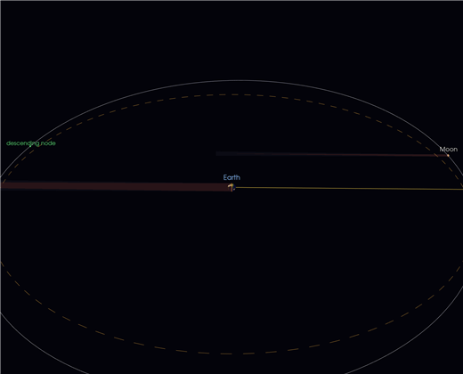
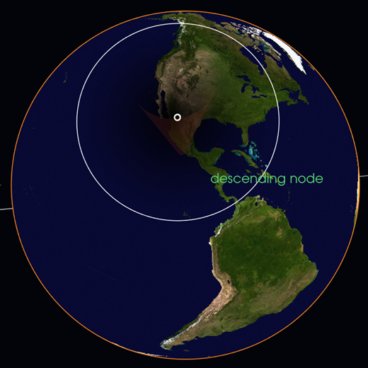
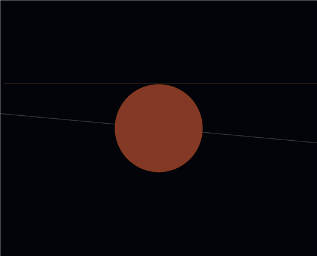
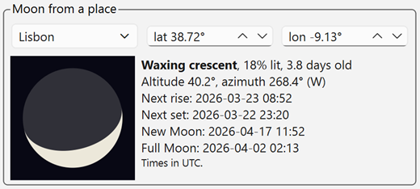

# Tutorial: The Earth-Moon System

**Earth-Moon system** shows the Earth and the Moon **at true scale** at any instant from 100 AD to
2999 AD. Each body has its day and night side. The shadow each body casts is drawn, and so are the
eclipses those shadows make. The window also lists every solar and lunar eclipse from 1900 to 2100.
The demo computes that list with its own ephemeris; it is not copied from a catalogue.

This tutorial covers the window and the lines it draws. It also explains the **dashed orange line**,
the **ascending and descending nodes**, and why eclipses do not happen every month. It ends with the
**Moon from a place** panel: the Moon's phase as it looks from any place on the Earth.

## 1. Open it

From any iGMT window: **T & L → Earth-Moon system…**. You do not need any data.

The window opens on the present instant. It has three parts:

- the **3-D view** of the Earth and the Moon (left);
- the **panel** (right): the numbers for this instant, the **Moon from a place** box, the eclipse
  list and the legend. The small arrow button at its edge folds it away and brings it back;
- the **time slider** under the view, then **two rows of controls**: time, display options and
  cameras. The green **?** disk at the right end of the first row opens this tutorial or the
  InteractiveGMT manual in the browser.

Drag in the view to rotate it, **Shift**+drag to pan it, and use the wheel to zoom.
**Overview** brings back the default view of the whole system.

Changing the time never moves the camera. Only the Moon, the Sun's direction, the shadows and the
Earth's turn change, so you can watch the Moon go round from a view you chose.

## 2. What the view draws

Everything is in the plane of the Earth's orbit (the ecliptic), seen from the Earth's centre.
**One unit is the Earth's radius.** The Moon is about 60 units away, and its radius is 0.27 units.
Because the Sun is about 23 500 units away, it is not drawn. A **yellow line** points towards it.

| On screen | What it is |
|---|---|
| Textured globe | The Earth, turned to its true orientation for the instant (sidereal time) |
| Grey sphere | The Moon |
| **Solid** orange ring on each body | The day/night line (terminator) |
| Yellow line, "to the Sun" | The direction of the Sun |
| Reddish translucent cone | **Umbra**: the full shadow, where the Sun is completely hidden |
| Faint bluish cone | **Penumbra**: the partial shadow, where part of the Sun is hidden |
| Grey solid curve | The Moon's path, 15 days before and after the instant shown |
| **Dashed orange** circle | The **ecliptic**, drawn at the Moon's current distance |
| Green dots and labels | The Moon's **nodes**: the ascending node and the descending node |

The night side of each body is darkened. Eclipse shadows are computed point by point: each point on
a surface is shaded by how much of the Sun's disc the other body hides from that point. One formula
therefore gives the umbra, the penumbra and the day/night line. Where the Moon is completely inside
the Earth's umbra, it is shown **copper-red**, because the Earth's atmosphere bends red sunlight into
the shadow.

!!! note "Two orange lines"
    The **solid** orange ring around a body is that body's day/night line. The **dashed** orange
    circle is the ecliptic. They are different lines with similar colours.

## 3. The dashed orange line: the ecliptic

The **ecliptic** is the plane of the Earth's orbit around the Sun. Seen from the Earth, it is the
path the Sun follows across the sky during the year. The Earth's shadow is cast away from the Sun,
so the shadow always lies in the ecliptic plane. The Moon's shadow lies in that plane only when the
Moon itself is on it.

The ecliptic is an infinite plane, so the demo draws it as a **dashed circle with the same radius as
the Moon's distance today**. The Moon's path and the ecliptic are then at the same scale and can be
compared directly. The circle is redrawn at every step, so its radius follows the Moon between
perigee (about 356 000 km) and apogee (about 406 000 km).

The Moon's orbit is **tilted about 5.1°** to the ecliptic. In the view, the grey curve of the Moon's
path is therefore close to the dashed circle but not on it. For half of each month the Moon is north
of (above) the ecliptic, and for the other half it is south of (below) it.

## 4. The nodes: ascending and descending

The Moon's tilted orbit crosses the ecliptic plane at **two points**, called the **nodes**:

- **Ascending node (☊)**: the Moon crosses the ecliptic going from **south to north**.
- **Descending node (☋)**: the Moon crosses the ecliptic going from **north to south**.

The two nodes are on opposite sides of the Earth. The demo finds them along the grey path (±15
days). It marks each crossing with a green dot and labels it with its direction. A 30-day path
contains one crossing of each kind, so at most one ascending and one descending node are shown.

The nodes are not fixed. Mainly because of the Sun's pull, they move slowly **westward** along the
ecliptic, which is called *regression of the nodes*. They make one full turn in **18.6 years**. Step
through a few months with **1 day** steps and you can see the green dots move round the dashed
circle.

### Why the nodes decide the eclipses

A solar eclipse needs a **new Moon** (the Moon between the Sun and the Earth). A lunar eclipse needs
a **full Moon** (the Earth between the Sun and the Moon). Both happen every month. Eclipses do not,
because at most new and full Moons, the 5° tilt keeps the Moon above or below the Sun-Earth line:

- the Moon's shadow passes **above or below the Earth**: no solar eclipse;
- the Moon passes **above or below the Earth's shadow**: no lunar eclipse.

An eclipse happens only when a new or full Moon falls **close to a node**, where the Moon is in the
ecliptic plane and the three bodies can line up. That condition is met during an **eclipse season**,
when the Sun is near the line of the nodes. There are about two eclipse seasons a year, roughly 173
days apart. The legend states this in short form: *"Nodes: eclipses happen only near them"*.

The first figure (2026-03-20 0h, panel: *Moon 1 % lit*, *no eclipse*) shows this. That instant is
a new Moon, but the Moon is far from its descending node. Its shadow cone passes the Earth without
touching it.

## 5. A total solar eclipse: 8 April 2024

1. Type `2024-04-08 18:17:00` in the date box (UTC), or find **2024-04-08 … Solar total** in the
   list and click it.
2. Click **Earth from the Sun**. The camera looks at the Earth's day side from the Sun's direction.
   (Clicking a solar eclipse in the list places this camera for you.)

The Moon's umbra reaches North America, and the penumbra darkens a large area around it. Two
**white circles** mark the shadow on the ground: the small thick one is the edge of the umbra
(totality inside it; in an annular eclipse, the antumbra, where a ring of Sun is left), the large
thin one the edge of the penumbra (a partial eclipse anywhere inside it). In the
figure the **descending node** is right in front of the Earth, where the grey Moon path crosses the
dashed ecliptic. A new Moon at a node is exactly the condition for an eclipse. The panel shows
*Solar total eclipse, up to 100 % of the Sun hidden*.

Click **Animate eclipse** to see the whole eclipse, from the first contact (15:42 UT, when the
penumbra first touches the Earth) to the last (20:52 UT), in about 24 seconds. The white circles
cross the Earth from west to east as it turns underneath them, and the eclipse leaves its **track**
in red: the line of greatest eclipse in the middle (where the shadow's axis meets the Earth), and
the north and south limits of the umbra on either side of it, the path of totality. Farther out, in
**light grey**, are the limits of the penumbra, the zone where the eclipse is seen as partial. A
side whose penumbra runs off the Earth (in 2024, past the North Pole) has no limit. The track is
drawn on the globe itself, so it turns with the Earth and stays there until you go to another
eclipse. Its two short hooks at the ends are sunrise and sunset, before and after the umbra
reaches the ground. Click it again, or **Pause**, to
stop. It works for lunar eclipses too: the camera then follows the Moon through the Earth's shadow.

## 6. A total lunar eclipse: 7 September 2025

1. Find **2025-09-07 … Lunar total** in the list and click it. The view goes to greatest eclipse and
   switches to **Moon from the Earth**.
2. The Moon is inside the Earth's umbra and is copper-red. The panel shows *Lunar total eclipse,
   umbral magnitude 1.36*: the Moon is 0.36 of its diameter deeper than just inside the umbra.

Click **Overview** for this instant. The full Moon is now at its **ascending node**, on the far side
of the Earth from the Sun, inside the Earth's shadow cone.

## 7. The Moon from a place

The **Moon from a place** box shows the Moon as it looks from one place on the Earth at the instant
shown. It opens at **your own location** ("My location", found by GMT.jl's `whereami()`) and
at the present instant, so you see tonight's Moon. Pick a city from the list, or type a latitude and
longitude, to see it from somewhere else. A place picked here is also handed to the **Sky viewer**.

The disc shows the Moon as it looks in that place's sky: **up is the place's zenith**. The lit fraction
is the same from everywhere on the Earth, but the tilt of the lit side is not:

- **Near the equator**, an evening crescent lies on its back, like a bowl.
- **At mid-northern latitudes**, it leans, with the lit side down and to the right, towards the Sun
  that has just set (the figure: Lisbon, 3.8 days after new Moon).
- **South of the equator**, the Moon is turned over. A first-quarter Moon is lit on the right from
  Lisbon and on the left from Sydney.

When the Moon is below the place's horizon the disc is dimmed and says so.

Beside the disc:

| Line | Meaning |
|---|---|
| Phase name | New Moon, Waxing crescent, First quarter, Waxing gibbous, Full Moon, Waning gibbous, Last quarter, Waning crescent |
| % lit, days old | The lit fraction of the disc, and the time since the last new Moon |
| Altitude, azimuth | Where to look: height above the horizon, and the compass direction (from north, through east) |
| Next rise / Next set | The next moonrise and moonset at that place, within the next 36 hours |
| New Moon / Full Moon | The next new and full Moon |

All times are in **UTC**; add the place's time zone for local time. Rise and set are for the top of
the Moon's disc touching a sea-level horizon, with the usual allowance for refraction. Hills and
buildings are not taken into account.

Drag the **time slider** and watch the disc fill up and empty. At the same time the Moon climbs and
sets, and its lit side turns as it crosses the sky.

## 8. The controls

**Time slider** (under the view): drag it to move time smoothly through one lunar month, 14.8 days
either side of the date set in the box. The arrow keys move it by 10 minutes and Page Up / Page Down
by 6 hours. Setting a date outside that month (box, eclipse list, **Now**, **Play**) re-centres the
slider on the new date.

**Bottom row 1 (time)**

| Control | Does |
|---|---|
| Date/time box | The instant shown, in **UTC** (proleptic Gregorian calendar), 100 AD to 2999 AD. The arrows and the mouse wheel step the part the cursor is in (the day, until you click another part: the hour, the minute…). The button at the right opens a calendar |
| **Now** | Go back to the present instant |
| **Play** / **Pause** | Run the clock, one step per frame |
| ◀ / ▶ and the step list | One step back or forward. Steps: 1 min, 5 min, 15 min, 1 h, 6 h, 1 day. Hold the button to repeat |
| **Backward** | **Play** runs time backwards |
| **◀ Eclipse** / **Eclipse ▶** | The previous or next eclipse in the list (using the list's filters) |
| **Animate eclipse** | Runs the eclipse at the instant shown from its first contact to its last, in about 24 seconds. Its camera is placed once, at the start; for a lunar eclipse it follows the Moon. A solar eclipse leaves its track on the Earth (red: line of greatest eclipse and the umbra's limits; light grey: the partial zone's limits). Click again to stop |

**Bottom row 2 (display and cameras)**

| Control | Does |
|---|---|
| **Size ×** | Draws both bodies 1× to 10× larger; the demo opens at ×2. The shadow cones widen with them; distances, and where each cone ends, stay true. At ×1 everything is to scale, and the bodies are specks: the Moon is 60 Earth radii away |
| **Shadow cones** | Show or hide the umbra and penumbra cones |
| **Moon path & nodes** | Show or hide the Moon's path, the dashed ecliptic and the nodes |
| **Overview** | Free camera over the whole system |
| **Earth from the Sun** | Looks at the Earth's day side from the Sun: where the Moon's shadow falls in a solar eclipse |
| **Moon from the Earth** | Looks at the Moon from the Earth: its phase, and the Earth's shadow in a lunar eclipse |
| **Earth from the Moon** | Looks at the Earth from beside the Moon |

Each camera button places the camera **once**, for the instant shown. Changing the time afterwards
leaves the camera where it is, and only the bodies move. To look at the Moon again after it has
moved on, click the button again. Clicking an eclipse in the list (or **◀ Eclipse** / **Eclipse ▶**)
also places the camera that shows that eclipse, once.

**The panel**

- **Numbers for the instant shown**: time in UTC, TT − UT (ΔT, in seconds), the Moon's distance in
  km and in Earth radii, the illuminated fraction of the Moon (its phase), the Sun's distance in AU,
  and **Now**: whether an eclipse is in progress, and of which kind.
- **Moon from a place**: see section 7.
- **Eclipse list**: every eclipse from 1900 to 2100, filtered by **Solar**, **Lunar** and
  **Penumbral**. Penumbral lunar eclipses, where the Moon only dims, are hidden unless that box is
  ticked. Each row gives the time of greatest eclipse (UTC), the kind, **γ** and, for lunar
  eclipses, **mag**. Click a row to go to that eclipse with the right camera.
  - **γ (gamma)**: how closely the alignment passes, in Earth radii, positive to the north. For a
    solar eclipse it is the distance of the Moon's shadow axis from the Earth's centre. For a lunar
    eclipse it is the distance of the Moon's centre from the axis of the Earth's shadow. A small |γ|
    means the eclipse is close to a node and central.
  - **mag**: umbral magnitude (penumbral magnitude for penumbral eclipses). It is the fraction of
    the Moon's diameter inside the shadow. A value of 1 or more means the eclipse is total.

Closing the window (the X, Esc or minimise) **parks** it in the Scene Objects of the window it was
opened from. Double-click that row to bring it back, with its date and camera unchanged.

## 9. Things to try

- **One month in a minute.** Drag the time slider from end to end. In the view the Moon goes once
  round the Earth. In the **Moon from a place** box it waxes from new to full and wanes back.
- **Same Moon, two hemispheres.** Look at the first-quarter Moon of 25 March 2026 in the evening at
  each place: from Lisbon at `2026-03-25 19:18`, then type latitude −33.87, longitude 151.21
  (Sydney) and set `2026-03-25 08:00` (evening there). It is lit on the right from Lisbon and on the
  left from Sydney.
- **Watch the nodes regress.** Set the step to **1 day**, leave **Backward** unticked, and click **Play**. Track
  the green dots against the dashed ecliptic for a few months. Then compare a date with the same
  date 9.3 years later: the ascending and descending nodes have changed places.
- **Eclipse seasons.** Step through the list with **Eclipse ▶**. Eclipses come in pairs or threes,
  a solar and a lunar about two weeks apart, and then nothing for about six months.
- **An annular eclipse.** Go to **2024-10-02 … Solar annular**. The Moon is near apogee, its umbra
  ends before it reaches the Earth, and the panel shows less than 100 % of the Sun hidden.
- **The true scale.** Set **Size ×1** in Overview: the Earth and the Moon shrink to specks, and you
  see how empty the space between them is, and how thin their shadows are.

## Accuracy

Positions come from the same ephemeris as **Solar system** and **Sky viewer** (ELP-2000/82 series
for the Moon, JPL Keplerian elements for the Sun). Checked against NASA's eclipse catalogues, the
time of greatest eclipse is within 2 minutes and γ within 0.01. The Earth's shadow is enlarged by
1/85 of its radius to account for the atmosphere, as in NASA's catalogue.

The Earth is treated as a sphere. The list is global: it does not give local contact times or the
path of totality. Hybrid solar eclipses are listed as total or annular.
