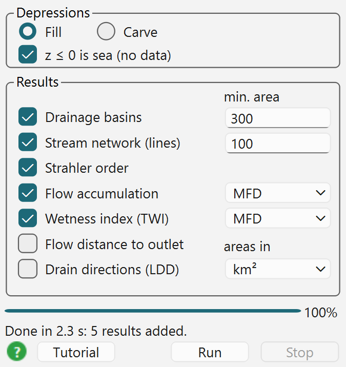

# Drainage analysis

*Grid Tools → Drainage analysis…* — the green **?** at the bottom of the dialog opens this page. For
a worked example, step by step, see the [tutorial](83b-drainage-tutorial.md).

From a digital elevation model alone, this tool works out where the water goes: the **drainage
basins** (catchments), the **river network** with its **Strahler order**, the **flow accumulation**,
the **topographic wetness index**, the **distance to the outlet** along the flow, and the **drain
directions** in the form hydrological models such as LISFLOOD read. The computation is done by
GMT.jl's hydrology functions (`flowdir`, `flowacc`, `drainagebasins`, `streamnet`, `streamorder`,
`twi`, `flowdistance`, `ldd`).

It works on the grid **on display** in the window. In a window with no grid the dialog still opens,
with every control greyed out until a grid is loaded.

## Depressions

Real DEMs are full of small pits — cells lower than all their neighbours, mostly noise — where water
would stop and the basins would break into thousands of fragments. They are removed first:

- **Fill** raises each pit to the level of its lowest rim. Robust; the filled hollows become flat
  areas, and the flow on them is routed toward their spill point.
- **Carve** keeps each pit at its own elevation and lowers a narrow channel from it through its rim.
  It changes fewer cells and suits DEMs where a road or a dam blocks a valley.

## z ≤ 0 is sea (no data)

Cells at or below zero are treated as sea, so rivers end at the coast. Keep it ticked for DEMs that
include bathymetry, like `@earth_relief`; untick it for land below sea level (the Dead Sea, polders)
or a DEM on a different datum.

## Results

Tick what you want. Each one is added to the window as a new layer, named after the source grid
("… drainage basins", "… wetness index (TWI, MFD)", …):

| Result | What it is |
|---|---|
| Drainage basins | every cell labelled with the basin it drains to; 1 = the largest |
| Stream network (lines) | the rivers as lines on top of the display, one line per reach |
| Strahler order | a grid with the order of each river cell |
| Flow accumulation | log10 of the upstream area draining through each cell (km²) |
| Wetness index (TWI) | ln(a / tan β): where water collects and stays |
| Flow distance to outlet | distance along the flow path to the basin outlet (km) |
| Drain directions (LDD) | flow direction of each cell, PCRaster keypad code (8 = north, 5 = outlet) |

**min. area** — the smallest basin kept, and the upstream area at which a river starts (the stream
network and the Strahler order use the second one).

**areas in** — the unit of the two min. areas: *cells*, or *km²* for a georeferenced DEM (geographic,
or projected in metres).

**Flow method** (two boxes) — how water is passed downhill for the flow accumulation and for the
wetness index:

- **D8** sends all the water of a cell to its steepest neighbour. Every cell belongs to exactly one
  flow path, which is what basins, rivers and LDD need — those results always use D8. On smooth
  hillslopes it draws artificial parallel lines.
- **MFD** (multiple flow direction) shares the water among all lower neighbours, in proportion to
  their slope. Smooth and realistic on hillslopes, but it makes rivers several cells wide.
- **D∞** splits the water between the two neighbours that bracket the steepest direction. Exact on
  planar slopes, less spreading than MFD.

For the accumulation map as a picture of the rivers, use D8. For the wetness index and anything about
hillslopes (soil moisture, erosion, landslide susceptibility), use MFD — the usual choice — or D∞.

## Run and Stop

**Run** computes the ticked results. The bar and the line under it follow the computation (*Filling
depressions*, *Flow directions*, *Flow accumulation*…); the window stays usable meanwhile. **Stop**
ends the run, and nothing is added.

Almost all the time goes into removing the depressions. Measured times:

| DEM size | Depressions + directions | Basins | MFD accumulation |
|---|---|---|---|
| 0.75 M cells | 0.3 s | < 0.1 s | 0.2 s |
| 25 M cells (5000 × 5000) | 3 s | 0.4 s | 5 s |
| 100 M cells (10000 × 10000) | 16 s | 2 s | 24 s |

Memory: about 40 bytes per cell on top of the DEM (4 GB for 100 M cells).

## In the console

The same functions are at hand in the window's **Julia Console**, with options the dialog does not
show:

- `drainagebasins(F, outlets=[lon lat], snap=n)` — the basin above a given point;
- `flowdir(G, sinks=M)` — keep the cells of mask `M` as real sinks (endorheic lakes, karst);
- `flowacc(F, weights=P)` — accumulate a quantity per cell (rainfall, runoff) instead of area;
- `flowacc(F, method=:mfd, p=…)` — the MFD exponent: ≈1 spreads widely, large values approach D8;
- `twi(F, minslope=…)` — the slope floor for flat cells (default 0.001).

Each function's help (`?flowdir`, `?flowacc`, …) lists all its options.
