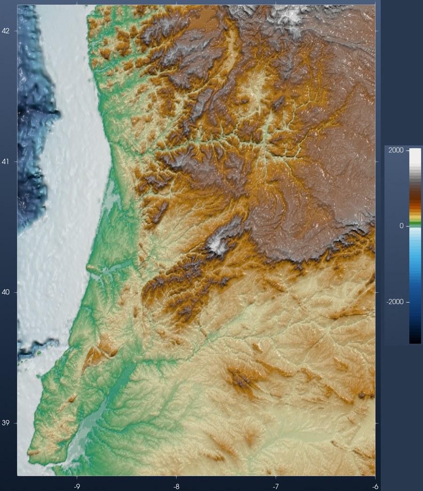
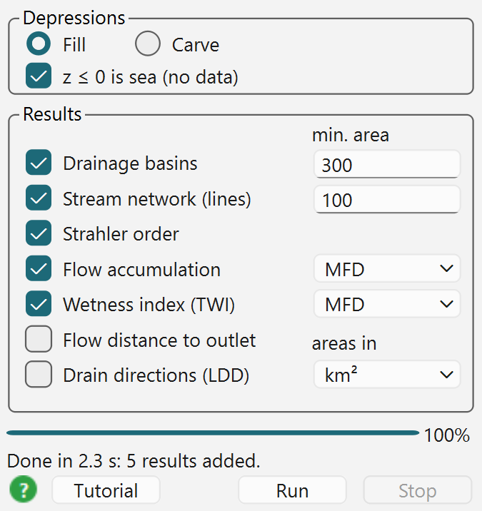
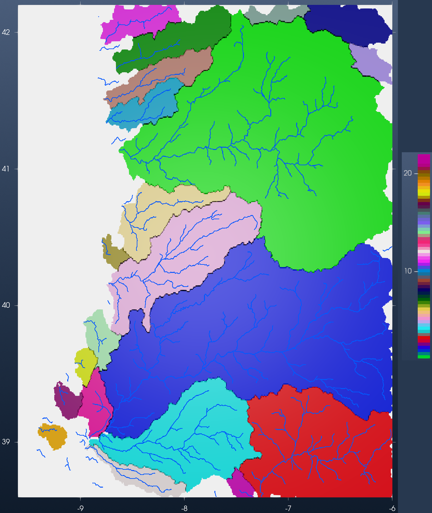
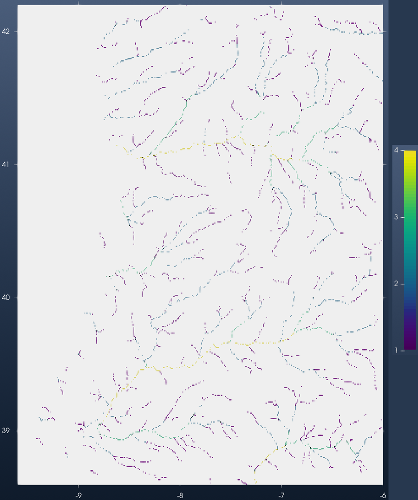
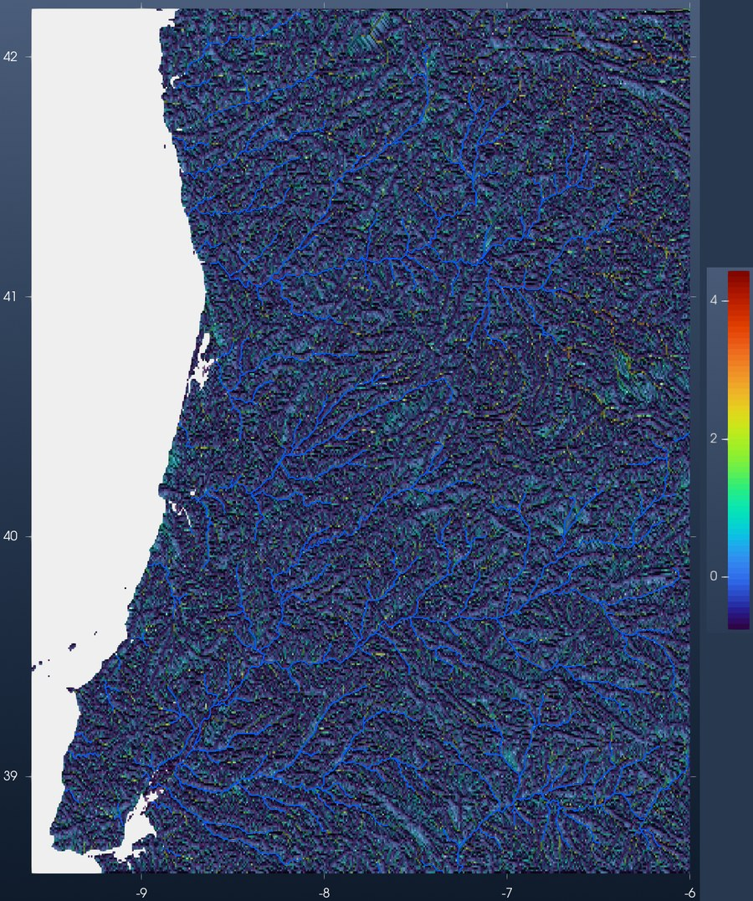
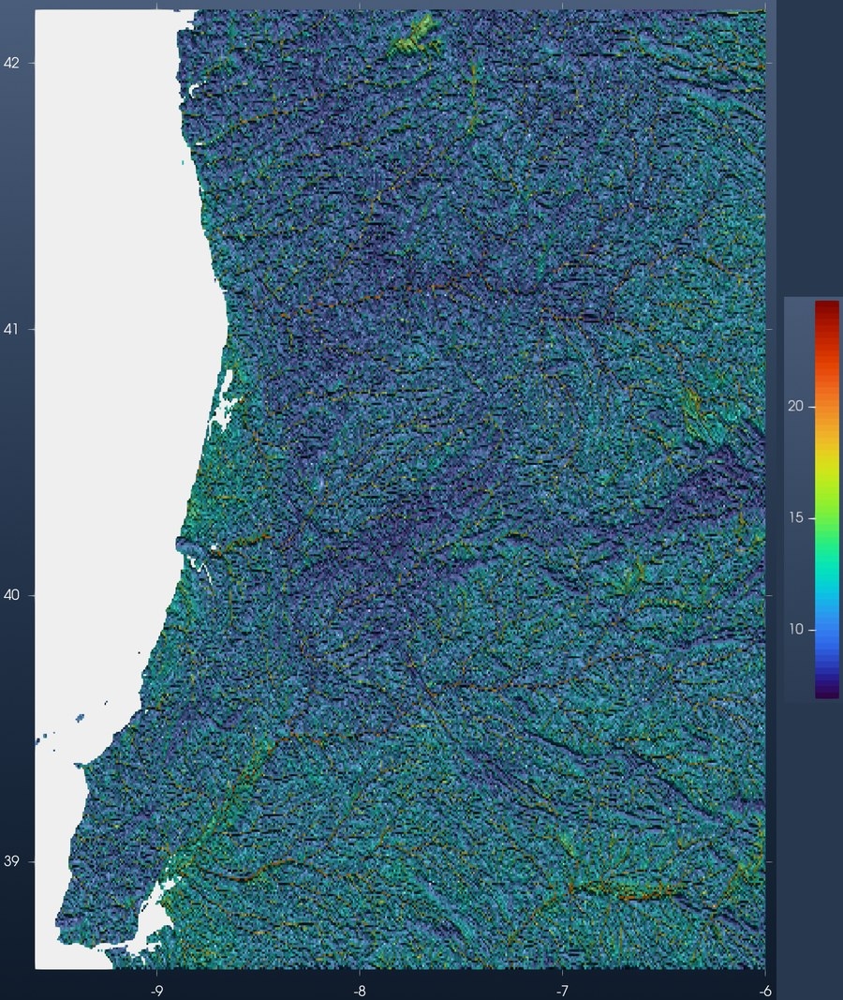

# Tutorial: Drainage analysis

*Grid Tools → Drainage analysis…* — a worked example. Every control of the dialog is explained on its [help page](83-drainage.md), which the green **?** of the dialog opens.

From a digital elevation model alone, this tool works out where the water goes: the **drainage
basins** (catchments), the **river network** with its **Strahler order**, the **flow accumulation**
(how much area drains through each cell), the **topographic wetness index**, the **distance to the
outlet** along the flow, and the **drain directions** in the form hydrological models such as
LISFLOOD read. The computation is done by GMT.jl's hydrology functions (`flowdir`, `flowacc`,
`drainagebasins`, `streamnet`, `streamorder`, `twi`, `flowdistance`, `ldd`), which can also be called
from the Julia Console (see [Going further in the console](#Going-further-in-the-console)).

## 1. A DEM on display

The tool works on the grid **on display** in the window. Any DEM will do: open a GeoTIFF or netCDF
file with *File → Open…*, or fetch one in the console. This tutorial uses the 15 arc-second relief of
central Portugal:

```julia
G = gmtread("@earth_relief_15s", region=(-9.6, -6.0, 38.6, 42.2))
iview(G)
```



The grid has 864 × 864 cells of about 450 × 350 m. It includes the sea floor, which matters below.

## 2. The dialog

Open *Grid Tools → Drainage analysis…*. In a window with no grid it opens too, so that its help page
(the green **?**) is always at hand, but everything else is greyed out until a grid is loaded.



**Depressions.** Real DEMs are full of small pits — cells lower than all their neighbours, mostly
noise — where water would stop and the basins would break into thousands of fragments. They must be
removed first:

- **Fill** raises each pit to the level of its lowest rim, like filling a bowl until it spills. Robust;
  the filled hollows become flat areas, and the flow on them is routed toward their spill point.
- **Carve** keeps each pit at its own elevation and lowers a narrow channel from it through its rim
  instead. It changes fewer cells and suits DEMs where a road or a dam blocks a valley.

**z ≤ 0 is sea (no data).** Cells at or below zero are treated as sea, so rivers end at the coast. Keep
it ticked for DEMs that include bathymetry, like `@earth_relief`; untick it for land below sea level
(the Dead Sea, polders) or a DEM on a different datum.

**Results.** Tick what you want. Each one is added to the window as a new layer:

| Result | What it is |
|---|---|
| Drainage basins | every cell labelled with the basin it drains to; 1 = the largest |
| Stream network (lines) | the rivers as lines on top of the display, one line per reach |
| Strahler order | a grid with the order of each river cell |
| Flow accumulation | log10 of the upstream area draining through each cell |
| Wetness index (TWI) | ln(a / tan β): where water collects and stays |
| Flow distance to outlet | distance along the flow path to the basin outlet |
| Drain directions (LDD) | flow direction of each cell, PCRaster keypad code (8 = north, 5 = outlet) |

**min. area** — the smallest basin kept, and the upstream area at which a river starts (the stream
network and the Strahler order use the second one). The unit is chosen in **areas in**: *cells*, or
*km²* for a georeferenced DEM (geographic, or projected in metres). Here one cell is about 0.16 km²,
so 300 km² keeps the main basins and 100 km² draws rivers from about 600 cells of catchment.

The two method boxes choose how water is passed downhill for the flow accumulation and the wetness
index — see [Which flow method](#Which-flow-method).

## 3. Run

Press **Run**. The bar and the line under it follow the computation (*Filling depressions*, *Flow
directions*, *Flow accumulation*…). The window stays usable meanwhile, and **Stop** ends the run —
nothing is added then. On this DEM the whole set takes about 3 seconds.

When it ends, the results appear in *Scene Objects*, named after the source grid ("… drainage basins",
"… wetness index (TWI, MFD)", …). The basins are what the window shows, with the river network on top:



The Douro (green), the Vouga, the Mondego, the Tejo (blue) and, at the bottom, the Sado and the
Guadiana: the main basins of the region, each with its own colour. The white strips along the coast
are small basins under the 300 km² limit. Check any other result in *Scene Objects* to see it.

## 4. The other results

**Strahler order.** Headwater streams are order 1; where two streams of the same order meet, the
order goes up by one. It ranks the rivers by size. (Untick the stream lines in *Scene Objects* to see
the grid under them.)



**Flow accumulation.** The upstream area of every cell, as log10 of km²: 0 is 1 km², 4 is 10 000 km².
The rivers stand out as the lines of large values; every cell has one, also on the hillslopes.



**Wetness index.** TWI = ln(a / tan β), with *a* the area draining through a unit width of contour and
β the local slope. High values mark the places that collect a lot of water and drain it slowly —
valley floors, hollows, the foot of slopes: wet soils, saturation-excess runoff, wetlands. Low values
mark crests and steep slopes.



**Flow distance** gives, for every cell, how far the water travels to the outlet (km). **Drain
directions (LDD)** writes the flow direction of each cell in PCRaster's code — the `Ldd` map of a
LISFLOOD setup; save the layer from *Scene Objects* to use it.

## Which flow method

- **D8** sends all the water of a cell to its steepest neighbour. Every cell belongs to exactly one
  flow path, which is what basins, rivers and LDD need — those results always use D8. On smooth
  hillslopes it draws artificial parallel lines.
- **MFD** (multiple flow direction) shares the water among all lower neighbours, in proportion to
  their slope. Smooth and realistic on hillslopes, but it makes rivers several cells wide.
- **D∞** splits the water between the two neighbours that bracket the steepest direction. Exact on
  planar slopes, less spreading than MFD.

For the accumulation map as a picture of the rivers, use D8. For the wetness index and anything about
hillslopes (soil moisture, erosion, landslide susceptibility), use MFD — the usual choice — or D∞.

## How long it takes

Almost all the time goes into removing the depressions; the basins themselves take a second or two
even on very large grids. Measured times:

| DEM size | Depressions + directions | Basins | MFD accumulation |
|---|---|---|---|
| 0.75 M cells (this tutorial) | 0.3 s | < 0.1 s | 0.2 s |
| 25 M cells (5000 × 5000) | 3 s | 0.4 s | 5 s |
| 100 M cells (10000 × 10000) | 16 s | 2 s | 24 s |

Memory: about 40 bytes per cell on top of the DEM (4 GB for 100 M cells).

## Going further in the console

The same functions are at hand in the window's **Julia Console** (its button in the status corner;
there `fig` is the window), with options the dialog does not show. The basin above a point — here the Mondego above Coimbra — with the point first moved onto the
river (`snap` = search radius in cells):

```julia
F = flowdir(G, sealevel=0)                                 # depressions + D8 directions
B = drainagebasins(F, outlets=[-8.43 40.21], snap=5)       # the basin above that point
A = flowacc(F, area=true)                                  # upstream area, m²
maximum(A.z[.!isnan.(B.z)]) / 1e6                          # ≈ 4990 km²
add!(fig, B; name="Mondego at Coimbra")
```

Other things only the console offers:

- `flowdir(G, sinks=M)` — keep the cells of mask `M` as real sinks (endorheic lakes, karst);
- `flowacc(F, weights=P)` — accumulate a quantity per cell (rainfall, runoff) instead of area;
- `flowacc(F, method=:mfd, p=…)` — the MFD exponent: ≈1 spreads widely, large values approach D8;
- `twi(F, minslope=…)` — the slope floor for flat cells (default 0.001).

Each function's help (`?flowdir`, `?flowacc`, …) lists all its options.
